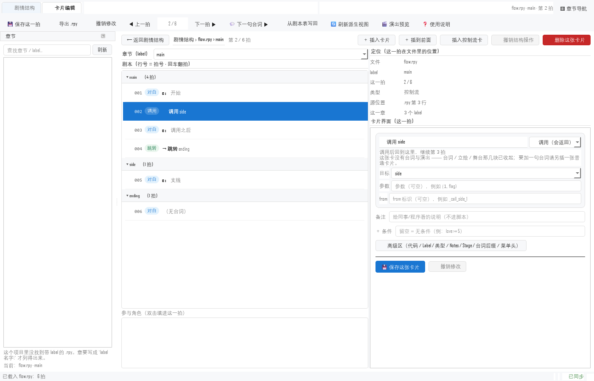
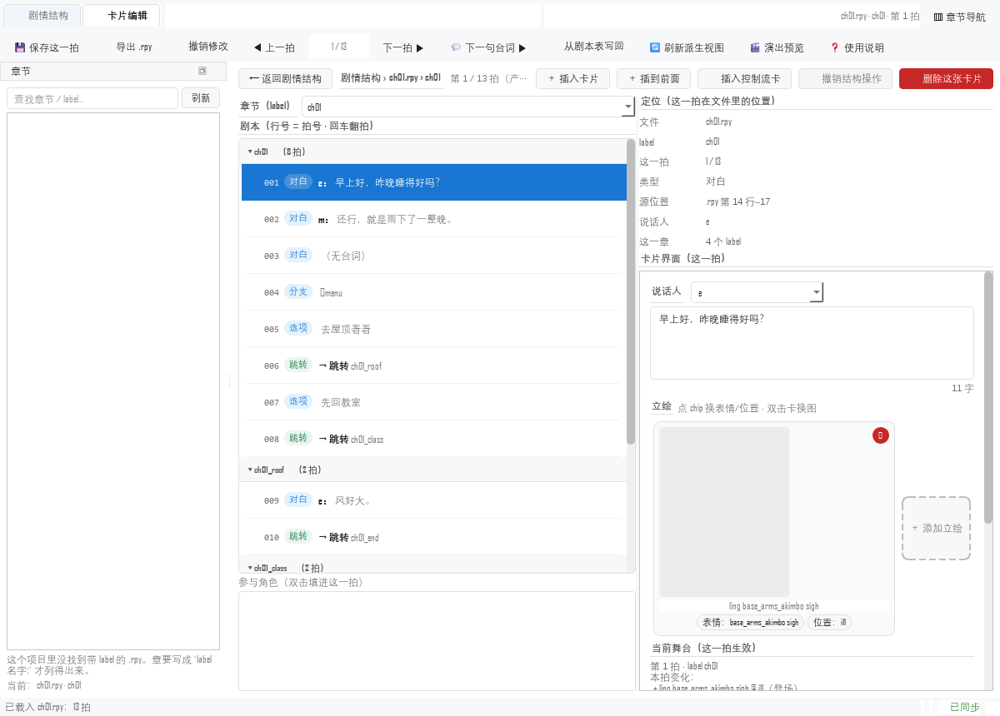
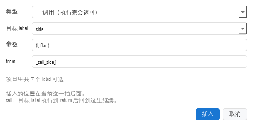
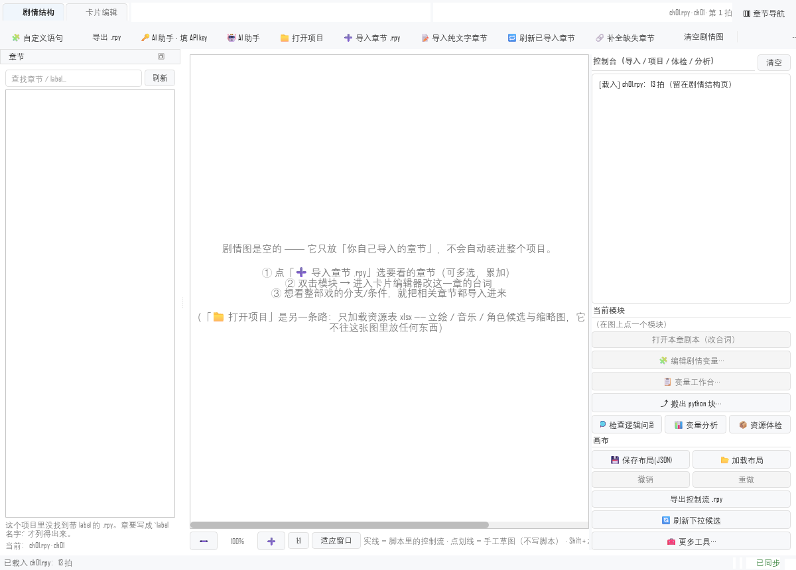

# 体验优化 第十二阶段：宽度、控制流卡、以及"块粒度"的建议（2026-10-23）

> 用户这一轮提了三件事（截图附在文末）：
> ① **整个界面太宽** —— 全屏都看不全，有文字跑到界面外；
> ② **控制流卡的 UI 不对**，下拉"错误缺失"；
> ③ 一个想法：每个块右边缘加 `+` 号，平时按 `.rpy` 显示、点开细到 label 调用粒度，
> `-` 收回 —— **"我完全没有决定好，先不做，考虑一下"**。
>
> ①② 已修并有守门用例；③ 本轮**只给建议**（§四），一行代码没动。

---

## 〇、结论（三句话）

1. **"太宽"有两个根因能修、一个留作已知限制**：窗口按 `sizeHint()`（**2720px**）
   打开、面包屑提示是普通 `QLabel`（最小宽 = 整句宽）—— 这两个修了，1200px 宽下
   卡片页按钮行完整可见；**工具栏放不下的动作**那个隐形按钮（Qt 的
   `qt_toolbar_ext_button`）本轮**没修成**，理由与下一轮做法见 §一（3）。
2. **"下拉缺失"是真的缺**：插入控制流卡时目标候选只取**当前文件**的 label ——
   真机 `chapter0_0.rpy` 里只有 1 个，下拉里就是它自己。现在取**整个项目**的
   label（本文件排最前）。
3. **控制流卡还铺开了台词与舞台**：一张 `call side` 没有台词、没有立绘，
   卡片却给了一屏空框。现在这几块收起，只剩调用条 + 备注 + 条件 + 高级区。

---

## 一、宽度：三个根因与修法

| # | 根因（实测） | 为什么会"跑到界面外" | 修法 | 守门用例 |
|---|---|---|---|---|
| 1 | `QMainWindow.sizeHint()` = **2720 × 705**（结构页 25 个动作全算进去） | 窗口**按 sizeHint 打开**，在 1600~1900 的屏幕上右侧直接出界 | `fit_to_available(1600, 950)`：四周留 48px 压进屏幕；**记忆恢复**时同样压一遍并把位置夹回屏内 | `test_ui_fit_and_flow.py::TestFitToAvailable`（3 条）+ `test_the_window_is_never_wider_than_the_screen` |
| 2 | 面包屑右边那句是普通 `QLabel`，**最小宽度 = 整句 468px** | 卡片页那条按钮行的最小宽度 **1279px**、可用只有 **1106px** → 最后两个按钮被裁掉 | 新建 `ui_qt/elide.py::ElidedLabel`（`QSizePolicy.Ignored` + `minimumSizeHint() = 24`），面包屑 / 模式条 / 右栏属性值三处共用 | `test_the_card_button_row_fits`（行最小 **1279 → 811**） |
| 3 | Qt 的 `qt_toolbar_ext_button`：12px 宽、**没有字**，而本项目 QSS 把 `QToolButton` 的图标区接管了 | 结构页放不下的 10+ 个动作收在一条**看不见的空白**里 —— 用户以为"功能被删了" | ⚠ **本轮没修成**（见下） | —— |

另外两处顺手改的：

- **卡片页分栏 3:5 → 3:2**：用户截图里正文 500px、右栏 900px，读台词反而最挤。
  现在初始 `[560, 500]`，正文占 60%。
- **拍列表横向滚动条永久关掉**：行文字由 delegate 按视口省略，横向滚动条只会
  制造"右边还有内容"的假线索，还会吃掉行高（截图里列表底部那条细线就是它）。

> 规模：1200×860 下，卡片页按钮行（含「🗑 删除这张卡片」）全部可见；
> 结构页工具栏在 1600 以下**仍会把尾巴上的动作收进那个看不见的按钮**（见下）。

### 1.3 工具栏「更多」：为什么本轮**没修成**

试了三条路，两条有坑、一条要动被测过的契约，所以**退回原状并记在这里**：

| 做法 | 结果 |
|---|---|
| 给按钮写「更多」并把宽度撑到 46px | Qt 把它钉在"右边缘 -12px"、**不随按钮宽度移动** —— 一半跑到工具栏外，截图里只剩半个"更"字。`updateGeometry()` / `layout().activate()` / 伪造 `QResizeEvent` 都试过，不动 |
| 手工 `setGeometry()` 摆回工具栏内 | 工具栏布局下一次又把 x 改回来 → **resize ↔ 摆放无限循环**（3 秒事件循环烧 4.4 秒 CPU，全量测试从 14 分钟涨到 1 小时量级） |
| 给按钮加 `»` 文字 / 自绘图标 | **两个都不画**（QSS 接管 `QToolButton` 后，扩展按钮只剩它自己的箭头位，且 12px 装不下字） |

**下一轮的正确做法**（不是本轮）：把结构页的 13 个低频动作（自定义语句 / AI 填 key /
导入纯文字 / 刷新已导入 / 补全缺失 / 清空剧情图 / 变量分析 ×2 / 项目体检 / 资源改名 /
直接编辑单章 / 重读资源表 / 使用说明）从工具栏**移进一个「🛠 更多」菜单按钮**。
这是显式控件，不依赖 Qt 的扩展按钮，也不碰"行高/密度"。

> 为什么本轮不顺手做：`test_custom_statement_entry` / `test_qt_signal_wiring` /
> `test_toolbar_export_entry` 都在**按工具栏动作清单**判（哪些必须在工具栏上），
> 这是一条已经测过的契约 —— 改它要同步改三处判据，属于"单独一轮"。

---

## 二、控制流卡：三个问题（不是一个）

### 2.1 目标候选只有当前文件

```python
labels = list(self._session.label_names())   # ← 只有"当前这个文件"
```

实测（真机 `chapter0_0.rpy`）：`label_names()` 返回 **1 项**，下拉里只有
`chapter0_0` 自己 —— 用户想 call 的小 label **一个都不在**。

修法：`window_card._flow_target_labels()` —— 本文件 → 图上节点 → **项目目录**
（`app/chapter_index.build_index`，40 个文件约 10ms）。插入对话框与卡片上那条
控制流条**共用这一份**（`_sync_flow_card` 也改用它，否则卡片上的下拉还是旧的）。

### 2.2 对话框太小，而且没有参数 / from

旧的：**252×179**，两张表单，提示语被折成两行。新的：**520×260**，四格：

| 格 | 说明 |
|---|---|
| 类型 | 调用 / 跳转；切到跳转时**禁用**参数与 from（Ren'Py 语法） |
| 目标 label | **默认空着**（从前默认选中第一项，手快一点就插了一张 `call <这一章自己>`）；下拉列表本身也放宽 |
| 参数 | `(1, flag)`；括号必须配平 |
| from | `_call_side_1`；不确定就留空 |

**校验用"渲染 → 再解析"**：`render_flow_line` 只拼字符串（`call side(a` 它照拼），
所以拼完立刻 `parse_flow_line` 回读一次，不合法就当场拒绝 —— 不能等到导出才炸。

同一道闸门也加进了 `session_table.insert_flow_beat`（别的调用方绕不过去）。

### 2.3 控制流卡还铺开台词与舞台

`call side` 是一行语句：没有台词、没有立绘、没有舞台。卡片却把"说话人 / 台词 /
字数 / 富文本预览 / 立绘 / 当前舞台 / 背景·音乐·语音"原样铺开 —— 一屏空框，
看着像"还有一屏没填"。

修法：这几块包进 `_dialogue_box` / 复用已有的 `_stage_box`，`set_flow(info)` 时
收起；下一拍是普通卡时**按它自己的内容**恢复（舞台的显隐仍归
`_apply_stage_visibility`，没有第二套规则）。控制流条上多一句：

> 这张卡没有台词与演出 —— 台词 / 立绘 / 舞台那几块已收起；要加一句台词请另插一张普通卡片。



---

## 三、判据

- 新增 `tests/test_ui_fit_and_flow.py`（21 条）：宽度两根因 + 目标候选 + 对话框 +
  截断校验 + 控制流卡收起/恢复。
- `tests/test_hell_custom_card_layout.py` 的"参数在台词框上面"改成比**容器**
  （台词区成了 `_dialogue_box`，`_text` 不再是面板的直接子控件）。
- 受影响的 10 个 UI 文件全跑：**407 passed**；全量见 §六。

---

## 四、关于"块右边缘 `+` 号"：我的建议是**不做内联展开**

### 先把问题说准

用户的感觉是对的：**粒度有三层，界面上只给了两层半。**

```
项目  ──►  文件（.rpy）  ──►  label  ──►  拍（卡片）
 ↑ 导航已有   ↑ 导航已有      ↑ 图/下拉     ↑ 卡片页
                              └─ 缺：一个 call 展开后"目标里有什么"
```

现在的痛点不是"无法展开"，而是：**读到一个 `call side` 时，不知道 side 里有什么、
也不知道怎么回来。** 直接切过去看（导航双击）会丢上下文。

### 为什么"每块 + 号内联展开"代价高

把别的 label 的拍**插进当前拍列表**，会同时踩三条硬约束：

1. **"行号 == 拍号"**：`_beat_rows[拍号] = 行号`、`Qt.UserRole`、`_show_index`、
   删除预览、自动保存快照全按这个不变量走（`tests/test_ui_qt.py` 几十条用例按
   它判过）。插进来的行没有拍号 → 选中、删除、撤销、保存全都可能**存错拍**。
2. **一张卡片的"真源"**：`call side` 是**一行**；展开出来的 side 的拍属于**另一个
   label（可能另一个文件）**。它们在同一张列表里可编辑的话，"改的是哪一章"
   就变成隐式状态 —— 这是这个项目最贵的一类缺陷（静默改错文件）。
3. **密度**：嵌套 call（side 里又 call ending）会指数展开；用户要的"平时收着"
   正是承认了这一点 —— 但"收着"的 UI 成本落在每一行上（一个 12px 的 `+` 热区
   紧贴行尾），和"点错了就换章"是同一类误触。

### 建议的替代（便宜、不破契约、可以分两步）

| 步 | 做什么 | 为什么 |
|---|---|---|
| 1 | **call 卡上写出"被调用方是什么"**：`side · 6 拍 · 第 173 行 · 被 2 处调用` | 数据都在（`flow_info` + 项目目录），解决"不知道里面有什么"的一半 |
| 2 | **「进去看」+ 返回栈**：点它 → 切到 side，面包屑 `main › side`，`←` 回到 main 的**同一拍** | 复用现有载入链路，不新增视图；不插行，不碰拍号；"回来"是用户真正缺的那一半 |

这两个加起来 ≈ 一天：步 1 半天（纯显示），步 2 一天（要处理未保存改动 / 自动保存 /
返回位置）。**先做步 1 就能验证"够不够"** —— 如果用户看完摘要就满足了，步 2 可以
再等；如果还要点进去，再做返回栈。

### 如果一定要"+" 

那就把它做成**只读弹层**：点行尾 `+` 弹一个小窗（前 5 拍 + 一个「打开这一章」），
**不要往列表里插行**。弹层不参与编辑，就不会碰上面那三条约束。

### 明确不建议

- **不做节点级展开**（图上把一个 label 展开成子节点树）：`docs/短板可行性评估`
  §C6 已经写过 —— 图在这个工具里的定位是**诊断视图**，不是编辑器。
- **不做"按文件 / 按 label"两个视图切换**：同一个东西两套视图 = 两套状态，
  迟早不一致；面包屑 + 返回栈是同一个视图里的**位置**，不是第二种视图。

---

## 五、这一轮没做

| 没做 | 为什么 |
|---|---|
| ③ 的 `+` 号（用户明确"先不做"） | §四：内联展开会碰"行号 == 拍号"，代价与收益不成比例 |
| **工具栏「更多」菜单**（§1.3） | 三条技术路都不成；正确做法是把低频动作移进显式菜单，但那要同步改三处"工具栏动作清单"判据 —— 单独一轮 |
| 工具栏**分组重构**（把低频动作收进菜单栏） | 同上：先做 §1.3 的「更多」按钮，再看要不要动菜单栏 |
| 列表行高 / 密度 | 与宽度无关，另说 |
| 对话框的 QLineEdit 视觉（当前是扁平样式） | 主题里所有输入框都这样，单改一处会不一致 |

---

## 六、全量数字

- 受影响的 10 个 UI 文件：**407 passed**
- 全量：**5959 passed / 2 skipped / 2 failed**（6m30s）—— 两条红都是既有的
  （`hydrate_golden`、跑批期间真机项目被外部写入的 `scan_golden`；
  后者 diff 只有"多"没有"少"）。
- 全量还抓到**我自己的一处回归**：`test_hell_custom_card_layout` 按
  `layout.indexOf(_text)` 判"参数在台词框上面"，而 `_text` 现在在
  `_dialogue_box` 里（直接子控件变了）。修法不是改布局，而是把判据改成比**容器**
  并补一句"台词框仍在容器里"—— 否则以后真把台词挪丢了也没人知道。

---

## 附：截图

| 1200×860 卡片页（按钮行完整） | 控制流卡（台词/舞台已收起） |
|---|---|
|  |  |

| 插入控制流卡（四格 + 候选计数） | 结构页工具栏右端「更多」 |
|---|---|
|  |  |
