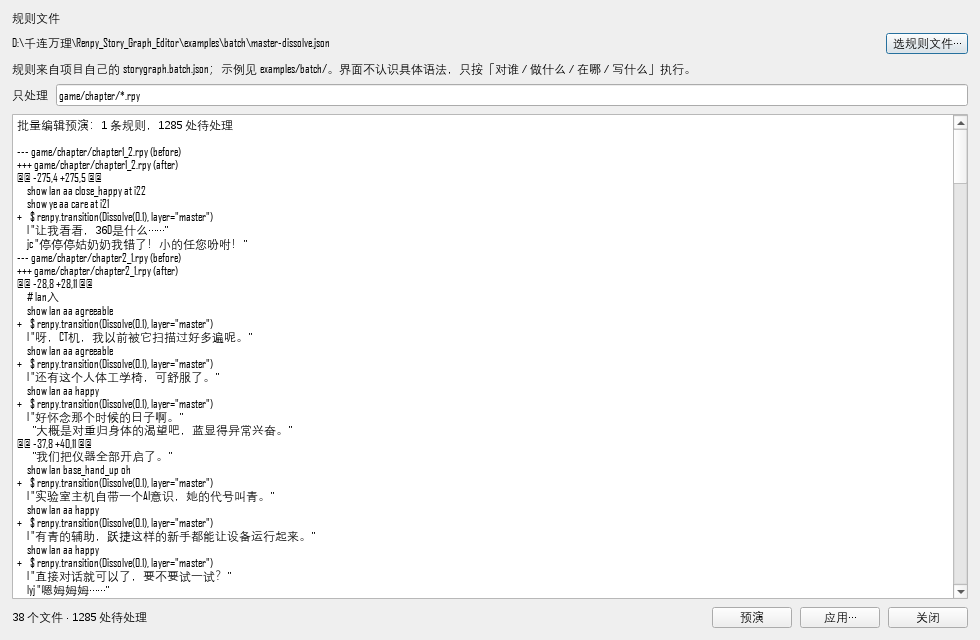

# 批处理：按规则批量插入 / 修改 / 删除 `.rpy` 的一行或一段（2026-11-06）

> 需求原话：`$ renpy.transition(Dissolve(0.1), layer="master")` 该放在每个
> 立绘改变后面；这种"自定义单行代码 + 整章为单位"的事，工具能不能兼容？
>
> 结论：能，但**不做成"检测 `renpy.transition`"的特例**。做一层通用规则：
> **对谁 / 做什么 / 在哪 / 写什么**。同一套能插 `$ camera(...)`、能替换旧
> 转场、也能删掉废弃的 `$ debug_print(...)`；`span` 负责"一段"——
> 整个 `if:` / `python:` / ATL 块，或从匹配行到某个结束行为止的一段。

## 0. 别人的工具是怎么做的

先看了几类成熟工具，取它们的共同点：

| 工具 | 做法 | 借过来的 |
|---|---|---|
| [Comby](https://comby.dev/docs/basic-usage) | 结构模板 + 洞（`:[x]`），理解括号/字符串/注释，rewrite 模板原地替换 | 规则 = **匹配模板 + 重写模板**；不改语义就不碰 |
| [ast-grep](https://ast-grep.github.io/guide/rewrite/rewriter) | YAML `rule` 选 AST 节点，`fix` 给替换文本，`rewriters` 处理子节点 | 规则要能**组合选择器**，且 fix 是字面文本 |
| [LibCST codemod](https://libcst.readthedocs.io/en/stable/codemods_tutorial.html) | visitor 遍历 CST；每个 codemod 用 **before/after 单测**钉住 | 每条变换都要有**前后对照测试** |
| `eed`（Unix `ed` 包装） | **preview diff + 自动备份 + 原子应用** | 默认预演、写前备份、失败不落盘 |
| [OpenRewrite](https://docs.openrewrite.org/authoring-recipes/writing-recipes-over-multiple-source-file-types) | recipe 跨文件类型批量改写，按项目范围执行 | 规则声明式、**作用域**明确 |

共同点不是"命令行 sed"，而是：

1. **声明式规则**（选谁 + 改什么），不是一次性脚本；
2. **作用域**（语言/文件/节点），不整库乱改；
3. **预演 / diff / 备份 / 原子写**；
4. **幂等 + 前后对照测试**。

Ren'Py 没有通用 AST codemod 工具，所以这里取折中：
**用 Ren'Py 解析器确认"这是哪一拍、哪条 show/hide 语句"，再用行级规则做
insert / replace / delete**。结构判断交给解析器，文本变换保持可读、可审。

## 1. 规则文件

默认读 `<项目>/storygraph.batch.json`，也可以用 `--rule` 指定（可重复）。

### 插入（样例：每个立绘 show 后补 master 转场）

```json
{
  "schema": "storygraph.batch/1",
  "rules": [
    {
      "id": "master-dissolve",
      "when": {
        "show": "sprite",
        "transition": "none",
        "code_not_contains": "renpy.transition"
      },
      "insert": {
        "placement": "after_last_show",
        "text": "$ renpy.transition(Dissolve(0.1), layer=\"master\")"
      }
    }
  ]
}
```

### 修改（样例：把 0.1 秒改成 0.2 秒）

```json
{
  "id": "retime",
  "when": { "show": "sprite" },
  "replace": {
    "scope": "after_last_show",
    "match": { "mode": "contains", "pattern": "renpy.transition(Dissolve(0.1" },
    "text": "$ renpy.transition(Dissolve(0.2), layer=\"master\")"
  }
}
```

### 删除（样例：删掉调试打印）

```json
{
  "id": "drop-debug",
  "when": { "code_contains": "debug_print" },
  "delete": {
    "scope": "beat",
    "match": { "mode": "contains", "pattern": "debug_print" },
    "occurrence": "all"
  }
}
```

### 一段（`span`：整块 / 到结束行为止）

`replace` / `delete` 不写 `span` 时只处理**一行**；写 `"span": "block"`
处理匹配到的**整个缩进块**（块头 + 块体），写
`{"span": {"until": <match>}}` 处理**从匹配行到第一个结束匹配行**（含首尾）。
`text` 可以是字符串数组，续行的前导空格是相对缩进。

```json
{
  "id": "slow-atl",
  "when": { "show": "sprite" },
  "replace": {
    "scope": "beat",
    "match": { "mode": "exact", "pattern": "show ye happy:" },
    "span": "block",
    "text": [
      "show ye happy:",
      "    xalign 0.3",
      "    ease 0.4 alpha 1.0"
    ]
  }
}
```

```json
{
  "id": "drop-debug-block",
  "when": { "code_contains": "debug_print" },
  "delete": {
    "scope": "beat",
    "match": { "mode": "exact", "pattern": "if DEBUG:" },
    "span": "block"
  }
}
```

```json
{
  "id": "retime-dict",
  "when": { "code_contains": "data = {" },
  "replace": {
    "scope": "beat",
    "match": { "mode": "contains", "pattern": "$ data = {" },
    "span": { "until": { "mode": "exact", "pattern": "}" } },
    "text": ["$ data = {", "    \"a\": 9,", "}"]
  }
}
```

`span` 的判据：

- `block` 只匹配**块头**（以 `:` 收尾，注释不算）；匹配到块体行不会猜；
- `until` 找不到结束行 → 跳过并报告，不删到文件尾；
- 跨行范围**切断块体**（块头在范围内、块体延伸到范围外）→ 跳过；
- 删整块时块头一起删；只删块体且会删空 → 跳过；多条规则范围重叠 →
  整份文件拒绝。

一条规则**必须且只能有** `insert` / `replace` / `delete` 之一；不认识的键
整份拒绝。

仓库里的样例：

- `examples/batch/master-dissolve.json`（insert，单行）
- `examples/batch/retime-transition.json`（replace，单行）
- `examples/batch/drop-debug.json`（delete，单行）
- `examples/batch/retime-atl.json`（replace，`span: block`）
- `examples/batch/drop-if-debug.json`（delete，`span: block`）

## 2. 规则字段

### `when`（对谁；全部条件 AND，省略 = 不过滤）

| 键 | 值 | 含义 |
|---|---|---|
| `show` | `"sprite"` / `"any"` / `"none"` / `["ye","lan"]` | 这一拍有没有立绘 show |
| `hide` | 同上 | 这一拍有没有立绘 hide |
| `change` | 同上 | show **或** hide，任一算 |
| `say` | `true` / `false` | 这一拍有没有台词 |
| `transition` | `"none"` / `"any"` | 有没有任何转场（`renpy.transition` / `with` / 行内 `with` / `hide … with` / `say … with`） |
| `text_contains` | 字符串 | 台词包含 |
| `speaker` | 字符串 / 字符串列表 | 说话人 |
| `label` | glob | label 名匹配 |
| `code_contains` / `code_not_contains` | 字符串 | 这一拍代码段里有没有 / 没有 |

`"sprite"` 的判据：项目有角色表就以角色表为准；没有角色表就退到
"排除 `bg` / `cg` / `screen` / `expression` / `layer` …"。

### `insert`

| 键 | 值 | 含义 |
|---|---|---|
| `placement` | `after_last_show` | 这一拍最后一条符合条件的 show 后面（ATL 块则在整个块后面） |
| | `after_last_change` | show/hide 里最后一条符合条件的后面 |
| | `after_beat` | 这一拍最后一个**顶层语句**的整块后面（不会插进 `python:` / ATL 块体） |
| | `before_beat` | 这一拍第一行前面 |
| `tag_kind` | `"sprite"` / `"any"` | 锚点只认立绘，还是任何 show/hide |
| `text` | 字符串 / 字符串数组 | 原样插入；第一行不要自带缩进（跟锚点走），续行可带相对缩进 |
| `skip_if_present` | `true`（默认） | 拍里已有同一行/同一段就跳过（幂等） |

### `replace`

| 键 | 值 | 含义 |
|---|---|---|
| `scope` | `beat`（默认） | 在这一拍的 `src_first..src_last` 里找 |
| | `after_last_show` / `after_last_change` | 只在这一拍最后一条 show / 立绘变化**之后**找 |
| `match` | 字符串 / 对象 | 见下 |
| `span` | 省略 / `"block"` / `{"until": match}` | 省略=单行；`block`=整个缩进块；`until`=到第一个结束匹配行为止（含） |
| `text` | 字符串 / 字符串数组 | 替换内容；第一行不含基准缩进，续行可带相对缩进 |
| `occurrence` | `first`（默认）/ `last` / `all` | 多条命中时改哪几条 |
| `tag_kind` | `"sprite"` / `"any"` | `scope` 用 show 锚点时，锚点认什么 |
| `skip_if_present` | `true`（默认） | 原行已经是目标行就跳过 |

### `delete`

| 键 | 值 | 含义 |
|---|---|---|
| `scope` | 同 `replace` | 搜索范围 |
| `match` | 字符串 / 对象 | 见下 |
| `span` | 同 `replace` | 省略=单行；`block`=整块；`until`=到结束匹配行 |
| `occurrence` | `first`（默认）/ `last` / `all` | 删哪几条 |
| `tag_kind` | `"sprite"` / `"any"` | 同上 |

### `match`

| 写法 | 含义 |
|---|---|
| `"$ foo()"` | 简写：整行（去缩进后）逐字相等 |
| `{"mode":"exact","pattern":"$ foo()"}` | 同上 |
| `{"mode":"contains","pattern":"debug_print"}` | 行内包含 |
| `{"mode":"regex","pattern":"^\\s*\\$ foo\\(", "flags":"i"}` | 正则；`flags` 只支持 `i` |

多行 `text` 的缩进约定：**第一行不带缩进**，基准缩进由锚点（insert）或
被替换首行（replace）决定；后续行原样保留自己的前导空格，叠在基准
缩进后面。例如基准是 4 空格，`["$ data = {", "    \"a\": 1,", "}"]`
会写成 4/8/4 空格的三行。

## 3. 命令

```powershell
# 预演（默认，不写盘）
python cli.py batch D:\千连万理\sr_general `
  --rule examples\batch\master-dissolve.json `
  --chapter "game/chapter/*.rpy" --limit 3

# 预演 + 统一 diff（先看具体改哪几行）
python cli.py batch D:\千连万理\sr_general `
  --rule examples\batch\master-dissolve.json `
  --chapter "game/chapter/chapter2_1.rpy" --diff

# 一段：整块替换/删除也是同一条命令，只是规则里多写 "span"
python cli.py batch D:\千连万理\sr_general `
  --rule examples\batch\retime-atl.json --diff

# CI：有可处理行就退 1（不写盘）
python cli.py batch D:\千连万理\sr_general `
  --rule examples\batch\master-dissolve.json `
  --chapter "game/chapter/*.rpy" --check

# 真写（每份文件先备份，再原子替换）
python cli.py batch D:\千连万理\sr_general `
  --rule examples\batch\master-dissolve.json `
  --chapter "game/chapter/*.rpy" --apply
```

退出码：`0` 通过 / `1` 有可处理行（`--check`）或写失败 / `2` 规则或项目读不了。
`--json` 输出完整计划（含 `insertions` / `edits` / `skipped`）。

## 4. 写盘判据（为什么敢批量写）

1. **行/段编辑**：读原文 → 按规则算 insert / replace / delete（可跨行）→
   原子替换；不重生成、不改拍模型、不动 Excel。
2. **先预演**：默认不写；`--apply` 才写。
3. **计划后源文件被改过就拒绝**：写前重读，`old_text` 必须逐字相同。
4. **同一行/同一段被两条规则改 → 整份拒绝**：不猜先后，不产生"半个改动"。
5. **单行规则不碰块头**：`python:` / `if:` / `show …:` 被跳过；要动整块
   必须显式写 `span`，并且范围要覆盖整个块体。
6. **跨行范围切断块体 → 跳过**：块头在范围内、块体延伸到范围外，拒绝；
   删整块时块头一起删，只删块体且会删空也跳过。
7. **非 UTF-8 拒绝**；**保留 CRLF / LF / BOM**；**写前备份**。
8. **缩进跟基准走**：insert 跟锚点，replace 跟被替换首行；第一行不带
   缩进，续行只写相对缩进。

## 5. 真机数字（只读预演，未写 `sr_general`）

```text
--chapter "game/chapter/*.rpy"   → 1285 处 insert
不带 --chapter（game/ 全部）      → 1303 处
  （多出的 18 处在 game/script.rpy / game/testunit/test1.rpy，
   不是章节正文；要批章节就带 --chapter）
```

最初的统计是 **1295** 拍"有立绘 show、没有 `renpy.transition`"。严格规则
（`transition: none`）会再跳过 10 拍**已经有本地转场**的：

- 1 拍台词尾巴 `y "…" with vpunch`（`chapter3_2_2`）；
- 9 拍 `hide … with Dissolve`（`chapter3_3_1` / `chapter3_3_2`）。

这 10 拍再插 master 转场就是叠两次，所以 **1285** 才是"确实缺 master
转场"的数。要连这些也插，把规则里的 `transition: none` 拿掉、换成
`code_not_contains: "renpy.transition"` 之类的窄判据即可（自己承担叠加）。

`chapter1_2.rpy` 只有 1 处缺口（L276，两条 show 同拍）；前四章其余都已带。
拿 `chapter1_2` / `chapter2_1` 的**临时副本**跑过 `--apply`：拍数不变
（215→215、130→130），label/show/hide/text/speaker 逐拍不变，只多出插入行。

`span` 真机预演（只读，未写）：对 `game/chapter/story_graph_control.rpy`
用 `delete` + `span: block` 匹配 `menu:`，识别出 **4 个 menu 块**
（L27-L35 / L59-L67 / L91-L95 / L109-L113），共 4 处；同一块同时落在
多拍 `src` 区间里只算一次，不会误报"范围重叠"。对
`game/minigame/mini_game1.rpy` 匹配 `python:`，识别出 **6 个 python 块**
（L22-L43 / L68-L79 / L87-L108 / L116-L117 …），说明块尾能跨过
`src_last` 扫到真正的块体末尾。章节正文本身基本没有
`show …:` / `if:` / `python:` 缩进块，所以在章节上跑块规则是 0 处，
这是正常的，不是漏检。

多行/整块的 **apply 语义**由测试夹具覆盖：ATL 块 3 行替换、`if` 块 3 行
整块删除、`$ data = { ... }` 4 行按 `until` 替换，写后重解析都通过，
重跑计划均为 0 处（幂等）。

## 6. 建议的落地顺序

1. 先 `--check`，把 1285 这个数摆到 CI / 人眼前；
2. 拿一章小章 `--apply`，进引擎看一眼真实效果；
3. 确认后再整章批；
4. 以后新写的拍缺这行，用 `--check` 报出来，**不自动插**；
5. 要改旧转场 / 删调试行，再写 `replace` / `delete` 规则，同样先预演；
6. 整块 ATL / `if:` / `python:` / `menu:` 用 `span`，先 `--diff` 看范围，
   确认块尾覆盖完整再 `--apply`。

## 7. 已知边界

- 能改**一行**或**连续一段**（`span: block` / `span: until`），但不做
  **重排 / 移动**：只按原始行号替换、删除、插入，不生成新的顺序。
- 锚点只认**解析器确认过的** `show` / `hide` 语句行；`python:` 块里的字符串/
  变量即使长得像 `show …` 也不会被当成锚点。
- `scope: beat` 默认只覆盖拍区间；`span` 规则会把范围往上扩到紧邻的
  `if:` / `elif` / `else` / `while` / `for` / `python:` / `menu:` 块头
  （解析器的拍常常从块体开始，不含块头）。`label` 不扩，避免误删整个 label。
- `span: block` 的块尾会按缩进扫到整份文件（`python:` 块体不一定在
  `src_last` 内）；`span: until` 的结束行必须仍在搜索范围内。
- `span` 只认缩进结构，不理解 Python 的括号续行 / 三引号字符串；跨行
  范围如果切断了它认为是块头/块体的行，会保守跳过并报告。
- 角色表存在时，`"sprite"` 以角色表为准：没登记进角色表的 tag 不会被选中。
- 编辑器开着同一章时，先保存 / 关闭再批；本工具写完不会去改已打开的会话。
- **不在导出时自动插**：批量写是显式动作，避免"导出一次多一行"。

## 8. 代码位置

- 引擎：[`storygraph/app/batch_edit.py`](../storygraph/app/batch_edit.py)
- 兼容别名：[`storygraph/app/batch_insert.py`](../storygraph/app/batch_insert.py)
- CLI：[`storygraph/cli.py`](../storygraph/cli.py) 的 `batch` 子命令
- 界面：[`storygraph/ui_qt/dialog_batch.py`](../storygraph/ui_qt/dialog_batch.py)
  （「更多工具 → 🧩 按规则批处理 .rpy（预演 → 应用）…」）
- 测试：[`tests/test_batch_edit.py`](../tests/test_batch_edit.py)
  （38 条：insert / replace / delete、block / until、多行、BOM、块守卫、CLI）、
  [`tests/test_batch_dialog.py`](../tests/test_batch_dialog.py)
  （8 条：预演不写盘 / 应用要确认 / 写前重算 / 坏规则不写 / 章节过滤）

## 9. 为什么这件事**不**交给「自定义模块」（2026-11-07）

先分清两个问题，它们长得像，其实方向相反：

| | 回答什么 | 形状 | 归属 |
|---|---|---|---|
| **写法层**（`statement_registry` / `custom statement`） | 「这一行长什么样、参数是什么、能不能演」 | **多对一**：n 种项目写法 → 一套语义 | 项目声明一次，全项目共用 |
| **策略层**（本文这套规则） | 「哪里该多一行、哪一行该换掉」 | **一对多**：一条语义 → n 个位置 | 每条策略一份，按章节/范围执行 |

`$ renpy.transition(Dissolve(0.1), layer="master")` 这行**本来就认识** ——
`transition_expr` 能从 `Beat.code` 里读出它、`spec_args` 认识它的
`layer` 关键字、`stage` 能拿它演出。缺的从来不是"读懂"，是"**整章每处
立绘变化后面都少这么一行**"。

把这件事塞进写法层，会长出「每个 head × 每个位置 × 每个触发条件」的
组合表 —— 正是之前抱怨过的那种填不完的表。而策略层只需要四个格子：
**对谁 / 做什么 / 在哪 / 写什么**，加一条幂等判据（已经有就跳过）。

换引擎时区别更明显：写法层换的是"这行怎么读"，策略层换的是"这行写成
什么"（规则文件里的 `text` 是 Ren'Py 语法，换 Unity 就换一份规则，引擎
代码不动）。

## 10. 界面入口（2026-11-07）

不想开命令行也能干同一件事：「更多工具 → 🧩 按规则批处理 .rpy」。



口径与 CLI 完全一致，只是把"敢不敢按"补上了：

1. **一进来不写盘**：只预演；「应用…」在有计划之前是灰的。
2. **预演顺序是「摘要 → diff → 每份文件明细」**：一千多处的计划里，
   人要先看"到底会多出什么字"，明细放后面查账；diff 超过 80 行会截断
   并注明（写入的是全部计划，不是这 80 行）。
3. **应用前重算**：不拿预演那份直接用；源文件在这期间被改过，重算出来
   的行号才是对的，`apply_plan` 还再比对一次原文，对不上就跳过这个文件。
4. **只认项目自己的规则文件**：默认 `<项目>/storygraph.batch.json`，
   也可以点「选规则文件…」指别处；界面不内置任何具体写法。
5. **写完自动重载当前章节**：不然卡片上还是旧的。

截图那份预览是真的：`sr_general` 的 `game/chapter/*.rpy`，
`examples/batch/master-dissolve.json`，**38 个文件 / 1285 处**（只读，
没写盘）。

## 11. 还差什么（诚实清单）

1. **`change: "sprite"` 不等于"画面真的变了"**：它看的是"这一拍有没有
   show/hide 立绘语句"。同一套立绘重复 show 也算，会被补一行多余的转场
   （不炸，只是啰嗦）。要更准得比较相邻拍的**合成状态**（tag/属性/位置/
   zorder），`app/stage.py` 与 `app/layer_compose.py` 已经有这个能力，
   但还没接成 `when` 的一条判据。
2. **只管 `.rpy` 行**：不改拍模型、不动 Excel、不进 IR。所以它和"编辑器
   里改一张卡"是两条路 —— 批完重载，卡片上看到的就是新行。
3. **导出时不自动补**（刻意的）：批量写是显式动作，避免"导出一次多一行"。
4. **规则文件没有版本迁移**：`schema` 不是 `storygraph.batch/1` 就整份拒绝，
   不猜。
5. **多人同时改同一章**：写前逐字比对只能保证"不会覆盖别人的改动"，
   不做合并；撞上了就跳过，报出来。
