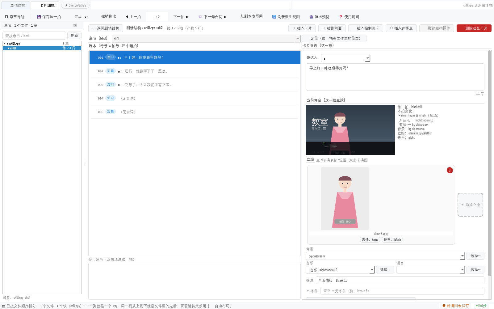
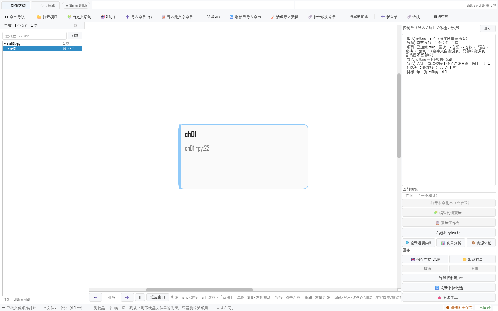

# 新手快速操作手册

> **给第一次打开这个工具的人。** 从解压到改完一句台词写回文件，大约 10 分钟。
> 不需要装 Python，不需要装 Ren'Py；只有在"想用 Ren'Py 跑起来看效果"时才需要 SDK。
>
> 官话版本（每个按钮的完整说明）在工具栏右端的 **❓ 使用说明** 里（五页，一个独立窗口，
> 开着也能继续改）。这一份只讲**你第一天会用到的那几件事**。



---

## 0. 三十秒知道它是什么

| 它做 | 它不做 |
|---|---|
| 把 Ren'Py 剧本读成**一张张卡片**，改台词 / 改演出 / 看结构 | 不改你的引擎、不装插件、不接管项目 |
| 改完**只把改过的那几行**写回 `.rpy` | 不重新生成整份脚本（对不上就整份放弃） |
| 把章节之间的关系画成**剧情结构图**（谁 jump 谁、菜单在哪分叉） | 不猜语义：认不出的写法原样保留 |
| 给每一拍画一张**舞台小图**（背景 / 立绘 / 对话框长什么样） | 不是美术工具，不产出图片素材 |
| 顺带体检、找坏资源、标状态、多人协作锁 | 不上传任何东西（除了你点 ⭐ 时打开一个网页） |

一句话：**它是已有项目的"外科手术刀"**，不是从零写剧本的编辑器。

---

## 1. 打开（第一次，1 分钟）

1. **把 zip 整份解压**到一个固定目录（比如 `D:\StoryGraph\`）。
   ⚠ 不能只把 `StoryGraph.exe` 拖出来 —— 它要靠同目录的 `_internal\` 才能启动。
2. 双击 **`StoryGraph.exe`**。
3. 如果 Windows 弹「已保护你的电脑」：点「更多信息」→「仍要运行」。
   这是没买代码签名证书的个人项目都会有的提示，不是报错。
4. 第一次打开是**空的** —— 它不会自己去找你的项目，这是故意的
   （工具不该在你没点头的时候去翻你的硬盘）。

> 想先用一个现成的项目试试？解压目录里有一个 **`demo`** 文件夹，跟着下一节走就行。

---

## 2. 跟着 demo 走一遍（最推荐，10 分钟）

### 2.1 打开项目

点顶部 **「📁 打开项目」** → 选解压目录里的 **`demo`** 文件夹（里面能看到 `game\` 和
`asset_tables\`）。

- 它读两样东西：**资源表**（立绘 / 音乐 / 语音 / 角色候选）和**左栏的章节清单**。
- 它**不会**往剧情结构图里放任何东西 —— 图上放什么，由你下一步自己决定。

### 2.2 打开一章

左栏 **「▥ 章节导航」** 里出现 `ch01.rpy → ● ch01`。**双击 `ch01`**，就进了卡片页。

`●` 的意思是"这一章已经在剧情图里"；没有点就是"只在磁盘上"。

### 2.3 认识三栏

| 位置 | 是什么 |
|---|---|
| **中间左** | 这一章的所有拍（行号 + 类型牌：对白 / 旁白 / 分支 / 调用…），一行一拍 |
| **中间右** | **这一拍的卡片**：说话人、台词、立绘、背景、音乐、备注 |
| **最右上方** | 「▸ 定位（这一拍在文件里的位置）」—— **默认收起**，点开才看文件 / label / 第几拍 / 源在第几行 |
| **底部一行** | 左边是"刚刚发生了什么"，右边是 **「● 未导出」** 和 **「⏱ 自动保存 21:03」** |

> 为什么"定位"默认收起：右栏那一整栏留给卡片。你在哪一章哪一拍，**模式条最右边**
> 一直写着（`ch01.rpy · ch01 · 第 1 拍`）。
>
> **右栏（卡片那一栏）默认窄，也不会被挤坏**：把中间那条分隔条往右拖到最窄，
> 右栏会停在"卡片刚好放得下"的地方（卡片最小宽 296px），**不会再出现横向滚动条**；
> 立绘网格也会随宽度自己变 —— 窄了 1 列竖排、宽了最多 4 列。
> 想看得更大：双击那条分隔条，或点右栏标题右边的 **`⤢`** 一键展开 / 收起。

### 2.4 改一句台词（三步，这是全工具的核心节奏）

1. 在**台词框**里改字（右下角有字数；超过 200 字会变警示色）。
2. 点 **「💾 保存这一拍」**（或 Ctrl+S）。
   → 改动进了**内存**，状态栏变成「● 未导出」，标题栏多个 `*`。
3. 点 **「⤓ 导出 .rpy」**（或卡片页 Ctrl+Shift+S）。
   → 这一步才**真的写文件**。导出对话框里默认就是这一章原来的文件，直接保存即可。

导出完会告诉你结论，一般是这样一句：

```
[导出] 已写入 ch01.rpy（增量补丁：改了 1 行）
```

三种可能的结果，都不是坏事：

| 看到 | 意思 |
|---|---|
| **增量补丁** | 只替换你改过的那几行，你手写的注释、排版、`define`、`transform` **一个字没动** |
| **全量重生成** | 改动太大（整段结构变了）对不上位，退回整章重写 —— 状态栏会说明为什么退回 |
| **被门禁拦住** | 产物有硬问题（比如中文图像名、label 重名），**不写你的目标文件**，改写成 `<名字>.blocked.rpy`，让你先看 |

### 2.5 看一眼"这一拍长什么样"

右栏 **「当前舞台（这一拍生效）」** 标题下面那张小图，就是这一拍在游戏里的样子：
背景、立绘、站位、对话框、名字。它和 **「🎬 演出预览」** 是同一套渲染，只画这一拍。

图右边那几行字是**文字摘要**：本拍变化 / 背景 / 立绘 / 音乐 / 语音，以及
**从上一拍继承了哪些**（Ren'Py 里背景和 BGM 是"状态"，不写就是沿用上一拍）。

- 右下角出现「⚠ 缺 N 个素材」= 脚本里写的那张图在磁盘上找不到（鼠标停上去看是哪几个）；
- 改了背景 / 立绘 / 台词并**保存**之后，图会自动重画；
- 想看整章连着动起来：工具栏 **「🎬 演出预览」**；
- 这一拍在游戏里**用过场**时（`with dissolve` 这类，或项目自己写的
  `$ renpy.transition(...)`），摘要里会多一行 `过场：Dissolve 0.1（master）`，
  `🎬 演出预览` 会按这个效果演中间帧。项目自定义的转场按项目自己的 `define` 解析
  （`闪黑` / `Pixellate 0.3`…）；**认不出的会如实写「无法精确预览」，不会假装淡入**。

### 2.6 关掉再打开

它会**记住**：上次打开的项目、窗口布局、左栏的折叠状态。
第一次打开（还没有记忆时）窗口默认 **1360×900**（旧版是 1600×950；默认窄一档，
省得为了看一眼卡片就把横向滚动条拖来拖去），**最小能缩到 738px 宽** ——
缩窄时布局会自己让路：右栏 / 卡片不会出横向滚动条，立绘网格自动变 1~4 列。

但**不会**记住"你还没导出的改动"—— 那部分在关窗时会问你
「保存 / 不保存 / 取消」，选"保存"就先写回这一章再关。

### 2.7 挑一张图（立绘 / 背景 / CG 用同一个选择器）

点 `＋ 添加立绘`、或背景 / 音乐 / 语音那格右边的 **`⋯` 小按钮**（旧版是「选择…」），
弹出的是**同一个选择器**：

- 左边按**角色**分组：`立绘：凌跃捷（ling）` 里是这个角色的**全部表情**，
  **不再一个表情一个分类**；预览图 / 头像单独一组，背景 / CG / 界面各自成组；
- 顶上可以按**用途**过滤（全部 / 立绘 / 背景 / CG / 界面 / 角色预览图 / 其他），
  旁边还有搜索框；条目显示人话名（角色显示名 + 表情），鼠标停上去能看原始 ID / 路径；
- ⚠ **角色预览图、头像不能直接上舞台**（那是给界面用的副本）。选中后工具会
  **自动换成对应的真立绘**，底下提示条写「已用对应的立绘 xxx」；换不到 / 认不出时
  「确定」是灰的，并给一句原因（可以在 **`🗂 资源映射`** 里把这张图登记后重试）；
- 万一卡片上出现**警告提示条**（这张图的写法不是已知角色 tag），点条上的
  **「去『资源映射』修」** 就能打开映射窗；导出前还会再把这个可疑行报一次，
  **不会静默写出一个游戏里不存在的 `show`**。

---

## 3. 界面一览



**最上面一行是"模式条"**，只有两个模式，点一下就换：

- **🗺 剧情结构** = 看**章与章之间**怎么跳（起点那一页）；
- **✎ 卡片编辑** = 改**这一章里**怎么演（日常呆得最多的一页）。

模式条右边紧跟一个 **⭐ Star on GitHub** 小徽标 —— 点一下**立刻**在浏览器里打开项目主页。
它是**可整块删掉的**：后台自检只决定按钮上那句提示；自检没通过时页面照样打开
（浏览器里若打不开，多半是代理/网络），不会卡、不会弹窗、启动时也不联网。

**工具栏分两套**（跟着模式换），但 **「⤓ 导出 .rpy」两页顶部都有** —— 因为它是
最常用的落盘动作，不该逼你先切回某一页。

**菜单栏（窗口最顶上那一条）**里只有一个 **`🗂 资源映射`** 菜单 —— 给"资源表认不准"的项目用：
`载入映射…` / `重读` / `导出映射初稿…` / `保存到项目根` / `资源对照表`。
不用它也能干活（工具会按文件夹和文件名推断"哪张图是哪个角色的哪个表情"）；
用了它就等于把这件事写进项目根（或 `game/` 下）的 `storygraph.mapping.json` ——
跟着项目走、可提交、可 diff。给项目开发者看的格式说明见仓库
`docs/资源映射_给项目开发者.md`，可直接发人的样例是 `examples/mapping/` 里的那份。

**剧情结构页常用**：

| 按钮 | 作用 |
|---|---|
| ➕ 导入章节 .rpy | 把 `.rpy` 加进图里（**可多选，累加**）；图里只有你导入过的章 |
| 📁 打开项目 | 只加载资源表，图上什么都不加 |
| 🔗 补全缺失章节… | 图上"被跳到、但文件还没导入"的章，一次补齐 → 连线才画得出来 |
| ⤢ 自动布局 / ▤ 按文件顺序排列 | 按跳转分层 / 一个文件一列（对照源文件读时用） |
| 🔎 检查逻辑问题 | 可达性、死分支；结论写在右栏，并标在图上 |
| 🩺 项目体检 | 三级校验，只读，不写盘 |
| 🧵 跨章连续性 | 上一章的音乐 / 背景 / 立绘 / CG，下一章第一句台词时还在不在？（只读；下一章只有一条入边就判继承 —— 分支点分出去的各章继承同一份章末状态，只有分支汇聚的地方不猜） |

**卡片页常用**：`💾 保存这一拍` · `⤓ 导出 .rpy` · `◀ 上一拍 / 下一拍 ▶` ·
`💬 下一句台词 ▶`（跳过没有台词的拍）· **`⋯ 结构`**（增删卡片的 5 个动作收在
这个菜单里：插入卡片 / 插到前面 / 插入控制流卡 / 插入选择点 / 删除这张卡片；
动作与快捷键都没变，只是不再各自占一个按钮）· `↩ 撤销结构操作`（留在外面，
删完 / 插错立刻能撤）· `🎬 演出预览` · `❓ 使用说明`。

**次要功能都收在「🧰 更多工具…」里**：导出到 Unity / Godot / JSON、资源统计、
协作锁与状态、协作库、上次没导出的改动、资源改名、校验当前章节…

---

## 4. 每天最常用的 8 个动作

| 想做什么 | 怎么做 |
|---|---|
| **改台词** | 卡片页改字 → `💾 保存这一拍` → `⤓ 导出 .rpy` |
| **换背景 / 加立绘** | 背景那格右边的 **`⋯`**（旧版「选择…」）；立绘用 `＋ 添加立绘`。**同一个选择器**：按角色分组、可按用途过滤、选中预览图会自动换成真立绘（见 §2.7） |
| **换表情 / 站位** | 立绘卡下面的两个 chip：`表情: happy` `位置: leftish`，点一下换一个 |
| **插一张空卡** | `⋯ 结构 → ＋ 插入卡片`（在当前拍**后面**）或 `＋ 插到前面`；新卡是空的，**不会**抄上一拍的背景音乐 |
| **插一张"调用 / 跳转"卡** | `⋯ 结构 → ↳ 插入控制流卡`：目标从项目里全部 label 里选，`call` 还能填参数与 from |
| **删一拍** | `⋯ 结构 → 🗑 删除这张卡片`（会先问一声；删完能点 `↩ 撤销结构操作` 放回原位） |
| **让两章接上** | 图页按住 **Shift + 左键**从一个块拖到另一个块；双击连线能改类型（jump / call）、条件和插入位置 |
| **看整章演出来** | `🎬 演出预览`；勾「引擎排版」= 按项目的 gui.rpy / 字体 / 分辨率离屏合成，和游戏里一样 |

**图上的手势**（记四个就够）：

- **滚轮** = 缩放（不用按 Ctrl）；**空格 + 左键拖动**（或中键拖动）= 平移；
- **左键拖动一个块** = 挪位置；**双击块** = 编辑这一章的剧情变量；
- **拖着块碰到画布边缘** = 画布自己朝那个方向滚（块一直跟在鼠标下面，可以一口气拖到很远）；
- **双击空白** = 在那里新建一个章节块；**Delete** = 删掉选中的块（只改图，不动文件）；
- **Enter** = 进选中模块的卡片；卡片页 **Esc** = 回结构图，**Enter** = 提交并翻到下一拍。

---

## 5. 从自己的项目开始

三种入口，按你手上有什么选：

**A. 我已经有 `.rpy`，只想改台词** —— 最省事
`📁 打开项目` 选项目根 → 左栏双击那一章 → 改 → `⤓ 导出 .rpy`。
**不用建图**，图上有没有块都无所谓。

**B. 我也想在图上改结构** ——
`➕ 导入章节 .rpy` 选要看的章（可多选）→ 图上出现块 → Shift 拖线接线 → 导出。

**C. 我手上是 Excel / 纯文字** ——

- 有剧本表：卡片页 `⤒ 从剧本表写回`，选那张 `.xlsx`（导出前会先给你门禁结论）；
- 有纯文字 `.txt` / `.docx`：工具栏 `📝 导入纯文字章节` → **先问你导出到哪个文件夹**
  （落点由人指定，工具不猜）→ 转成 `.rpy` 落盘并导入。认不出的角色写法它会先问你一句，
  **没确认就一个字节都不写**。

**从零开始做表**：解压目录里有 **`剧本空表格.xlsx`**，第一个工作表 `Beats` 是要填的空表，
另有一页「列说明」写清每一列填什么（`章节 / 类型 / 说话人 / 台词 / 条件 / 舞台 …`）。
把它拷进你的项目，填完用 `⤒ 从剧本表写回` 即可。

**D. 我想让工具认得更准（或把"资源映射"发给别人）** ——
打开项目 → 菜单栏 **`🗂 资源映射 → 导出映射初稿…`**：工具会扫你项目里**实际存在的**
目录与文件名，生成一份 `storygraph.mapping.json` 初稿（**只从你的数据推导，不写死任何项目**），
在「资源对照表」页里核对 / 修改（可只看"没认出来"的）→ **`保存到项目根`**（先给你看
diff 再确认写，旧文件留 `.bak`）。
这份 JSON 就是"这个项目的资源知识"：跟着项目走、能提交、能 diff，也可以连同
`docs/资源映射_给项目开发者.md` 一起发给别的项目开发者，他们照格式填自己的就行。

---

## 6. 五条安全规矩（为什么敢让它动你的稿子）

1. **`.rpy` 是唯一真源**：只做**逐行**的替换，没改过的行一个字节都不动。
2. **要么全对、要么完全不动**：任一行对不上位就**整份放弃并报错**，绝不产出"半对"的脚本。
3. **生成门禁**：产物有硬问题（中文图像名、label 重名、Python 语法错）时**不写目标路径**，
   改写成 `<名字>.blocked.rpy`，避免把能跑的工程写坏。
4. **自动保存不写你的项目**：有未导出的改动时，每 30 秒抄一份到
   `%LOCALAPPDATA%\StoryGraph\autosave\`。下次打开那一章会问「上次的改动还在（恢复 / 不要了 / 稍后）」。
5. **覆盖手写文件前一定问**：目标里有 `default` / `init python` 这类工具不敢替你决定的东西时，
   弹窗会说明"这一次到底会丢什么"，默认按钮是**取消**。

> 还有一条：导出**不会**自动改名、不会动 `game/` 以外的文件、不会替你删东西。
> 清理 `.rpy.bak` / `.blocked.rpy` 要你自己在 `🧹 清理导入残留…` 里勾选。

---

## 7. 常见问题（按症状查）

| 症状 | 原因 / 怎么办 |
|---|---|
| 双击 exe 没反应，或一闪就没 | 十成是**只解压了 exe**。整份 zip 解压，`_internal\` 文件夹要跟 exe 在同一层 |
| 点了按钮，界面没反应 | 先看**中/右的「控制台」**（导入 / 体检 / 分析的结论都写在那儿），再按 `❓ 使用说明`。工具**不会**静默失败，但提示不一定在屏幕正中 |
| 剧情图上一条线都没有 | 多半是"把各章串起来的那个文件还没导入"（例如 `chapter_controller.rpy`）。控制台会**点名说缺哪个文件**，点 `🔗 补全缺失章节…` |
| **连线了，但图上没多出一条** | 先看「添加连线」窗口里那行 ✔/✎：**✎ 现在写不进剧本** = 只会画一条虚线草图（图上有「草图」两个字）。真没写进去时会**弹窗**说原因，不再只闪一下状态栏 |
| 点 `⋯`（背景 / 音乐 / 语音格右边那个小按钮）说"还没有资源表可用" | 还没 `📁 打开项目` 选项目根。资源表在 `<项目根>\asset_tables\*.xlsx` |
| 导出说"对不上位"，退回全量 | 你（或别人/别的工具）在外部改过这个 `.rpy`。先 `🔁 刷新已导入章节…` 再改，增量才对得上 |
| 导出被门禁拦住 | 看弹窗正文：中文图像名 → 改成英文；`label` 重名 → 产物别直接落在 `game/`（先导到 `build/` 看） |
| 舞台图写着「⚠ 缺 N 个素材」 | 脚本里写的图在磁盘上找不到：检查 `game/images/` 下的文件名与大小写，或看导出时写出的 `# TODO: 缺少资源 …` |
| 忘了点导出就把窗口关了 | 有未导出改动时关窗会问你；万一选了"不保存"，去 `🧰 更多工具 → 🕘 上次没导出的改动…` 找快照 |
| 右边卡片被挤得看不全 | 现在挤不到看不全了：右栏有硬下限，拖到"卡片刚好放下"就停住（**不会出横向滚动条**）；想看得更大，点右栏标题右边的 `⤢`，或双击分隔条一键展开 / 收起。`▸ 定位` 仍可收起那六行；左栏宽度可以拖，不要了在 `▥ 章节导航` 关掉，随时叫回来 |
| 立绘分类还是"一堆单独的分类" | 旧版按资源表「标签」列分组，Tag 空的行会被拆成一图一类。现在**按角色分组**（`立绘：角色（tag）` 里放该角色全部表情）。还有认不出的 → 用 `🗂 资源映射` 登记那张图；工具的推断规则只认字面量，**认不出不会瞎猜** |
| 我只是选了一张预览图 / 头像，卡片里怎么变成另一张了 | 这是**故意的**：预览图/头像是给界面用的副本，直接写进 `show` 游戏里会找不到图。选择器会自动换成对应的**真立绘**，提示条上写着换成了哪张；换不到就不让加并给原因 |
| 过场那行写着「无法精确预览」 | 这个转场是项目里自定义的，工具只认得 `Dissolve / Fade / Pixellate / ImageDissolve / MultipleTransition / Pause / Solid` 这几种构造器；其它（如 `MoveTransition` / `CropMove`）**如实标"没法精确演"**，不会假装成淡入。写回文件不受影响，只是预览近似 |
| 舞台小图 / 预览里的 CG、背景被裁掉了一块 | 那是**游戏里真实的显示**：没有 `at` / `fit` 的大图在引擎里就是 1:1 贴左上、超出屏幕就裁切。摘要会写一行 `背景 xxx → 屏幕（无 at：游戏里会被裁切）`，想改就选「尺寸变换」下拉（只引用项目里已有的 `transform`，写回前给 diff、可撤销） |
| 界面上的图标是方块 | 系统的 emoji 字体缺失（常见于精简版 Windows）。功能不受影响，认字就行 |

---

## 8. 命令行（可选，给批量 / CI 用）

同目录的 **`StoryGraph-CLI.exe`** 是无界面版，参数与 `python cli.py` 完全一样：

```bat
:: 只体检，不写盘（退出码 0 通过 / 1 有错 / 2 用法问题）
StoryGraph-CLI.exe validate demo

:: 体检 + 出产物（Ren'Py / Unity / Godot / 中立 JSON / CSV）
StoryGraph-CLI.exe build demo --engine renpy --out demo\build

:: 单文件摊表 / 表写回
StoryGraph-CLI.exe table rpy2xlsx demo\game\script\ch01.rpy
StoryGraph-CLI.exe table xlsx2rpy demo\剧本表_ch01.xlsx

:: 装完之后先自检一遍（打出来的包能不能跑，就看这个）
StoryGraph-CLI.exe selfcheck
```

---

## 9. 还想看更多

- **❓ 使用说明**（工具栏右端）：五页 —— 上手 / 编辑卡片 / 快捷键 / 保存与导出 / 图与预览。
  每个按钮的细节、边界情况、为什么这么设计，都在那儿。
- **`README.md`**（项目主页）：功能清单、架构、怎么从源码跑起来。
- **`LICENSE`**：**GPLv3**（第三方组件说明在文末）。你可以自由使用、修改、再分发；
  分发修改版时同样要开源。
- demo 只是"打开就有东西看"的样例工程，**不是美术资源**，图是占位图；
  把它拷到你的 Ren'Py 工程里跑，才能真正看到游戏里的样子。
