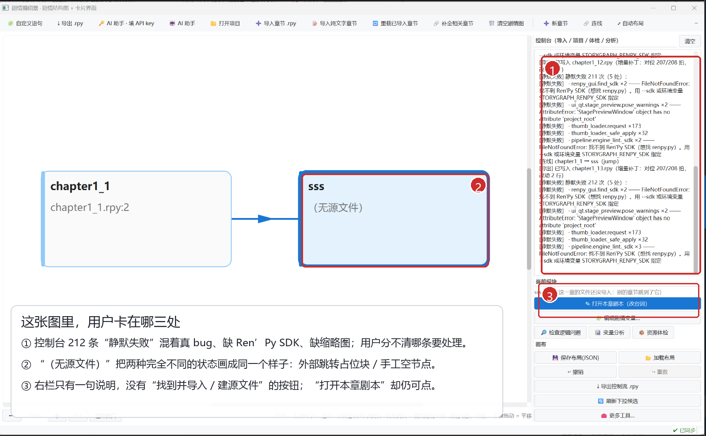
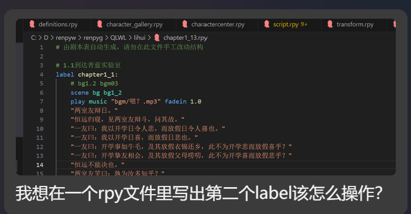

# 用户反馈与操作体验分析（2026-10-22）

> 反馈来源：3 张截图 + 6 段原话。  
> 代码基线：`52d37f5`（2026-10-22 00:20）。  
> 本文先做**分析与操作纠偏**，不改代码。  
> 截图里的 `StagePreviewWindow.project_root` 崩溃已在 `52d37f5` 修复；如果你跑的是更早的打包版，这条还会出现。其余结论按当前源码复核。



*用户截图（已加标注）：控制台噪声、同形异义的“无源文件”、没有修复入口的提示。*

---

## 一、一句话结论

用户不是“不会用”。当前工具把**文件、label、拍**三种粒度都叫“章节”，而界面上只有“文件”这一层是真正打通的：

- **解析/渲染层**已经支持一个 `.rpy` 里多个 label，甚至点号 label；
- **剧情图层**按 label 建节点，也知道每个节点的 `file_path`；
- **卡片页**却按“文件”打开，把文件里所有 label 的拍平铺成一条列表，不标 label 边界；
- **导出普通章节**只读拍，不读图上的连线；
- **剧情图**只存在内存里，除非手动“保存布局”，否则关掉就没了。

于是用户问的“无源怎么变有源”“第二个 label 怎么写”“怎么 call 小 label 再回来”，在界面上都不是“点一下”能完成的动作；它们是**产品模型没有对齐**，不是单个按钮没找到。

---

## 二、优先级总表

| 编号 | 优先级 | 问题 | 性质 | 用户感受 |
|---|---|---|---|---|
| P0-1 | 最高 | 演出预览永远从第 1 拍开始 | 明确 bug | “我在第 200 拍，预览又把我扔回开头” |
| P0-2 | 最高 | 点同一文件里第二个 label 的节点，打开的永远是文件第一拍 | 明确 bug | “第二个 label 建了，但点了还是第一章” |
| P0-3 | 最高 | “无源文件”没有按类型给修复入口（手工空节点无入口，占位块只能靠全局补全），且“打开本章剧本”仍可点 | UX + 状态建模 | “怎么把无源搞成有源？” |
| P0-4 | 最高 | label 内没有 `call` / `jump` 控制流卡；连线又不写脚本 | 架构 | “最需要解决的就是大 label 里 call 小 label 再回来” |
| P1-1 | 高 | 同一文件加第二个 label 的入口藏在“写入文件”，建完也无法定位 | UX | “我就不打开编辑器，要在工具内改” |
| P1-2 | 高 | 变量编辑是整章 Python 文本框，没有“检测 / 修改”工作台 | UX + 模型 | “检测和修改变量似乎不行……我没学会用” |
| P1-3 | 高 | “连线”只改内存图，不写 `.rpy`，也不自动保存 | 架构 + 沟通 | “连线是生成新 rpy 还是新 label？” |
| P1-4 | 高 | “补全相关章节 / 重载已导入章节”名称与行为不对齐 | UX + 文档 | “这两个到底谁让无源变有源？” |
| P1-5 | 高 | 控制台把真 bug、缺 SDK、缺缩略图混成 212 条 | 可观测性 | “一大片红字，我不知道该处理哪条” |
| P1-6 | 中 | 点号 label（`main.route`）创建被拒、补全也找不到 | 明确 bug | 复杂结构直接被卡死 |
| P2-1 | 中 | “重载”只增不删，源文件删掉的 label 会留幽灵节点 | 数据一致性 | “我删了，图里还在” |
| P2-2 | 中 | 新建章节填的“变量操作”只进内存，不写进骨架文件 | 数据一致性 | “变量填了，打开剧本没有” |
| P2-3 | 中 | 新建章节默认写到 `game/<名字>.rpy`，不跟项目现有章节目录 | UX | 章节文件散落两处 |

---

## 三、先纠偏四个词

用户和工具之间最大的摩擦，不是操作步骤，而是**同一个词指了不同的东西**。

| 词 | Ren'Py 里是什么 | 工具里现在是什么 | 造成的误解 |
|---|---|---|---|
| `.rpy` 文件 | 一个脚本文件，可以放很多 label | “一章”的载体 | 用户以为一个文件只能一章 |
| label | 一个可被 `jump` / `call` 的块，可以有很多个 | 图上的一个节点 | 用户以为“新章节 = 新文件” |
| 拍 / Beat | label 里的一行台词或一条演出 | 卡片页的一张卡 | 卡片页标题写“章节（拍）”，又和 label 混用 |
| 连线 / Edge | 不是 Ren'Py 语法，只是“谁跳谁”的关系 | 图上的一条线，存在内存里 | 用户以为画了线就会写进脚本 |

**建议统一叫法：**

- `.rpy` → **剧本文件**
- label → **章节（label）**
- Beat → **拍**
- 图上的线 → **控制流连线（草图 / 可应用到脚本）**

特别是当前“一章”同时指文件、label、拍列表，必须拆开。否则后面每加一个功能，都会再出现一次“这一章到底是哪个”。

---

## 四、现在到底该怎么操作（操作纠偏）

以下按**当前源码**写，不假设未来会改。能做的、不能做的、以及坑，都写清楚。

| 你想做 | 现在这样点 | 实际结果 / 坑 |
|---|---|---|
| 新建一个**有源文件**的章节 | `📁 打开项目` → `➕ 新章节` → 章节名 → 保留“写入文件”默认路径 → 创建 → 选中节点 → 右栏 `✎ 打开本章剧本（改台词）` | 会写出 `label 名:` + `return`。**不要双击节点**：双击是“编辑剧情变量”，不是打开卡片 |
| 在**已有 `.rpy`** 里加第二个 label | `➕ 新章节` → 章节名 → 把“写入文件”改成那个已有 `.rpy` 的完整路径 → 创建 | 能追加成功；但点新节点打开时，卡片页会从**文件第一拍**开始，不会定位到新 label。目前只能自己在列表里翻 |
| 打开某个 label 的卡片 | 选中图上的节点 → 右栏 `✎ 打开本章剧本（改台词）`；或右键 → `改本章台词（卡片）` | 对同一文件里的第二个 label，也会打开文件第一拍（P0-2） |
| 在一个大 label 里 `call` 小 label 再回来 | **没有对应按钮** | 卡片会显示一行“这一拍还会原样执行：call 小label”，但目标只能在“高级区 → 代码”里手写；图上的连线不会自动更新。不推荐作为正式工作流 |
| 从当前拍开始预览 | `🎬 演出预览` → 在“跳到第”里输入拍号 → 点“拍” | 预览永远先展示第 1 拍；必须手动跳（P0-1） |
| 检测 / 修改变量 | 选中节点 → `🧩 编辑剧情变量…`；只读分析用 `📊 变量分析` | 变量编辑是一个**整章 Python 文本框**，不是“变量清单 + 逐拍修改”；`default` / `define` 的初值不在里面（P1-2） |
| 让“无源”的占位块变有源 | 先 `📁 打开项目` → `🔗 补全相关章节` | 只有**项目里能找到该 label 的声明文件**时才会补进来；如果 label 带点号，当前补全正则找不到（P1-6）。手工空节点没有“补全”可救 |
| 让“无源”的手工节点变有源 | **没有专门入口** | 如果项目里已经有同名 label，可以试全局 `🔗 补全相关章节`（它按 label 找文件，不区分手工/占位）；否则“新建章节”会因同名 label 被 `existing` 拦住，只能删块重建（会丢布局/连线），或先在外部建好 `.rpy` 再导入。这是必须补的产品缺口 |
| 重新读取磁盘上改过的章节 | `🔁 重载已导入章节` | 只重解析**已有源文件**的节点；不会把无源变有源，也不会删除源文件里已经删掉的 label（P2-1） |
| 画一条 `jump` / `call` 连线 | `🔗 连线`，或 Shift + 左键从 A 拖到 B | 只改内存里的图，不写 `.rpy`；要生成脚本得点右栏 `⤓ 导出控制流 .rpy`，而且生成的是独立的 `_control` 文件，原章节不变（P1-3） |
| 保存剧情图 | 右栏 `💾 保存布局(JSON)` | 不点就不会持久化；关掉程序图就没了。当前没有“未保存”提示 |

> 结论：**“新建章节”和“打开本章剧本”这两个最常用的入口，都把“文件”当成了“章节”。** 用户按“章节”的心智去点，必然对不上。

---

## 五、逐条反馈拆解

### 5.1 “新建了个节点显示无源文件……怎么才能把无源搞成有源？”

**用户原话**

> 新建了个节点显示无源文件，这个新建章节我也没搞明白，怎么才能把无源搞成有源，不然打开章节剧本不能用！

**先分清：现在有两种“无源文件”，界面把它们画成了同一种。**

| 类型 | 怎么产生 | 正确修复方式 | 当前入口 |
|---|---|---|---|
| A. 外部跳转占位块 | 别的章节 `jump` / `call` 到一个还没导入的 label，解析器先建一个没有 `file_path` 的节点 | 找到声明这个 label 的文件并导入 | `🔗 补全相关章节`，或手动 `导入章节` |
| B. 手工空节点 | 用户点“新章节”，把“写入文件”留空；或没打开项目时创建 | 创建源文件 / 绑定已有文件 | **没有专门入口**；项目里若已有同名 label，全局 `补全` 可能碰巧找到，但不保证 |

类型 A 的代码路径：`renpy_parser._add_edge()` 在目标 label 没有节点时调用 `graph.add_node(to_label, 200, 200)`，不传 `file_path`。类型 B 的代码路径：`AddNodeCommand(..., file_path=None)`。

**现在 UI 的三个具体问题：**

1. **提示文案把 B 也说成 A。**  
   `window_nodes.py:135-136` 对所有 `not fp` 的节点都说“这一章的文件还没导入：别的章节跳到了它”。手工空节点根本没有“别的章节跳到它”，用户会被误导。

2. **主按钮可点，但点了必然报错。**  
   `window_nodes.py:137-140` 对“节点存在”就启用 `✎ 打开本章剧本`；但 `window_nodes.py:150-153` 一检查 `not fp or not Path(fp).exists()` 就退出。右键菜单反而知道要置灰（`window_nodes.py:195-200`）。同一件事，两个入口两种状态，用户会以为“这个按钮坏了”。

3. **没有“就地修复”的动作。**  
   右栏只有一句说明，下面是“打开本章剧本”“编辑剧情变量”这些**不能解决问题**的按钮。用户自然会问“那我到底点哪里？”

**另外，`new chapter` 的状态栏文案也有一条死路：**

`window_nodes.py:284-285` 说：

> 只在图里，还没有源文件；双击后可用「导出」给它建立 `.rpy`。

但 `_on_node_open()` 在没有源文件时直接拒绝打开，用户根本进不了卡片页，也就没有“导出”可点。这条提示给的是一条走不通的路。

**建议的状态模型**

不要再用 `file_path is None` 一个布尔值表示所有情况，给节点一个计算出来的来源状态：

```text
BOUND      有 file_path，文件存在          → 可打开卡片
PLACEHOLDER 无 file_path，但项目里能找到声明 → 显示“在 xxx.rpy 找到” + [导入并绑定]
MANUAL     无 file_path，项目里也找不到     → 显示“手工节点” + [新建源文件] [绑定已有文件]
MISSING    有 file_path，但磁盘上没了       → 显示“源文件丢失” + [重新定位] [移除]
```

**右栏至少要有：**

```text
sss · （未绑定源文件）
[在 chapter1_13.rpy 找到这个 label]   [导入并绑定] [定位]
```

找不到时：

```text
sss · 手工节点，还没有源文件
[新建 .rpy]  [绑定已有文件]  [从图上移除]
```

**验收标准**

- 点一个无源节点，主按钮不再“可点但报错”，而是打开对应的修复动作；
- 类型 A 能一键导入并绑定，导入后节点立刻有 `file_path`；
- 类型 B 能新建或绑定，不需要删块重建；
- 类型 A / B 的文案不同；
- `AddNodeDialog` 不再因为同名占位块而把“补建源文件”的路堵死。

---

### 5.2 “一个 rpy 一个 label 是因为游戏简单；其实可以很复杂”

**用户原话**

> 有的 label 有自己的选项自带的 jump，call 之类的小 label，咱们这种按剧情分 rpy 文件的，同一节的各种大小 label 肯定得写在一起啊！咱们一个 rpy 一个 label 是因为咱们的游戏就把结构设计的简单了，其实是可以很复杂的。



*用户的实际文件：`chapter1_13.rpy` 里只有 `label chapter1_1:`。过去第二个 label 只能在工具外手写；现在可以在“新建章节 → 写入文件”里手填已有路径追加，但入口很隐蔽，而且建完打开不到正确位置。*

这句话需要**部分纠正**：底层并不是“只支持一个 rpy 一个 label”。

- 解析器支持一个文件多个 label；
- `beats_from_parse_result()` 会把多个 label 的拍都收进来；
- `render_beats_to_rpy()` 在 `label_name` 为空时按 `Beat.label` 分段生成多个 `label`；
- 图构建器会为同一文件的每个 label 建节点，`file_path` 都指向同一个文件。

我用一个最小工程实测：

```text
main.rpy:
  label main:
      e "start"
      call side
      e "back"
      return

  label local_extra:
      e "extra"
      return

side.rpy:
  label side:
      e "side"
      return
```

导入 `main.rpy` 后，图上确实有 3 个节点：

```text
main        → main.rpy
local_extra → main.rpy
side        → 无源（还没导入 side.rpy）
```

所以**数据层支持多 label**；真正的问题是：

1. **卡片页没有 label 维度。**  
   `EditorSession.load(file)` 把整个文件的拍读成一条列表；左栏只显示“章节（拍）”，没有 label 分组，也没有“当前在哪个 label”的面包屑。用户看到的是 4 张平铺的卡，不知道第 4 张已经属于另一个 label。

2. **打开节点时只传文件，不传 label。**  
   `window_nodes._on_node_open()` 调 `load_script(fp)`；`window_card.load_script()` 最后固定 `_show_index(0)`。所以点 `local_extra` 节点，打开的仍是 `main` 的第一拍。

3. **节点高亮也只按文件匹配。**  
   `window_card._sync_graph_highlight()` 遍历节点，只比较 `Path(fp) == Path(target)`，命中第一个就返回。同一文件的多个 label，永远只高亮第一个。

4. **“新建章节”默认一个名字一个文件。**  
   `AddNodeDialog` 的“写入文件”默认 `<项目>/game/<章节名>.rpy`，不跟项目已有的章节目录，也不提供“加入已有文件”的单选/下拉。用户当然会形成“一个 rpy 一个 label”的印象。

**结论：** 不是“工具只支持简单结构”，而是**工具把“文件”当成章节的边界，把 label 只当成拍上的一个字符串**。复杂结构在数据层能进来，在操作层没有位置。

**最小的修法（不需要重写解析/渲染）：**

- `EditorSession.load(path, label=None)` 返回该 label 第一拍的索引；
- `load_script(path, label=None)` 用这个索引 `_show_index()`；
- `_on_node_open(nid)` 传 `node.label_name`；
- `_sync_graph_highlight()` 同时匹配 `file_path` 和 `label_name`；
- 面包屑显示 `文件 › label`；
- 左栏按 label 分组（可折叠），至少在 label 第一拍前插一个分组头；
- 新建对话框增加“加入已有文件”，并在创建后直接打开新 label。

**验收标准**

- 两个 label 在同一文件时，点 B 节点，左栏当前行就是 B 的第一拍；
- 面包屑写着 B，图上只高亮 B；
- 卡片列表能一眼看出 label 边界；
- 新建 B 后不需要手动翻列表。

---

### 5.3 “我就不打开编辑器，要在工具内改第二个 label”

**用户原话**

> 我想在一个 rpy 文件里写出第二个 label 该怎么操作？我就不打开编辑器！我就要在这个工具内改！

**当前能做出来的路径：**

`➕ 新章节` → 章节名 → 把“写入文件”改成已有 `.rpy` 的**完整路径** → 创建。

`cc4d81b` 已经支持“文件已存在且没有同名 label → 末尾追加 `label 名:` + `return`”，并保留 BOM / CRLF；同名会拒绝。这个方向是对的。

**但它仍然不像“在工具内改”：**

- “写入文件”是一个**纯文本框**，没有“浏览…”按钮，也没有已导入文件的下拉；
- 默认路径是新建 `<名字>.rpy`，用户要先知道“改成已有文件”这条隐藏规则；
- 没有“在这个文件里新建 label”的节点右键动作；
- 创建成功后，点新节点又回到文件第一拍（P0-2）；
- 如果用户填的是相对路径，节点会存相对路径，之后按当前工作目录解析，可能打不开；
- 没有校验目标是否在项目的 `game/` 下，写到项目外 Ren'Py 不会加载。

**建议的对话框：**

```text
新建章节
章节名（label）  [ chapter1_2          ]

位置
  (•) 新建文件      [ game/chapter1_2.rpy        ] [浏览…]
  ( ) 加入已有文件  [ game/script/chapter1_13.rpy ▾ ] [浏览…]
      该文件已有：chapter1_1
  ( ) 只画结构（稍后绑定源文件）

[创建]  [创建并打开]
```

**建议增加两个入口：**

- 节点右键 → `在本文件新建 label…`（文件已确定，只问 label 名）；
- 卡片页 label 分组头 → `＋ 在本 label 后新建 label`。

**验收标准**

- 不离开工具，能在已有文件里新建第二个 label；
- 创建后直接打开新 label 的第一拍；
- 文件路径有浏览/下拉，不要求用户手打绝对路径；
- 同名、非 `.rpy`、项目外路径都有明确提示。

---

### 5.4 “演出预览总是从第一拍，不是当前拍”

**用户原话**

> 剩下的，我看编辑 label 内部的卡片的效果还可以，就是演出预览总是从第一拍而不是当前拍展示。
>
> 就是我在修改 200 拍的时候，按演出预览，然后出来的是第一拍，需要手动跳到第 200 拍！！！应当从当前拍开始预览……

这是**明确的索引丢失 bug**，不是用户操作问题。

**代码路径：**

- `window_export.py:432-441` 的 `open_stage_preview()` 只传 `frames()` / registry / project_root，**没有传当前拍号**；
- `stage_preview.py:1045` 的 `StagePreviewWindow.__init__` 固定 `self.idx = 0`；
- `stage_preview.py:1077-1088` 的 `_show_initial_frame()` 固定 `show_frame(0)`。

所以无论用户在第几拍，预览都从 0 开始。

**最小修法：**

```python
# window_export.py
open_preview(
    self,
    self._session.frames(),
    registry=self._registry_provider(),
    project_root=self._project_root,
    start_index=self._loaded_idx,   # ← 新增
)
```

```python
# stage_preview.py
def __init__(..., start_index: int = 0):
    ...
    self.idx = max(0, min(int(start_index), len(self.frames) - 1))

def _show_initial_frame(self):
    ...
    self.show_frame(self.idx)       # ← 不再固定 0

def open_preview(..., start_index: int = 0):
    win = StagePreviewWindow(..., start_index=start_index)
```

**还要加一条判据：**

```text
200 拍的章节，当前在第 200 拍 → 打开预览 → win.idx == 199
```

**体验上再加一层：**

- 按钮文案从“演出预览”改成“从当前拍预览”；
- 预览窗口标题/底栏显示“从第 200 拍开始”；
- 切到“只看有变化的拍”时也要保住当前拍：现在 `_on_only()` 会直接 `show_frame(0)`，应按 `line_id` 重新定位；如果当前拍没有舞台变化被过滤掉，明确说“当前拍没有舞台变化，已跳到第 N 拍”，不要静默跳。

---

### 5.5 “变量检测和修改似乎不行，我没学会用”

**用户原话**

> 然后就是关于变量，检测和修改变量似乎是不行……我没学会用。

这不是用户没学会，而是**当前没有一个符合“检测 / 修改”心智的界面**。

**现状：**

- `🧩 编辑剧情变量…` 打开的是 `NodeOpsDialog`：一个整章的纯文本编辑框，一行一条 Python 赋值；
- 它只列“剧情变量”，会把 `renpy.transition(...)` 这类技术代码藏掉（这是对的），但用户看不到：
  - 变量名清单；
  - 初值（`default` / `define`）；
  - 每条赋值发生在哪一拍；
  - 当前值范围 / 分支条件里怎么用；
- `📊 变量分析` 输出的是“节点入口状态 / 出口状态 / 变量列表”的**原始文本**，不是可操作的变量表；
- `语法检查` 只查这一行是不是合法 Python，**不查变量有没有定义、类型对不对**；
- 变量编辑没有“新增 / 删除 / 下拉 / 搜索 / 定位到拍”；
- `default love = 0` / `define flag = True` 属于文件级保真块，**不会出现在变量编辑器里**。我实测一个文件：

```renpy
default love = 0
define flag = True

label vars_main:
    $ love += 1
    if love > 3:
        $ route = "roof"
    e "done"
    return
```

`node_variables()` 只返回：

```text
['love += 1', 'route = "roof"']
```

看不到 `love` 的初值 0，也看不到 `flag`。所以“检测”天然是不完整的。

**后端不是没有能力：**

- `core/utils.py` 已有 `extract_variables()` / `declared_variables()`；
- `graph/analysis.py` 已有 `VariableState` 和区间传播；
- `session.check_variable_syntax()` 已有逐行语法检查；
- 缺的是“变量工作台”这个产品层。

**建议的变量工作台：**

```text
变量（本章）
┌────────┬────────┬──────────────┬──────────────┐
│ 变量   │ 初值   │ 本拍操作     │ 出现位置     │
├────────┼────────┼──────────────┼──────────────┤
│ love   │ 0      │ +1           │ 第 12 / 47 拍│
│ route  │ ""     │ = "roof"     │ 第 47 拍     │
│ flag   │ True   │ —            │ default      │
└────────┴────────┴──────────────┴──────────────┘

[新增变量] [在本拍加一条操作] [定位] [检查]
```

**交互原则：**

- 变量名、初值、类型从 `default` / `define` / 赋值 / 条件里自动收集；
- 每条赋值能定位到具体拍，不靠“第几行文本”猜；
- 修改某条赋值时，改的是那一拍的 `CodeBlock` / 变量操作，不是整章文本；
- 分析结果可点击跳到图上节点 / 卡片；
- `语法检查` 保留，但不要把它当成“变量检测”的全部。

**验收标准**

- 能看到本章变量清单和初值；
- 能点一条赋值跳到对应拍；
- 能在某一拍新增/删除一条变量操作；
- 保存后 `.rpy` 只改对应行，技术代码原位保留；
- `变量分析` 的输出能按变量过滤，而不是一大段状态文本。

---

### 5.6 “连线到底是什么效果？生成新 rpy 还是新 label？”

**用户原话**

> 然后就是连线是什么效果，是生成新 rpy 文件还是增加新 label？我没搞明白怎么用。

**当前真实行为：既不生成新 rpy，也不增加新 label。**

`AddEdgeCommand` 只做一件事：

```python
self.edge_id = self.graph_view.graph.add_edge(...)
```

它不碰 `EditorSession.beats`，不碰任何 `.rpy` 文件。图上的线只活在内存里（除非你手动“保存布局(JSON)”）。

那“导出控制流 .rpy”呢？

- 它会生成一个**独立文件**（默认 `story_graph_control.rpy`）；
- 每个模块生成一个 `<label>_control`；
- 里面 `call` 原 label，再按连线写 `jump` / `call` / `menu` / `if`；
- **原章节文件不会变**；
- 生成物要真的进游戏，还得自己把入口接到这些 `_control` label 上。

所以用户画了半天线，发现游戏没变，是合理的。

**更麻烦的是“双真源”：**

- 解析时，`call side` 会变成图上的边；
- 同时，拍构建器 `_emit_jump_call()` 把同一行塞进一张 `kind=narration` 的拍，`raw="call side"`；卡片上只有一行“这一拍还会原样执行：call side”，可编辑值藏在“高级区 → 代码”；
- 如果用户在卡片里把 `call side` 改成 `call other`，图上的边**不会变**，要重新导入才更新；
- 如果用户在图上画一条边，卡片里的 `raw` 也**不会变**。

同一句控制流，两个地方各存一份，而且互不同步。

**建议：不要让“连线”继续做纯内存的第二个真源。**

两条路，推荐第二条：

1. **明确降级为草图**：图上标“草图，不写脚本”，保存/关闭时提示；导出控制流仍然保留。这能减少误解，但没解决“想在大 label 里 call 小 label”的需求。
2. **让连线成为控制流拍的投影**（推荐）：
   - 在 label 内增加一种一等公民的 `flow` 拍：`call` / `jump` / `return`；
   - 卡片上显示“↳ 调用 side_label，返回后继续第 87 拍”；
   - 导出时它就是真正的 `call side_label` / `jump side_label`；
   - 图上的边从 flow 拍派生，不再单独维护；
   - 图上“连线”= 在源 label 末尾（或指定位置）插入一条 flow 拍。

**这样用户的问题就有答案了：**

> 连线不是生成新 rpy，也不是增加新 label；它应该是在当前 label 里插入一条 `call` / `jump`，并让图和脚本说同一件事。

**验收标准**

- 在大 label 里插入 `call small_label`，卡片上看得见、能改目标；
- 导出后 `.rpy` 里就是这一行；
- 图上自动出现 A → small_label 的边；
- 重新导入后边不重复、不丢失；
- 删除 flow 拍，边也消失（或明确提示“图上有手工边”）。

---

### 5.7 “补全相关章节 vs 重载已导入章节”

**用户原话**

> 还有就是，补全相关章节是根据 call，jump 抓取得到其他剧情图？而重载已导入章节则让本地已有 rpy 文件的无源变有源？

**一半对，一半不对。**

| 动作 | 实际做什么 | 会不会让无源变有源 |
|---|---|---|
| `🔗 补全相关章节` | 扫描项目：① 图上无源 label 由哪个文件声明；② 谁 `jump/call` 了已导入的 label。把找到的文件一起导入 | **会**，前提是项目根已打开、文件里能找到该 label（点号 label 当前找不到） |
| `🔁 重载已导入章节` | 只取 `graph_files(graph)`（已经有 `file_path` 的节点），重新解析这些文件 | **不会**。无源节点没有 `file_path`，根本不在重载范围内 |

所以用户猜的“补全 = 根据 call/jump 抓其他剧情图”基本对；“重载 = 让无源变有源”不对。

**“重载”还有一个隐藏问题：它只增不删。**  
我实测：一个文件原来有 `label a` / `label b`，导入后把源文件里的 `b` 删掉，再点重载，图里仍然有 `b`，而且 `file_path` 还指向那个文件。它不是“刷新”，是“再合并一次”。

**建议：**

- 把两个动作改成用户能预测的名字：
  - `补全缺失章节…`（带预览：将导入哪些文件、新增哪些节点/连线）
  - `刷新已导入章节`（带 diff：新增/删除/修改了哪些 label）
- 或者合并成一个 `同步剧情图…` 对话框，里面两个复选框：
  - `[x] 从项目里补全缺失的 label`
  - `[x] 重新读取已导入文件（删除源里已不存在的 label）`
- 执行前显示“将新增 3 个节点 / 删除 1 个节点 / 更新 2 条连线”，别让用户点完才知道。

**验收标准**

- 重载后，源文件删掉的 label 从图上消失（或明确问“保留还是移除”）；
- 补全能处理点号 label；
- 两个动作都有预览，不再靠名字猜。

---

### 5.8 “大 label 里 call / jump 小 label，再回到大 label”

**用户原话**

> 我觉得最需要解决的，就是怎么在一个大 label 里面 call 或 jump 其他小 label 然后再回到这个大 label。

这是本报告里**最重要的产品缺口**，也是架构层面的。

**当前能力：**

- Ren'Py 语义上，`call small_label` 会执行小 label，遇到 `return` 回到 `call` 的下一行；
- 工具解析时能识别 `call`，图上能画出边；
- 但卡片页没有“调用卡”，用户在卡片上看到的是一张**没有台词的空旁白卡**，只提示“这一拍还会原样执行：call side”，目标只能去“高级区 → 代码”改；
- `return` 不落卡，所以用户也无法在卡片上看到“这里会回到大 label”；
- 想要“调用后继续写”，只能手写代码，且图不会同步。

**这解释了用户为什么说“最需要解决”：**

他不是缺一个 `call` 按钮，而是缺**一条完整的编辑闭环**：

```text
在大 label 的某个位置
  → 插入“调用小 label”卡
  → 选目标 label
  → 明确“调用完回到这里”
  → 导出成 call
  → 图上出现边
  → 重新打开还能看懂
```

**建议的 flow 拍设计：**

```text
┌─ 第 87 拍 ─────────────────────────────┐
│ ↳ 调用 side_label                       │
│   返回后继续：第 88 拍                   │
│   目标：[side_label ▾]  [定位]           │
└────────────────────────────────────────┘

┌─ 第 120 拍 ────────────────────────────┐
│ ↳ 跳转 ending_true（不返回）             │
└────────────────────────────────────────┘
```

数据结构上，不要再把 `call` 只存在 `raw` 字符串里：

```text
Beat(kind='flow',
     flow_type='call',        # call / jump / return
     target='side_label',
     from_clause='',          # call ... from ...
     args='',                 # call side(...)
     raw='call side_label')   # 保真用；渲染以结构化字段为准
```

**分两步做，避免一次性重构：**

1. **第一阶段（可先上）**：解析 `raw` 里的 `call` / `jump`，在卡片上显示成“控制流卡”，目标可改；改完写回 `raw`，保存后触发图重算。这样用户至少能看见、能改。
2. **第二阶段（收口）**：把 `call` / `jump` / `return` 变成真正的 `flow` 拍，图边从拍派生，删除“边”和“raw”双真源。

**验收标准**

- 在 `main` 里插入 `call side`，卡片上显示目标和“返回后继续”；
- 导出产物是 `call side`，不是注释/空拍；
- 图上有 `main → side` 的边；
- 在 `side` 末尾有 `return` 的语义说明；
- 重新导入后不重复、不丢边；
- 把 `call` 改成 `jump` 时，明确提示“不会返回”，不要静默改语义。

---

### 5.9 “控制台 212 条静默失败，我该看哪条？”

**截图里的三类东西被混在一起：**

| 类别 | 例子 | 对用户的影响 |
|---|---|---|
| 真 bug | `StagePreviewWindow` 没有 `project_root` | 姿势提示功能整个哑掉；已在 `52d37f5` 修 |
| 环境缺失 | 找不到 Ren'Py SDK（`recover_guid_find_sdk` / `pipeline.engine_lint`） | 引擎校验 / GUID 恢复不可用；预览、导出不受影响 |
| 资源缺失 | `thumb.loader.request ×173` | 173 张缩略图没加载；不影响剧情数据 |

用户看到的是 212 条同样格式的 `[静默失败]`，没有 severity、没有“要不要处理”、没有“怎么处理”。这不是“日志详细”，是**把诊断成本转嫁给用户**。

**建议：**

1. 顶部先给摘要，不要先铺 212 行：

```text
本次操作：导入 1 个文件 / 新增 2 个节点 / 1 条警告
[环境] 未找到 Ren'Py SDK —— 引擎校验不可用（不影响预览/导出）  [如何配置]
[资源] 173 张缩略图未加载（不影响剧情）                       [查看]
[代码] 1 个内部错误：stage_preview.pose_warnings                [复制诊断]
```

2. 重复项聚合：`thumb.loader.request ×173` 一行，不要 173 行。
3. 默认只展开“需要处理”的项；环境/资源类收进“详情”。
4. 把“静默失败”改成用户能懂的话：“已跳过 173 个缩略图加载”。
5. 内部错误保留完整 traceback，但放在“复制诊断”里，不要和缺图混排。
6. 缺 SDK 只在启动/首次相关操作时说一次，附 `STORYGRAPH_RENPY_SDK` 配置说明。

**验收标准**

- 212 条变成 3 条摘要 + 可展开详情；
- 用户能一眼看出“哪条会让功能不可用”；
- 同一错误不会刷屏；
- 真 bug 仍然可见、可复制。

---

## 六、架构分析：不是解析器的问题，是“三套粒度”没有对齐

### 6.1 当前的四层单位

| 层 | 单位 | 证据 |
|---|---|---|
| 解析 / 渲染 | `.rpy` 文件 + `Beat.label` | 一个文件多个 label 能解析、能渲染 |
| 剧情图 | label 节点 + `file_path` | 同一文件多个 label 会建多个节点 |
| 卡片页 | **文件** | `EditorSession.load(path)` 读整个文件，列表平铺所有拍 |
| 导出普通章节 | **拍列表** | 不读图上的边；只按 `Beat.label` 分组 |
| 控制流导出 | **图边** | 单独生成 `_control` 文件 |

### 6.2 由此产生的五个结构性问题

1. **“章节”一词过载。**  
   对话框里“章节名”是 label；卡片页“章节（拍）”是拍；导出“这一章”是文件。用户无法建立稳定心智。

2. **来源状态只有一个 `file_path` 布尔值。**  
   占位块、手工空节点、源文件丢失，全显示“（无源文件）”，修复动作却完全不同。

3. **控制流有两个真源。**  
   图边和 `raw` 里的 `call/jump` 各存一份，互不同步；连线不写脚本，改代码不更新图。

4. **变量挂在节点上，编辑却在拍级。**  
   `node_variables()` 返回整章变量文本，用户想改“第 47 拍的 `love += 1`”只能在一整段文本里找；`default` / `define` 还不在里面。

5. **图不是持久真源。**  
   图只存在内存；`保存布局(JSON)` 是手动动作，关闭程序不会自动保存，也没有“未保存”提示。用户会以为“导入一次就在项目里了”。

### 6.3 哪些不用重写

- **解析器**：已经支持多 label、点号 label（`FIX-10`）、参数、文件级保真块；
- **渲染器**：`render_beats_to_rpy()` 已能按 `Beat.label` 分组生成多个 label；
- **补丁/门禁**：已有增量补丁、结构边界、label 硬边界等大量守卫；
- **变量后端**：已有 `extract_variables` / `declared_variables` / `VariableState`；
- **跨文件发现**：已有 `find_label_files` / `find_files_referencing_labels`。

所以不建议“推翻重做”。真正要补的是**产品模型层**：

```text
现在：
  .rpy ──parse──> beats[label] ──graph builder──> nodes[label] + edges
                       │
                       ├─ card page: 平铺所有 label 的拍（无分组）
                       └─ graph edge: 只存在内存（不写脚本）

目标：
  .rpy ──parse──> LabelBlock[] ──> beats + FlowBeat ──> render .rpy
                       │                    │
                       ├─ card page 分组      └─ graph 投影（同源）
                       └─ 来源状态 / 修复动作
```

### 6.4 建议的增量改造顺序

1. **先修三个小洞**（P0-1 / P0-2 / P0-3）：预览索引、打开正确 label、无源修复入口。改动小，用户立刻有感。
2. **补 label 容器**（P1-1）：`LabelBlock` / label 分组 / 新建 label / 面包屑。先不做 flow 拍。
3. **补 flow 拍**（P0-4）：先只读展示 + 目标可改，再收口成图边同源。
4. **变量工作台**（P1-2）：复用现有后端，不新写解析。
5. **图持久化 / 同步对话框 / 控制台收敛**（P1-3 / P1-4 / P1-5）。

---

## 七、目标体验（建议稿）

### 7.1 来源状态卡

```text
┌─ sss ───────────────────────────────┐
│ 来源：chapter1_13.rpy:6              │
│ 状态：已在项目里找到，但还没导入       │
│ [导入并绑定]  [在编辑器中定位]         │
└─────────────────────────────────────┘

┌─ sss ───────────────────────────────┐
│ 来源：无                            │
│ 状态：手工节点                       │
│ [新建 .rpy]  [绑定已有文件]  [移除]   │
└─────────────────────────────────────┘
```

### 7.2 卡片页 label 分组

```text
chapter1_13.rpy
├─ ▾ chapter1_1        [＋ 在本 label 后新建]
│   1  e "……"
│   2  show ...
│   3  ↳ call side_label
│      返回后继续：第 4 拍
│   4  e "……"
└─ ▸ side_label
    1  e "……"
    2  return
```

### 7.3 预览

```text
[🎬 从当前拍预览]  当前：第 200 / 213 拍
```

打开后标题/底栏：

```text
舞台演出预览 · 从第 200 拍开始
```

### 7.4 变量工作台

见 5.5 的表格。

### 7.5 图

- 图上加图例：`实线 = 源文件里的控制流` / `虚线 = 手工草图`；
- 手工边标注“未写入脚本”；
- 关闭前提示“剧情图有未保存改动”；
- 或者自动保存到项目内 `storygraph_layout.json`。

---

## 八、修改顺序与验收

### P0（先做，用户立刻有感）

| 项 | 改动 | 验收 |
|---|---|---|
| 预览从当前拍 | `open_stage_preview` 传 `_loaded_idx`；`StagePreviewWindow` 接受 `start_index`；`_show_initial_frame` 用 `self.idx` | 第 200 拍打开 → `idx == 199` |
| 打开正确 label | `load_script(path, label)`；`_on_node_open` 传 `label_name`；`_sync_graph_highlight` 同时匹配 label | 两个 label 同文件，点 B 打开 B 的第一拍 |
| 无源修复入口 | 计算 `source_kind`；右栏按状态给按钮；无源时不再启用“打开本章剧本” | 占位块能一键导入；手工节点能建/绑源 |
| 控制流卡 | 先只读展示 `call/jump`，目标可改；保存后图重算 | 大 label 里能看见、能改 `call side`；导出正确 |

### P1（紧接着做）

| 项 | 改动 | 验收 |
|---|---|---|
| 同文件新建 label | 对话框加“新建文件 / 加入已有文件 / 只画结构”；节点右键“在本文件新建 label” | 不离开工具，创建后直接打开新 label |
| label 分组 | 卡片左栏按 label 分组；面包屑显示当前 label | 一眼看出边界 |
| 变量工作台 | 变量清单 + 初值 + 逐拍操作 + 定位 | 能改第 47 拍的 `love += 1` |
| 连线语义 | 要么标“草图”，要么变成 flow 拍投影 | 用户知道画线会不会写脚本 |
| 补全/重载 | 改名为“补全缺失章节 / 刷新已导入章节”，带预览；重载删除幽灵 | 点之前知道会发生什么 |
| 控制台 | 摘要 + 聚合 + 分类 + 可展开 | 212 条变 3 条 |
| 点号 label | `valid_label` / `_LABEL_RE` / `_REF_RE` 支持点号 | `main.route` 能建、能补全 |

### P2（收尾）

- 新建章节的“变量操作”写进骨架文件；
- 默认章节目录跟随项目已有章节；
- 布局自动保存 / 未保存提示；
- 文案统一：剧本文件 / 章节(label) / 拍 / 控制流。

---

## 九、已修 / 未修对照

| 用户点 | 当前代码状态 | 说明 |
|---|---|---|
| 新建章节显示无源 | **部分已修**（`cc4d81b`） | 有项目时默认写骨架；但占位块、手工空节点、无项目时仍无源，且没有修复入口 |
| 一个 rpy 写第二个 label | **入口已加，体验未闭环**（`cc4d81b`） | 可通过“写入文件”追加；但入口隐蔽、无浏览、建完打开错 label |
| 控制台 `pose_warnings` | **已修**（`52d37f5`） | 旧包仍会出现 |
| 预览从第一拍 | **未修** | 见 5.4 |
| 变量检测/修改 | **未修** | 见 5.5 |
| 连线不写脚本 | **未修** | 见 5.6 |
| 补全/重载语义 | **未修**（行为本身是设计如此） | 需要改名/预览/文档 |
| 点号 label | **未修** | 解析器支持，创建/补全不支持 |
| 重载幽灵节点 | **未修** | 只增不删 |
| 新建章节变量丢失 | **未修** | `_write_new_chapter` 只写 `label` + `return` |

---

## 十、建议下一步

先做三件**小改动、高感知**的事：

1. 预览从当前拍开始（P0-1）；
2. 点节点打开正确 label（P0-2）；
3. 无源节点给真正的修复按钮，去掉“可点但报错”（P0-3）。

这三件做完，再动“label 分组 + flow 拍”的结构改造（P0-4 / P1-1）。否则直接上大改，用户在前三天仍然会觉得“还是不能用”。

---

## 附录 A：这次复核用到的离线证据

### A.1 多 label 能导入，但卡片平铺

```text
导入 main.rpy（含 main / local_extra 两个 label）：
  nodes: main(main.rpy), local_extra(main.rpy), side(无源)
  卡片 load 后 beats 的 label: ['main', 'main', 'main', 'local_extra']
```

说明：数据层能处理多 label，卡片页没有分组。

### A.2 `call` 不是一等公民

```text
main.rpy:
  label main:
      e "start"
      call side
      e "back"
      return

卡片里对应的拍：
  kind = narration
  text = ''
  raw / CodeBlock = 'call side'
```

说明：`call` 只作为“旁白拍里的原始代码”存在，不是控制流卡。

### A.3 点号 label 的解析与补全不一致

```text
解析器 labels: ['main.route', 'side.choice']
find_label_files(root, ['side.choice']): {}
valid_label('main.route'): False
```

说明：解析器认点号，创建/补全不认，复杂结构会被卡死。

### A.4 新建骨架不包含“变量操作”

`_write_new_chapter()` 只写：

```renpy
label newvars:
    return
```

对话框里的“变量操作”只进了内存节点，没有进源文件。

---

## 附录 B：代码定位

| 行为 | 位置 |
|---|---|
| 无源节点提示 / 可点按钮 | `storygraph/ui_qt/window_nodes.py:135-153` |
| 新建章节写骨架 | `storygraph/ui_qt/window_nodes.py:54-97` |
| 新建章节对话框 / 同名检查 | `storygraph/ui_qt/dialogs.py:309-424` |
| 打开卡片固定第 0 拍 | `storygraph/ui_qt/window_card.py:126-151` |
| 高亮只按文件匹配 | `storygraph/ui_qt/window_card.py:229-240` |
| 文件加载全部 label | `storygraph/app/session_table.py:164-196` |
| 列表无 label 分组 | `storygraph/app/session_table.py:576-608` |
| 预览不传当前拍 | `storygraph/ui_qt/window_export.py:432-441` |
| 预览固定 idx=0 | `storygraph/ui_qt/stage_preview.py:1045,1077-1088` |
| 只看变化拍重置到 0 | `storygraph/ui_qt/stage_preview.py:1524-1538` |
| 变量编辑器 | `storygraph/ui_qt/dialogs.py:431-529` |
| 变量分析 | `storygraph/ui_qt/window_graph_ops.py:209-218` |
| 连线只改图 | `storygraph/graph/commands.py:61-80` |
| 控制流导出 | `storygraph/ui_qt/window_graph_ops.py:1051-1099` |
| 补全 / 重载 | `storygraph/ui_qt/window_graph_ops.py:1425-1451` |
| 缺失章节发现 | `storygraph/app/session_graph.py:323-372` |
| 点号 label 校验 | `storygraph/ui_qt/dialogs.py:36-40` |
| 点号 label 发现正则 | `storygraph/parsing/discover.py:33-38` |
| `call/jump` 落成 raw 旁白拍 | `storygraph/story/beat_build.py:1144-1159` |
| label 硬边界 | `storygraph/story/beat_build.py:422-444` |
| 图节点无来源类型 | `storygraph/graph/models.py:29-38` |
| 无源样式 | `storygraph/ui_qt/graph_canvas.py:161-169` |

---

*本文只做反馈分析与方案，不包含代码修改。*
