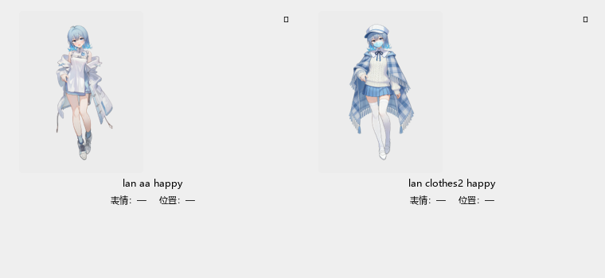

# 立绘提示检测器 · 地狱测试第三轮（跨文件自定义结构 + with/at/transform + 预览图）

> 2026-11-05 用户纠正：
>
> > 你一开始的地狱测试完全没有理解我的意思，先想办法在保持通用性的前提下，修好 bug，
> > 然后，重写地狱测试！我说了必须要自定义变量/结构，还能识别！并且不误报，不漏报！
> > 服装的 show 只是最简单的一个……后面你要有 with，要有 transform 的引擎没有的
> > 自定义结构……更离谱的是还要写在不同的文件里……有的时候不必过于苛求它到底是不是
> > 图片！因为很多时候这些东西也不是图片！（所以我之前说找到对应的图片是错误的……
> > 应该说：预览里面被选中的图片，修改后显示正确）

第三轮把验收从“提示条上写一句实际路径”改成**打开预览图看像素**，工程零件从
一个 `extra.rpy` 拆成**九个文件、六个目录**，并把 `with` / `at` / `transform` /
`screen` / `layer` 这些“不是图像名”的形态全部纳入判据。

## 一、上一轮错在哪

| 上一轮 | 用户要的 |
|---|---|
| 拿 lint 的 `is not an image` 当最硬裁决 | `aa` 是 `CC_OUTFIT_CYCLE` 的服装代号，**不对应任何 png**，lint 查的是 image 注册表，没资格判 layeredimage 的属性组合 |
| 提示条写“实际显示 `…/indifferent.png`”就算“找到图” | **预览里**那张图换完维度要真的变；提示条写对、缩略图不变，等于没修 |
| 自定义结构全塞在一个 `extra.rpy` | 定义要散在不同文件/目录（`data/`、`definitions/`、`helpers/`、`stage/`、`fx/`、`screens/`、`chapters/`） |
| 只测 `show` 的图像名 | `with` / `at` / `@` / `behind` / `as` / `onlayer` / `zorder`、`show expression` / `screen` / `layer` 都不许被当成属性 |

## 二、先修的三个通用 bug

修法都落在**项目声明的结构**上，没有一条写死 `sr_general` 的专有表。

| # | 现象 | 根因 | 修法（文件） |
|---|---|---|---|
| 1 | 没有项目根时卡片/测试**卡死十分钟** | `Path('') == '.'`：`load_layer_model('')` 把整个仓库（含 `.pip-tmp/` 上千个临时项目）当项目扫 | 空根直接返回空模型；`layer_model_stamp('')` 返回 `()`；`Symbols.token_image_path` / `resolved_paths_of` 空根短路（`layered_model.py` / `dsl.py`） |
| 2 | **换了服装，预览图不变** | 真机 `crop_lan` 写的是 `AlphaMask(图, Crop((0,0,4320,1895), Solid("#fff")))`；旧解析器只认“AlphaMask 的两个参数都是字符串”，判 `error` → `plan.ok=False` → 退回单张表情件 | 把 `AlphaMask(图, Crop(矩形, Solid))` 识别成**裁剪**：`AlphaMask` 只看蒙版 alpha，白色实心矩形 = 矩形内全保留（`layered_model.py` 的 `_solid_rect_of`） |
| 3 | 卡片缩略图对 `lan aa happy` 判“**没有**” | `resolve_sprite_thumb_path` 只走“注入解析器 → 按 `<tag>/<attrs>.png` 猜”；没有解析器时猜 `game/images/lan/aa_happy.png`，不存在 | 加第二级：按项目 `layeredimage` 解析（`resolve_layers` + `compose_sprite`），**最后**才退回文件名约定（新叶子模块 `sprite_thumbs.py`，从 `sprite_grid.py` 拆出） |

真机 `D:\千连万理\sr_general`（`AssetCatalog.image_path`，修后实测）：

```
lan aa happy        → game/images/characters/lan/happy.png
lan clothes2 happy  → %TEMP%/renpy_sge_thumbs/composed/3bf4c31f1ca12afd9540c811.png
lan based           → game/images/characters/lan/indifferent.png
```

第一条是“普通服装 = 不加衣服层”，第三条是“认不出的词运行时被忽略、实际显示默认表情”，
第二条才是这次修的核心：**换装后必须换图**。

## 三、第三轮的工程零件（九个文件）

| 文件 | 放什么 | 为什么放这 |
|---|---|---|
| `game/data/wardrobe.rpy` | tab 缩进 + 中文键 + 嵌套 dict + tuple + `renpy.image()` | 真机 `CC_OUTFIT_CYCLE` 的变体；定义在 `data/` 而不是 `config.rpy` |
| `game/data/define.rpy` | `define HELL_TAGS = ["hat"]`；`{"label_key": "fallback_word"}` | 只在这里定义的 `hat`；dict 的**值**是陷阱 |
| `game/definitions/lan.rpy` | `layeredimage lan`：双 `expressions` 组 + `outfit` 组 | 真机结构；两个组的 `when` 条件互为反面 |
| `game/definitions/alias.rpy` | `image lan 符_77 = …` | 引擎认、但不是 `layeredimage` 的 attribute |
| `game/helpers/crop.rpy` | `crop_lan()`：`AlphaMask(图, Crop(矩形, Solid))` | 真机 `crop_lan` 的缩小版（8×4 裁切） |
| `game/stage/poses.rpy` | `transform hell_pose` / `transform hell_sway(amount=…)` | 自定义 transform，放在另一个目录 |
| `game/fx/transitions.rpy` | `define hell_dissolve = Dissolve(…)` | 自定义转场，给 `with` 用 |
| `game/screens/hud.rpy` | `screen hell_hud()` | 非图像 `show` |
| `game/chapters/ch1.rpy` | 真 show 行：`with` / `at` / `@` / `behind` / `as` / `onlayer` / `zorder` | 证明这些子句不参与属性校验 |

图片是 8×8 的“上红下透明”脸件 + “上透明下蓝”衣服件：

```
happy.png      上半 (255,0,0,255)   下半透明
coat.png       上半透明             下半 (0,0,255,255)
clothes2.png   上半透明             下半 (0,160,0,255)
```

于是 `lan coat happy` 的合成结果必须是**上红下蓝** —— 换维度没换图时，
这两个像素不可能同时成立。

## 四、判据：47 条

`tests/test_sprite_hint_hell_structures.py`：

| 组 | 条数 | 钉什么 |
|---|---|---|
| `TestDefinitionsAcrossFiles` | 9 | 嵌套 dict / tuple / `define` / `image` 语句 / `renpy.image()` / Unicode 名；dict 值不算词；删文件立刻改判 |
| `TestTypoTwinsAreReported` | 10 | `hat2` / `aa2` / `sigil_78` / `符_78` / `ghost` / `based` 必须点名；**脚本里 `show` 过不算定义**；只点坏词不点好词；删掉定义文件后改判 |
| `TestClauseWordsAreNotAttributes` | 14 | `with` / `at` / `@` / `behind` / `as` / `onlayer` / `zorder` / ATL 冒号；`expression` / `screen` / `layer` / `text`；`transform based:` 不救 `lan based`；自定义 transform / `define` 转场从自己的文件解析（前者进解析器，后者进 `transition_catalog`） |
| `TestCardPreviewShowsTheRightPicture` | 8 | 真卡片：`aa` → `happy.png`；换成 `coat` → 合成图（像素上红下蓝）；换回来 → 回 `happy.png`；点 outfit chip 也走同一条；typo 卡片要点名；`with` 塞进 `image` 字段仍按图像名解析；`expression` / `screen` 说“非图像”，不说“没有” |
| `TestStagePreviewUsesTheSameResolution` | 2 | 舞台预览 `sprite_plan` + `compose_sprite`：换装后图必须变 |
| `TestOutfitCodeWithoutAnyPng` | 4 | 真机 `aa`：没 png、不是 attribute、旧 lint 缓存说“不是图像” → 都不许报错 |

验收命令：

```powershell
python -m pytest tests/test_sprite_hint_hell_structures.py -q      # 47 passed
```

相关回归（检测器 / 声明 / 身份 / 分层 / 卡片槽位 / 包分层）：

```powershell
python -m pytest tests/test_sprite_hint_detector.py `
  tests/test_sprite_hint_hell_custom.py tests/test_sprite_hint_engine_verdict.py `
  tests/test_sprite_tag_ownership.py tests/test_layered_model.py `
  tests/test_sprite_thumbnail_and_slots.py tests/test_sprite_missing_hint.py `
  tests/test_declared_layered_identity.py tests/test_spec_self_consistency.py `
  tests/test_package_layering.py -q                                # 169 passed
```

## 五、预览证据（真机，不是小图）

`python tools/_shot_preview_correct.py`（真项目 `sr_general`，故意**不接**
`session.path_of_image`，证明分层兜底自己也能算对）：

| 场景 | 截图 |
|---|---|
| `lan aa happy` → `happy.png`（普通服装，不加衣服层） | [`shots/hell_detector_preview_aa_2026-11-05.png`](shots/hell_detector_preview_aa_2026-11-05.png) |
| `lan clothes2 happy` → 裁脸 + `clothes2` 叠好的图 | [`shots/hell_detector_preview_clothes2_2026-11-05.png`](shots/hell_detector_preview_clothes2_2026-11-05.png) |
| 两张并排：同一张脸、不同衣服 | [`shots/hell_detector_preview_row_2026-11-05.png`](shots/hell_detector_preview_row_2026-11-05.png) |



并排图里左边的裙子是 `aa`（普通），右边是 `clothes2` 的风衣 —— 这正是用户
说的“预览里面被选中的图片，修改后显示正确”。

真机上再把**注入解析器**接回去（`AssetCatalog.image_path` 作 `on_resolve_path`，
真卡片点 outfit chip）走一遍，结论一致：

```
起手   lan aa happy        → game/images/characters/lan/happy.png        hint=''
点服装 lan happy clothes2  → %TEMP%…/composed/6f0d2ba917d0ea17877da752.png  hint=''
```

## 六、边界（没做的，写清楚）

1. **`with` / `at` 的名字不做“图像属性”校验**：它们是子句，不是图像属性。
   `at` 的 transform 由脚本解析器读（判据里已钉 `hell_pose` / `hell_sway`）；
   `with` 的 `define … = Dissolve(…)` 由 `transition_catalog` 读成效果
   （判据里已钉 `hell_dissolve` → dissolve 0.2s）。**候选下拉**仍只列
   `registry.transforms` + 内置转场 —— `define` 转场不进下拉，但不影响
   手打、也不影响预览。
2. **项目定义词是全局词表**（`defined_words`，与 tag 无关）：同项目任何位置
   定义过的词都不报。这是“宁可漏报别的角色的词，也不误报项目自定义结构”的
   取舍；真正的 typo（`based` / `hat2` / `ghost`）只要没被定义过就必须报。
3. **dict 的“值”不算词**：`{"aa": "普通"}` 里的“普通”不是属性代号；
   `{"aa": "fallback_word"}` 里的 `fallback_word` 也不因出现在值里而合法。
4. **Unicode 的 dict 键仍不收**（`_WORD_RE` 是 ASCII）：引擎认的 Unicode 名字
   请用 `image` 语句声明（已支持，见 `image lan 符_77`）。
5. **引擎缓存**只读、不校验指纹：脚本改了以后，卡片可能先显示旧裁决，
   等后台 lint 跑完、下次打开项目才翻过来。
6. `resolve_sprite_thumb_path` 的**分层兜底**要求项目的 `layeredimage` 能被
   `resolve_layers` 完整解析；有一层认不出就退回文件名约定，**不画半张图**。

## 七、全量

```powershell
python tools/fasttest/run.py
```

本轮（12 workers）：**9424 passed / 7 failed / 2 skipped / 2 xfailed**，5m54s。

> 这次全量收集时地狱文件是 45 条；收尾又补了两条（`define` 转场从自己文件读、
> `with` 整段塞进 `image` 字段仍按图像名解析），单跑
> `tests/test_sprite_hint_hell_structures.py` 是 **47 passed**。产品代码在全量之后
> 没有再改。

7 条失败里 **6 条是工作区里并行未完成的改动**（`SayTail` 字段、`schema.json` 漂移、
`asset_registry._scan_inside_game` 顶层重复定义、`sync_asset_tables` 指纹、
`asset_mapping` 两条），与本轮五个文件没有调用关系。

第 7 条是 `test_tech_debt_budget`：`swallow_calls 1284 → 1288` /
`broad_excepts 1240 → 1244`（+4）。用 `git diff` 可确认这 4 处全在并行的
`storygraph/mcp_surface.py`（`image_lookup` / `beats` / `assets` / `chapters`），
不在本轮改动里；本轮把缩略图解析拆成 `sprite_thumbs.py` 之后
**swallow / broad except 净增 0**，`sprite_grid.py` 也从 1521 行降回 1445 行
（技术债 `long_files` 不再被顶破）。
