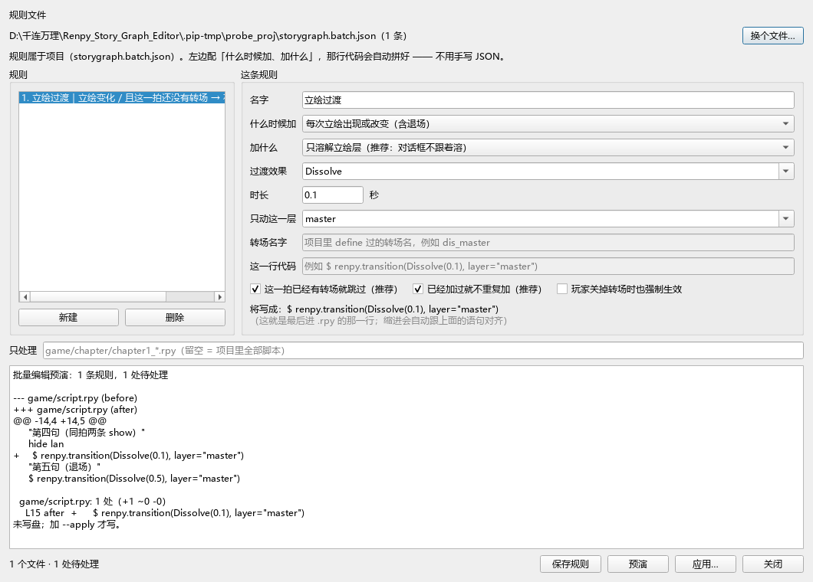

# 立绘转场：群里那行 `$ renpy.transition(...)` 怎么进工具

> 需求来源（2026-11-07，群里）：
> 「`$ renpy.transition(Dissolve(0.1), layer="master")`，大伙都用了吗？
> 就情况来看，这个东西应该放在每个立绘改变的后边」
>
> 问题：**自定义单行代码 + 整章批处理**，工具能兼容吗？自定义模块够强吗？
>
> 本文的每条结论都标了来源：`[文档]` = Ren'Py 官方文档，`[源码]` = renpy 仓库源码，
> `[实测]` = 本仓库探针跑出来的输出（脚本见 §7）。

---

## 0. 结论（先看这三句）

1. **这件事工具已经能做，而且不用写 JSON。** 图界面 →「更多工具 → 按规则批处理 .rpy」，
   点「新建」，两个下拉（**什么时候加** / **加什么**）+ 一个时长，底下实时显示
   "将写成：`$ renpy.transition(Dissolve(0.1), layer="master")`"，然后预演 → 应用。
   那行代码是工具拼的（`app/batch_recipes.build_text`），编剧一个括号都不用打。
   （2026-11-07 之前这块只有"选一份写好的 JSON"的入口 —— 用户当场指出
   "你的可视化界面无法单独定义出这玩意儿"，现已补上，见 §3.5。）
2. **但群里那行写法不是最优解，有两个更省事的官方机制**：把层转场定义成**命名转场**
   （`define dis_master = {"master": Dissolve(0.1)}`，表里「转场」列只填一个名字），
   或者立绘若靠 say 属性变（`e happy "..."`），一行 `config.say_attribute_transition`
   解决全书 —— 都不用逐行插代码。
3. **真缺口不在"认不认得这行"，在"判据不够严"**：现有规则会漏掉 `hide`、
   不检查"这一行会不会被后面的 `with` 吃掉"、也不判"这次立绘变化是不是真的发生了"。
   三条都是小改动（P0/P1，见 §4），不是架构问题。

---

## 1. 先纠正一个前提：这行的语义不是"立刻做转场"

### 1.1 官方定义

| 事实 | 原文 |
|---|---|
| 它**登记**给"下一次交互"，不是立即演 | `renpy.transition(trans, layer=None, always=False)` — "Sets the transition that will be used during the **next interaction**." `[文档·other]` |
| `layer=None` = 整屏；指定层 = 只动那层 | "layer: The layer the transition applies to. If None, the transition applies to the entire scene." `[文档·other]` |
| `always=False` 会**尊重玩家设置** | "always: If false, this respects the transition preference." `[文档·other]` |
| 作者本人解释过"为什么写完没反应" | renpytom: "It doesn't take effect until the next interaction. Since the **scene and show statements don't cause an interaction**, you're having some interesting side effect." `[issue #1358]` |

所以群里那句"应该放在每个立绘改变的后边"——**在"这一拍没有别的 `with`"时，放前面放后面等价**；
真正决定成败的不是前后，是**中间有没有别的 `with` 语句把它清掉**。

### 1.2 三种写法的实际差别（这是选型的关键）

| 写法 | 作用层 | 阻塞台词 | 位置敏感 | 说明 |
|---|---|---|---|---|
| `show x happy with dissolve` | 整屏（master+screens+…） | **阻塞** 0.1s | — | 对话框会跟着一起溶 |
| `show x happy with {"master": Dissolve(0.1)}` | 只 master | **不阻塞** | — | `[文档·transitions]`：dict 写法"returns immediately，transition 在下一交互开始时排程"，"can be used with the master layer to cause transitions to occur **while dialogue is being shown**" |
| `$ renpy.transition(Dissolve(0.1), layer="master")` | 只 master | 不阻塞（同上机制） | **敏感**：中间任何 `with`（含 `window show/hide`）会清掉它 | `[源码]` `with_statement()` 的 dict 分支对每层调 `renpy.exports.transition(v, layer=k)` 后**直接 return、不调 `do_with`** —— 与上一条同一条路径 |

另外两条不用猜的官方机制：

- **`config.say_attribute_transition` + `config.say_attribute_transition_layer = "master"`**：
  只要立绘是靠**say 属性**改的（`e happy "台词"`，等价于 `show eileen happy` + 台词），
  一行 define 后全书自动带转场，且"**Ren'Py will not pause to wait for the transition**"`[文档·config]`。
  想按 tag/模式给不同过渡，用 `config.say_attribute_transition_callback`（参数里就有 tag、
  `permanent`/`temporary`/`restore` 模式、前后 tag 集合）。
- **`config.implicit_with_none`**（默认 True）：每次交互后补 `with None`，正是它让
  "漏掉的 pending 转场"不会跨句泄漏 —— 也是为什么"插在太早"会白插。

### 1.3 由此得到的判据

一条 `$ renpy.transition(...)` 要真的生效，必须满足：

1. 它在**所有**会改立绘的语句之后（同拍多条 show 时只留一条，否则后者覆盖前者，白跑）；
2. 它到"下一个交互"之间**没有** `with` / `show … with …` / `window show|hide`（后两者内部就是 `with_statement`）；
3. 该拍确实发生了**可见变化**（`show lan happy` 而 lan 已经是 happy → 白白消耗一次过渡）；
4. 想要"玩家关掉转场也生效"就得写 `always=True`（默认不写 = 尊重玩家设置）。

---

## 2. 工具现在能做的（实测证据，不是"应该能"）

| 能力 | 入口 | 实测结果 |
|---|---|---|
| 这行**可读可改参数**（不 eval、只换那一段） | 表/卡自动长出 `renpy.transition·transition@0`、`renpy.transition·layer@kw` | `read_arg` → `Dissolve(0.1)` / `master`；改 `layer` 只动引号内那一段 |
| 预览能认出"这是什么过渡、几秒" | `transition_expr.parse_python_transition` | `TransitionCall(name='Dissolve', args=(0.1,), layer='master')` |
| 表里**手写一行**，导出位置正确 | 「代码」列（多行格） | 渲染结果 `show lan happy` → `$ renpy.transition(...)` → 台词（**在立绘之后**，不是之前） |
| **整章批量插入** | `storygraph.batch.json` + 图形界面/CLI | 13 行小项目：插 3 处；同拍两条 show 只插 1 处（插在最后一条后）；已有 `with dissolve` 的拍跳过；重跑 **0 处** |
| 批量改时长（全书统一 0.1→0.2） | `examples/batch/retime-transition.json` | 用 `replace` + `contains` 匹配，只动命中的行 |
| 项目自己的包装函数（`$ my_wipe("left", 0.6)`）可视化 | 「技术调用」小窗（`ui_qt/dialog_calls.py`，写 `rules.json` 的 `calls` 段） | 声明后同样长出参数列；可声明 `effect` / `seconds_arg` 让预览按等价效果演 |
| CI 门禁 | `batch --check`（有可处理行退 1） | 可用于"导出前/合并前必须有 0 处未应用" |

**所以"自定义模块够不够强"这个问题，答案是够 —— 强在两层：**

- **层一：技术调用**（`$ f(...)`）—— 它**不是语句**，所以不走"自定义语句"那套格子，
  而是走 `call_expr` + `BUILTIN_CALL_SCHEMAS` + `rules.json` 的 `calls`；内置只认
  `renpy.transition` 的语法确定项（第 0 个位置参数 = 转场表达式、`layer=` = 层），
  **不猜时长**（`Dissolve(d)` 的 `d` 可能是变量）。
- **层二：批处理**（"对谁 / 做什么 / 在哪 / 写什么"）—— 它**不认识 `renpy.transition`**，
  所以明天换成 `$ camera(...)`、`$ msg_add(...)`、`project_wipe ...` 都是同一条规则。

---

## 3. 三个方案（按推荐度排序）

### 方案 A（推荐，零代码改动）：把"master 层溶解"变成一个**名字**

在项目里加一次（`game/transitions.rpy`）：

```renpy
define dis_master = {"master": Dissolve(0.1)}
```

然后表里「转场」列只填 **`dis_master`**，产物是：

```renpy
show lan happy with dis_master
```

为什么这个比 `$ renpy.transition(...)` 好：

- **一处改速度，全书生效**（改 define 那一行，不用再跑批处理）；
- 不阻塞台词（dict 形态，官方明确说的）、只动 master、对话框不跟着溶；
- `with` 是引擎标准路径：跳过、回滚、玩家设置全套行为都不用我们操心；
- 策划只需要在下拉里选一个**名字**，不需要记住括号和引号；
- 工具零改动就能支持：`[实测]` 表里「转场」列填 `{"master": Dissolve(0.1)}` 也是逐字保留的
  （`sanitize_single_line_cell` 不动花括号/引号），填名字则更干净。

批量从旧写法迁过来：用 `replace` 规则把 `$ renpy.transition(...)` 那行删掉、
把 `show x y` 改成 `show x y with dis_master` —— 后者要动 show 行，属于 `replace` + `span: block`
的活（`retime-atl.json` 是同类模板）。

> 唯一要补的一小步：让 `dis_master` 出现在「转场」列候选里。现在的候选来自
> 资源表 transforms + 词汇表 `cue`；`define dis_master = {...}` 是"变量"不是"transform"，
> 大概率**不在候选里**（但手打完全合法）。见 §4 的 P1-3。

### 方案 B（作者坚持 `$ renpy.transition` 时）：批处理规则

**在界面上配**（不用碰 JSON）：图界面 → 更多工具 → 按规则批处理 .rpy → 点「新建」，
选「每次立绘出现或改变（含退场）」+「只溶解立绘层」，时长填 `0.1`，
底下会显示将写成的那一行 → 「预演」 → 「应用…」。

配出来的规则长这样（这是**产物**，不是要人写的东西）：

```json
{
  "schema": "storygraph.batch/1",
  "rules": [{
    "id": "立绘过渡",
    "when": {
      "change": "sprite",
      "transition": "none",
      "code_not_contains": "renpy.transition"
    },
    "insert": {
      "placement": "after_last_change",
      "text": "$ renpy.transition(Dissolve(0.1), layer=\"master\")",
      "skip_if_present": true
    }
  }]
}
```

命令行等价物（CI 用，或批量机器上跑）：

```bash
python -m storygraph batch <项目根> --diff          # 只预演，看 diff
python -m storygraph batch <项目根> --apply         # 真写（写前备份）
python -m storygraph batch <项目根> --check         # CI：有 pending 就退 1
```

图形界面：图界面 → 更多工具 → 按规则批处理 .rpy → 选规则 → 预演 → 应用。

**必须知道它的三条边界**（都已实测）：

- 它是**一次性快照**：写完之后新写的 `show` 不会自动带上（这正是 `--check` 存在的理由）；
- `code_not_contains` 只判"这一拍有没有这个字符串"，**不判写在哪一句**；
- 它不碰 Excel、不重生成：只做"读原文 → 按规则算 → 原子替换"，新行会被后续解析自然收进
  `Beat.code`，所以表和卡片第二天就能看见、能改参数。

### 方案 C（如果是 say 属性改立绘）：一行 config，不插代码

```renpy
define config.say_attribute_transition = Dissolve(0.1)
define config.say_attribute_transition_layer = "master"
```

适用前提：项目写的是 `e happy "台词"`（Character 带 `image=`），不是显式 `show`。
这种项目里**根本不需要逐行插**，而且它是唯一"新写的台词自动就有"的方案。

> 注意：三个方案可以共存。`config.say_attribute_transition` 管属性变化，
> 批处理管显式 `show`，两者作用在不同语句上，不冲突。

### 3.5 可视化入口（2026-11-07 补的，这一节是"给人用的"）

之前那个窗口只有「选规则文件…」——用户当场点破：

> 「我当然知道！那是 json 文件！是人亲手写进去的！可是我不要手写 json！
>   我这个工具是给编剧设计的！我需要自定义模块中的可视化界面！」

现在它长这样（左右分栏，截图 `docs/shots/batch_rules_visual_2026-11-07.png`）：




```
┌ 规则 ──────────────┐ ┌ 这条规则 ─────────────────────────────────────┐
│ 1. 立绘过渡｜立绘变化…│ │ 名字        [立绘过渡                    ]    │
│                    │ │ 什么时候加  [每次立绘出现或改变（含退场） ▾]  │
│ [新建]  [删除]      │ │ 加什么      [只溶解立绘层（推荐）        ▾]  │
└────────────────────┘ │ 过渡效果    [Dissolve                   ▾]  │
                       │ 时长        [0.1] 秒                        │
                       │ 只动这一层  [master                     ▾]  │
                       │ 转场名字    （灰：只对"项目里定义好的转场"） │
                       │ 这一行代码  （灰：只对"自定义一行代码"）     │
                       │ ☑已经有转场就跳过 ☑已经加过就不重复加 ☐强制  │
                       │ 将写成：$ renpy.transition(Dissolve(0.1), layer="master")
                       └─────────────────────────────────────────────┘
```

**四种「加什么」**（预设表 `batch_recipes.CUE_KINDS`，不是写死的 if）：

| 选的是 | 拼出来的那一行 | 什么时候选 |
|---|---|---|
| 只溶解立绘层（推荐） | `$ renpy.transition(Dissolve(0.1), layer="master")` | 对话框不许跟着溶 |
| 整屏溶解 | `$ renpy.transition(Dissolve(0.1))` | 连对话框一起过渡 |
| 项目里定义好的转场 | `$ renpy.transition(dis_master, layer="master")` | 项目有 `define` 的命名转场 |
| 自定义一行代码（高级） | 人写的那行（**必须以 `$` 开头**，否则当场报错） | 换 `$ camera(...)` 之类 |

**从界面走完全程（五步，一个 JSON 都不用看）**：

1. 打开「按规则批处理 .rpy」（项目里没有规则文件也能进：此时「预演」是灰的、
   「新建」是亮的）；
2. 点「新建」→ 默认就是"立绘出现/改变（含退场）→ 只溶解立绘层 0.1 秒"，
   也就是这条需求；
3. 看底下那行灰字确认"将写成什么"（改时长/层/效果它实时变）；
4. 「预演」→ 报告 + diff：「3 个文件 · 2 处待处理」「L3 after + …」；
5. 「应用…」→ 确认框 → 写盘（写前备份 + 逐字核对源文件）。想留着下次用就
   点「保存规则」，文件自动生成在项目根。

**三条设计取舍**：

| 取舍 | 为什么 |
|---|---|
| 表单只给**下拉 + 数字**，不给"自己拼代码"的输入框（除最后一个高级项） | 编剧记不住 `layer="master"` 的引号该放哪；让工具拼，就不会拼错 |
| 文件里已有的**手写规则**照样列出来、标「只读」、保存时原样带回去 | "界面没显示"不等于"可以删"。删别人的规则是这类工具最容易犯的错 |
| 校验走 `batch_edit.parse_rule`（和读文件同一条） | 否则迟早出现"界面说存上了、引擎说用不了"，而那时候规则已经在项目里了 |

**判据**：`tests/test_batch_recipes.py`（40 条，纯函数：四种产物 / 秒数规范化 /
反解往返 / 手写规则不被删 / 保存稳定）+ `tests/test_batch_dialog_visual.py`
（11 条，界面：空项目新建→预演→应用、提示跟着表单、存了能读回、手写规则只读
且不丢、新建不继承上一条表单）+ 原有 `tests/test_batch_dialog.py`（8 条）全绿。

> 变异验证：把 `sprite_change` 的插入位置从 `after_last_change` 改成
> `after_last_show` → 纯函数 3 条红 + **界面那条"3 处"变 2 处**也红
> （报告里明写 `拍里找不到 after_last_show 锚点`）。也就是说判据真的在防
> "把退场漏掉"，不是摆设。


---

## 4. 真缺口（按优先级，都带证据）

### P0-1 规则漏掉"退场"

`when: {"show": "sprite"}` + `placement: after_last_show` 只认 `show` 行。`[实测]`：
13 行样本里 `hide lan` 那一拍**没插**（3 处 = 3 个 show，hide 那拍是第 4 个立绘变化）。
修法：规则改 `change` + `after_last_change`（`[实测]` 补上那 1 处）；
或者把 `show`/`hide` 两条规则都写。

### P0-2 不检查"这行会不会被后面的 `with` 吃掉"

`renpy.transition` 到下一个交互之间若有 `with` / `window show|hide`，会被
`with_statement(clear=True)` 清掉 —— 但 `when.transition: "none"` 只认
`Beat.with_`、独立 `with` 行、`$ renpy.transition` 三路 `[源码 transition_expr.beat_transitions]`，
**不认 `window`**（`_with_lines` 的正则只匹配行首 `with`）。所以：

```renpy
window hide
show lan happy
$ renpy.transition(Dissolve(0.1), layer="master")
window show
"台词"
```

这条会被规则判成"可以插"，插了却**静默不生效**。
修法（二选一，都很小）：
- 把 `window` 也纳入"这一拍有转场动作"的判据（`_beat_transitions` 里加一条 `window show|hide`）；
- 或者加一条 lint `W3xx`：「`renpy.transition` 之后到下一个交互之间还有 `with`/`window`」。

### P1-1 不判"变化是不是真的发生了"

`show lan happy` 而 lan 当前就是 happy（继承状态）→ 插进去是白跑一次 0.1s。
工具**有**跨章入口状态（`app.stage_entry` → `continuity.Chapter.entry`），
完全可以做 `when: {"change": "effective"}`（对比前后 `show` 串）。
`[真机]` 1013 个有背景的拍里 972 个是继承的 —— 说明"没变化"的 show 在真实项目里是常态，不是边角。

### P1-2 批处理只是快照，没有"到期提醒"

新写的 `show` 不会自动带；人不会每天手动跑一次。
最小改动：把 `batch --check` 接进**导出前 preflight**（`generation_guard` 旁边），
有 pending 就提示"有 N 处规则未应用"（不阻断，除非规则文件里写 `require: true`）。
这是"一处定义、两处生效"的最小闭环。

### P1-3 命名转场不进候选

`define dis_master = {"master": Dissolve(0.1)}` 是变量/字典，不是 transform，
所以「转场」列的下拉里看不到它（手打合法）。方案 A 推广前需要补这一步：
扫 `define` 出来的 dict / `Transition` 字面量，作为"项目转场"并入候选
（与 `transition_catalog.project_transitions()` 同一份数据，别另写一套）。

### P2 位置语义的"真源"是隐藏列 `ordered`，不是 `Beat.code`

`[实测]` 手工改 `beat.code` 而不重算 `ordered` → 这行渲染到 `show` **之前**；
走表格路径（`_split_code_cell` 重建 `ordered`）→ 渲染在 `show` 之后、台词之前。
结论：**任何"给拍加一行代码"的新入口，都必须同时维护 `ordered`**，
否则会出现"表里看着在下面、产物跑到上面"这种最难查的错位。
（现有表格路径是对的，我第一版探针走的是非真实路径，记在这里免得下次再踩。）

---

## 5. 否决掉的做法（以及为什么）

| 否决 | 理由 |
|---|---|
| 给 `Beat` 加一个 `post_cue` / `立绘转场` 字段 | 会造出**第二个真源**：同一行既能写在「代码」格、又能写在新字段，导出时谁赢说不清。`renpy.transition` 已经是"技术调用"，参数格已经自动长出来了 —— 再加字段等于三处写同一件事 |
| 把 `renpy.transition` 写死进代码（给它开特例） | 违反通用性：明天项目的过场叫 `my_wipe` / `film_transition`，特例就不管用了。批处理层"不认识具体语法"才是它的价值（`batch_edit` 的模块 docstring 第一句就是这个） |
| 让批处理直接改 Excel | 会把"源文件级手术"和"表级编辑"两条路混在一起，冲突无法判定。现状是**分工**：批处理动源文件 → 重新解析 → 表自然看到 |
| 用 `PIL`/截图像验收转场 | 转场是时间轴上的事，单帧截图看不出"是溶的还是跳的"。验收要用引擎试玩（`app/engine_preview.py` + `--warp` 单拍） |

---

## 6. 可扩展性判据：明天换一种写法，要走几步？

| 场景 | 要做的事 | 需要改代码吗 |
|---|---|---|
| 换成 `$ camera(...)` / `$ msg_add(...)` 批量插 | 复制一份 batch 规则，改 `when` / `text` | 不用 |
| 项目自己的包装函数 `$ my_wipe("left", 0.6)` 要参数格 | 打开「技术调用」小窗声明 head + 参数（`position` / `kw` / `kind`），可顺带声明 `effect` 让预览按等价效果演 | 不用 |
| 想让预览把 `my_wipe` 演成 Dissolve | 在声明里写 `effect: "Dissolve"` + `seconds_arg`（不写就如实标"认不出"，**绝不假装淡入**） | 不用 |
| 想按"这一拍是不是真的有变化"筛 | 需要给 `when` 加 `change: effective`（P1-1） | **要**（一处判据 + 一条测试） |
| 想按"包装函数的某个参数值"筛（只处理 layer=master 的） | 需要给 `when` 加 `call: {head, kw, value}` 之类 | **要**（`_when` 键白名单 + 匹配函数） |

也就是说：**"识别一种新写法"是零代码的（声明/规则）；
"新增一种筛法"才要改代码，而且是加一个键、加一个匹配函数，不动架构。**

---

## 7. 复现（本文所有数字的来源）

```bash
python .pip-tmp/probe_master_dissolve.py      # 插 3 处 / 同拍两条 show 只插 1 次 / 有 with 的跳过
python .pip-tmp/probe_master_dissolve2.py     # 重跑 0 处；change 版补上 hide 那 1 处
python .pip-tmp/probe_table_path_order.py     # 表格路径：show → $ → 台词（顺序正确）
python .pip-tmp/probe_add_code_line.py        # 反例：手改 code 不重算 ordered → 跑到 show 之前
python .pip-tmp/probe_dict_with.py            # {"master": Dissolve(0.1)} 逐字保留、可渲染
python .pip-tmp/probe_transition_parse.py     # Dissolve(0.1) / layer=master 被正确解析
```

参考：

- `[文档·other]` <https://www.renpy.org/doc/html/other.html> — `renpy.transition` 签名与"next interaction"
- `[文档·transitions]` <https://www.renpy.org/doc/html/transitions.html> — dict 层转场不阻塞
- `[文档·config]` <https://www.renpy.org/doc/html/config.html> — `config.say_attribute_transition(_layer/_callback)`
- `[文档·dialogue]` <https://www.renpy.org/doc/html/dialogue.html> — say with image attributes
- `[issue #1358]` <https://github.com/renpy/renpy/issues/1358> — renpytom 解释"show/scene 不产生交互"
- `[源码]` `renpy/exports/statementexports.py::with_statement` — dict 分支注册后直接 return
