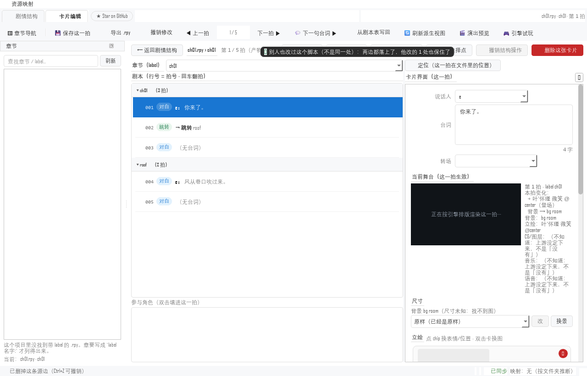

# 设计：别人也在改这个脚本 —— 原地小改的三路合并（第十四轮，2026-11-08）

> 第十一~十三轮补的是**退回去**（脚本的历史版本、留多久、占多大）。
> 这一轮补另一半：**写进去的那一刻**。
>
> 现场：图里点"删掉这条边"，plan 算好了"删掉第 4 行 `jump roof`"。就在算完
> 之后、写盘之前，文件被 VS Code / 另一个窗口 / 同步盘改了一行。从前的答案
> 只有一个字：**拒写**。用户的操作被退回，还得重新载入、重新点一遍 ——
> 哪怕别人改的那一行离我这一处有三百行远。
>
> 相关：`storygraph/story/write_gate.py`（`commit_text`）｜
> `storygraph/story/control_anchor.py`（锚点判定）｜
> `storygraph/app/source_line_delete.py`｜`storygraph/story/control_{route,branch}.py`｜
> 判据 `tests/test_merge_commit.py`｜`tests/test_merge_gate_coverage.py`

---

## 一、先验：五个问题，五个跑出来的答案

探针 `.pip-tmp/probe_r14_stale_edit.py`（静态普查 + 真跑一遍删源行）：

| 问的 | 量到的 |
|---|---|
| 全仓库有几处"读回来再写回去"的 `.rpy` 落盘点 | **18 处**（`style.apply` + `write_text_atomic`） |
| 其中"内容变了就拒写"的闸 | **17 处**有（整份比对 3 · 锚点行 3 · 撤销/回滚 9 · 自带指纹 2），**1 处没有** |
| 有没有一处用三路合并 | **0 处** |
| `write_gate.merge_text` 在生产代码里有调用方吗 | **没有** —— 2026-10-31 写好，只有测试在调 |
| 计划之后别人改一笔，`apply` 会怎样 | 三种相对位置**全部拒写** |

第四行是这一轮的起点：**做法半年就写好了，只是没人接线**。这正是本项目
最贵的那类缺口（"已实现、没接线"），比"没写"更隐蔽 —— 文档里写着"有自动
合并的候选"，而 `classify(..., base_text=)` 的调用方是 0。

第五行的三种相对位置（同一段文本，别人改在哪儿不同）：

| 别人改在哪 | 今天 | 三路合并能不能合 |
|---|---|---|
| 另一个 label 里（远处） | 拒写 | **能**：他的行留下、我删的行删掉 |
| 我删的那行**紧后面**（相邻） | 拒写 | 合不出来（判据故意保守，见 §五） |
| 我删的那行**本身**（同一处） | 拒写 | 合不出来（谁对谁错认不出） |

只有第一行该改。第二、三行拒得对 —— 这一轮把"拒"从**一律**收窄成**该拒的才拒**。

## 二、为什么"整份比对"这把闸过严

`if 读出来的全文 != 计划里的全文: 拒写` 是**最省事**的判据，也是最容易写对的。
问题在于它锁住的对象错了：用户要动的是**那一行**，闸锁的却是**整个文件**。

于是"别人在文件末尾加了一行注释"和"别人把我要删的那行改成别的东西"得到
同一个结局。前者是日常（同一个项目里总有人同时开着编辑器），后者才真该停手。

这条判据还把**同一份代码的两个方向**分成了两套：

```python
# graph/commands.py::DeleteSourceLineCommand.undo（撤销）
now, style = read_text(path)
if now != self.plan.new_text:
    raise RuntimeError('源文件在删除之后又被改过；为了不覆盖新改动，这次没有回滚')
write_text_atomic(path, style.apply(self.plan.old_text, source=path))

# 同一个类的 execute（正向）—— 从前没有这一句，只有"整份不相等就拒"
```

**撤销**早就有这道闸，而且措辞精确（"为了不覆盖新改动"）。这一轮把正向那一半
接上同一套判断，方向不同、判据同源。

## 三、做法：`commit_text` 的四种结局

`story/write_gate.py::commit_text(path, base_text, draft_text)` ——
**读现在这份 → 判定 → （必要时）合并 → 落盘**，写盘仍只走
`story.paths.write_text_atomic`（历史版本、原子替换、逐行换行还原都在那边）。

| 盘上是 | 结局 | 写法 |
|---|---|---|
| **草稿**（别人和我改得一模一样） | `same` | **不写**（不烧历史版本、不动 mtime） |
| **基线**（我算计划时那一份） | `wrote` | 照草稿写 —— 与从前逐字节一致 |
| 两边都改过、**不重叠** | `merged` | 写合并结果，`kept` 里说清保住了谁的那几段 |
| 两边都改过、**撞在一起** | `conflict` | **一个字不写**，`clash` 指出撞在第几行 |

`same` 为什么要单列：从前这种局面会被判成 `CONFLICT`（盘上 ≠ 基线）然后拒写 ——
比现在还差；而"照写一遍"会白烧一代历史版本、让 mtime 跳一下。第十轮给
`ext.registry.save` 立过同一条规矩（"一样就不碰"），这里照抄。

合并本身不新写一行算法：`merge_text` 早就在，判据也没动（`_touch` 决定能不能合）。
这一轮只是**让它有调用方**。

## 四、为什么合并可以**自动**做（不弹框）

被否决的三个备选：

1. **弹框问"要合并吗"** —— 这一族动作本来就是"点一下就写"（删一条边、补一个
   包装）。每次别人动过就多一个模态框，等于把"改一条"变成"改一条 + 点两次"；
   而 99% 的情况（他改在别处）合并是无损的。
2. **只报不写**（写一份 `.rej` 让人自己抄）—— 用户还得回去手动对一遍，
   等于没做，只是把工作推给人。
3. **写个 `.merged` 副本** —— 同一件事，还得手动替换 + 手动删副本。

选自动合并的三条前提（缺一条就不该自动）：

- **只有不重叠才合**：判据完全来自 `merge_text`，重叠就 `conflict`，没有"猜一个"；
- **合完必须说出来**：Toast 一句 + 日志一句（§八），不许静默改别人的文件；
- **每一代都重新读盘**：不缓存、不提前判定 —— 判定只发生在真要写的那一刻。

## 五、两道边界（第二道是踩出来的）

**① 相邻不猜。** 他插在我删掉那行的**下一行**，`_touch` 判"碰到"，于是 `conflict`。
看着像过度保守，但"删一行 + 紧贴着插一行"的先后顺序没有唯一解：把他那行放在
被删行的位置前面还是后面，产物都说得通。宁可让人二选一，也别猜。

**② 锚点只在它自己的 `label` 块里认。** 接线 / 断线 / 改接线这三处不合并整份，
靠 `control_anchor.locate()` 按内容找回"要动的那一行"。第一版写的是"全文唯一一处
就用它"，当场被自己的判据抓住：

```
ch01_control:  call ch01 / return      ← 我要改的是这一行
ch02_control:  call ch02 / return      ← 两个 return 一模一样
```

别人把 `ch01_control` 的 `return` 改掉了，全文只剩 `ch02_control` 那一处 ——
"唯一一处"于是把接线写到 **`ch02_control` 头上**（自己跳自己）。
判据 `test_route_anchor_changed_is_refused` 就是抓这个的。
现在：先按行号认，对不上就在**它自己那个 label 块**里认；块里找不到 = 那一行没了，
拒写并说"要动的那一行已经不在了"——**不拿全文别处的同名行凑数**。

## 六、撤销那道闸必须拿草稿比（这一轮最容易踩的坑）

`Commit.final_text` 是**盘上**的内容（合并结果），**不许**拿去当撤销的"期望内容"：

```python
# 第十四轮之前的写法（回执里 new_text = 计划要写的那份）
return {'ok': True, 'new_text': plan.new_text, ...}
```

撤销（`undo()`）的判据是"盘上还是**我写的那份**吗"。把 `final_text` 塞进
`new_text`，合并之后盘上恰好等于它 → 闸放行 → 把别人那几行一起抹掉。
所以回执里的 `old_text` / `new_text` 仍然是**计划里那两份**，`final_text` 只用来
报告；`Commit` 的字段注释里把这条写死了，判据用**真命令的 `undo()`** 钉住
（`test_undo_is_still_refused_after_a_merge`）。

## 七、接线清单

**走闸（`commit_text`，整份重算的那几个）**

| 入口 | 干什么 |
|---|---|
| `app/source_line_delete.apply_source_line_delete` | 删一条源边那一行（可能连整块删 / 补 `pass`） |
| `story/control_route.apply_control_init` | 在编排层末尾补 `X_control` 包装 |
| `story/control_branch.apply_control_branch` | 往 `X_control` 里插 / 删一个条件或菜单分支段 |

**认锚点（只动一行的那几个）**

| 入口 | 干什么 |
|---|---|
| `story/control_route.apply_control_route` | 接线：把 `X_control` 的收尾换成 `jump Y_control` |
| `story/control_route.apply_control_unroute` | 断线：删掉那一行，必要时补 `return` |
| `story/control_route.apply_control_edit` | 改接线：那一行换个类型 / 目标 |

**明确不走（各带理由，守卫里写死）**

| 入口 | 为什么 |
|---|---|
| `app/batch_edit.apply_plan` | 批量有预演：预览里的行号和内容必须与写下的逐字一致；合并会让"看到的 ≠ 写下的"，比拒写更坏 |
| `story/control_takeover.apply_takeover` | 一次写好几个文件（编排层 + 各章），要么全落要么全不落 |
| `story/choice_point.apply_choice_point` | 只在末尾追加，读写在同一次调用里；没有"计划时那份"可比 |
| `story/sg_transforms.apply` | 写的是工具自己的生成物（`# sg-gen` 指纹），下次生成本来就覆盖 |
| `assets/asset_extensions.apply_rename_patch` | 全局改名：一处对不上整份拒写，另有 `.bak` 回滚 |
| 撤销 / 回滚那 9 处 | **故意**不合并（合并会把别人新删的行又塞回去），但必须自带 `now != …` 那道闸 |

守卫 `tests/test_merge_gate_coverage.py` 用 `ast` 扫"真调了 `write_text_atomic`
的函数"，每一处都必须落进上面四类之一，否则红。

## 八、两句话，两个落点



第一版把完整的一句（110 字）直接交给 `notify`。截图一看，Toast 是**一行
`wordWrap=False` 的浮层**，正好裁在"界面要重新载入…"中间 —— 用户看到半句话，
而这半句恰好是最该看懂的半句。于是拆成两句：

- **短句** → `notify`（状态栏 + Toast）：`别人也改过这个脚本（不是同一处）：两边都落上了，他改的 1 处也保住了`
- **长句** → 窗口日志：`两边都落上了：他在第 8 行后面加了 1 行「$ flag = True」。那几处已经写进磁盘，界面要重新载入这一章才看得到。`

"界面要重新载入"不是客套：保住的那些行在**磁盘**上，图和卡片页仍是按载入时
那份画的（截图里第 002 拍还显示"跳转 roof"——它已经从盘上删掉了）。

## 九、判据与变异

`tests/test_merge_commit.py` **30 条** + `tests/test_merge_gate_coverage.py` **6 条**：

- **四种结局**（10）：照写逐字节一致 / `same` 不碰 mtime / 合并两边都在 /
  同处拒写且不动文件 / 相邻拒写（故意保守）/ CRLF+BOM 合完还是 CRLF+BOM /
  合并只留一代历史版本 / `history=False` 不建版本目录（写路与合并路都试）/
  非 UTF-8 拒写 / `as_dict` 可序列化；
- **说人话**（5）：`edits_between` 是公开的那一份 / 插入在开头 / 插入在第几行后面 /
  替换报区间 / 长行截断 / `merge_text` 仍是唯一判据；
- **接在家族上**（8）：删源行的合并与拒写 / 撤销在合并后仍被拦 / 补包装 +
  别人在中间加一行 / 写分支 + 别人在末尾加注释 / 锚点下移认回来 / 锚点被改拒写 /
  断线保住别人的行；
- **要吭声**（2）：真 `DeleteSourceLineCommand` → Toast 一句（≤40 字）+ 日志一句
  （带行号与"重新载入"）；没合并时一句都不发；
- **守卫**（6）：扫到的落盘点数量级 / 每一处都有答案 / 撤销自带闸 / 三处锚点共用
  一个判定 / 例外清单不 stale / 三个真入口接上了闸且把 `plan.old_text` 交了出去。

变异 `.pip-tmp/mutation_r14.py`：**16/16 抓住**（去 `same` / 写草稿不写合并结果 /
写基线 / 冲突照写 / 合并后不吭声 / `kept` 用草稿算 / 插入位置报错 / 相邻放宽 /
丢换行风格 / `history` 不传 / 锚点不认 label 块 / 锚点只按行号 / 退回整份比对 /
不给闸 base / 把合并结果当撤销期望 / 把闸拿掉）。

⚠ 变异自己抓出两个**判据的漏洞**（都是"看着绿、其实没测到"）：

1. **M10** 我第一次只测了"照写"那条路，改 `history` 从合并路传下去没被抓住
   → 补成两条写路都试；
2. **M16** 守卫原本用**子串**找 `commit_text`：把调用换成 `write_text_atomic`
   之后，函数体里的注释还写着 `commit_text`，守卫照样绿 → 改用 `ast` 取**调用名**。
   同一处还踩了第二个坑：方法体截出来是**缩进**的，`ast.parse` 直接
   `IndentationError` → 返回空集 → `undo` 整批从守卫眼里蒸发。两处都是
   "守卫自己躲开了检查"，比不检查更危险。

## 十、没做的（都记在真缺口里）

- **导出那条大路**（整份 / 增量 / 补丁）仍然"拒写"：那才是用户平时最常点的
  那一下（改一句台词 → 导出）。它要的是**拍级**三路合并（按 beat 对位，不是按行），
  工程量另算；
- **相邻冲突没有"人来点"的界面**：现在只有"拒写 + 重新载入"，没有"两版摆一起挑"；
- **`batch_edit` 的合并**：得先让预演能显示"合并进来的是哪几行"；
- **`control_takeover` 的多文件合并**：要么全落要么全不落，这条判据和合并天生别扭。

## 十一、顺手：`control_route.py` 差点撑爆 1500 行

锚点判定加进去之后，`story/control_route.py` 从 1493 涨到 1574 —— 技术债棘轮的
"超长文件"计数 +1，全量第一遍红的就是它（`test_tech_debt_budget`）。
把锚点判定抽成 `story/control_anchor.py`（`LABEL_LINE` / `label_block` / `locate`）
之后回到 **1495**。

搬的时候注意两件事：那个文件是 **CRLF**（逐行手改很容易顺手改成 LF，整份
1500 行都会显示成"改过"）；`_RE_LABEL_LINE` 从"定义"变成"从 `control_anchor`
导入的别名"，两处用它的地方（`_label_decl` / 锚点）必须仍指向**同一个**正则
（各写一份就是两条真源，迟早在"什么算 label 行"上分叉）。
