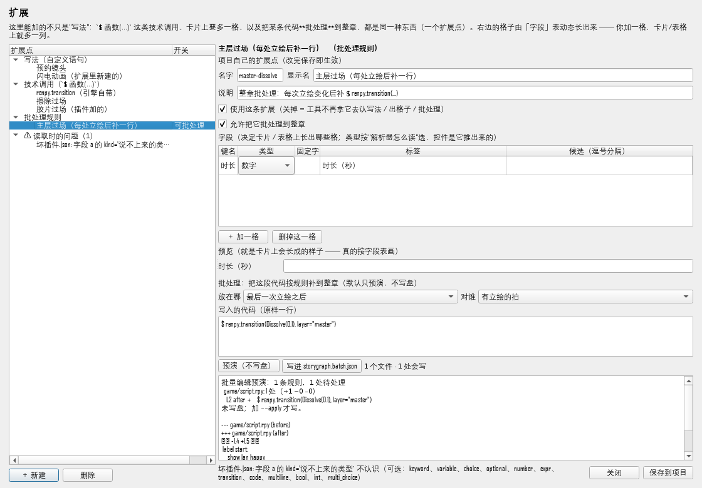
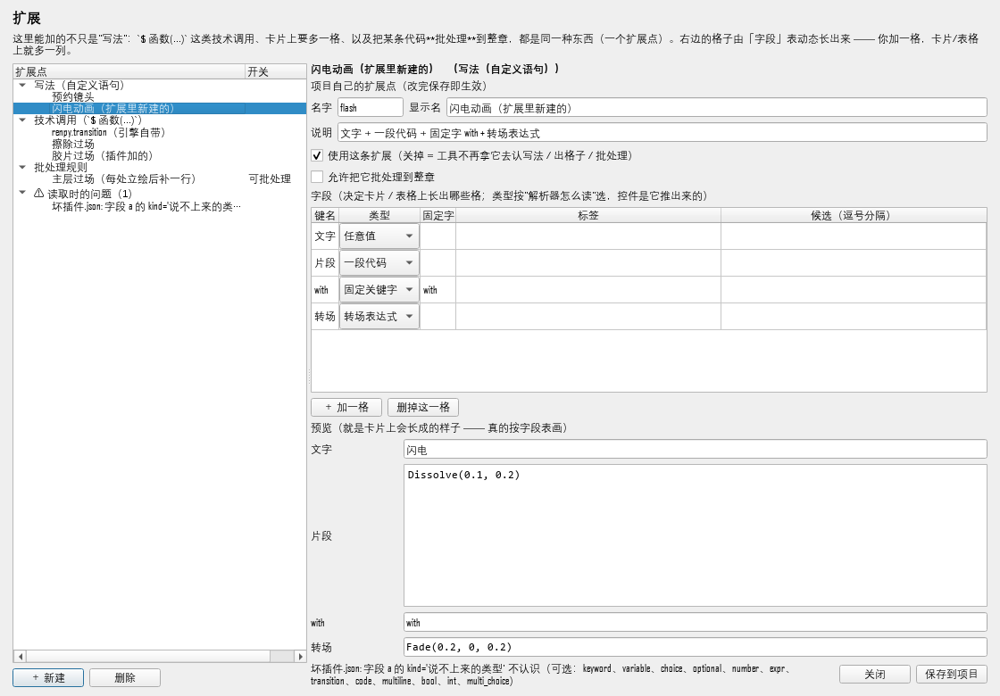
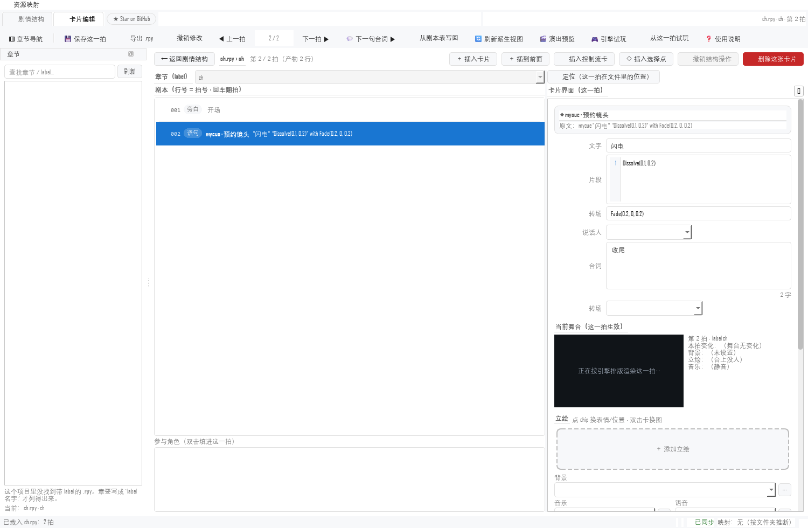
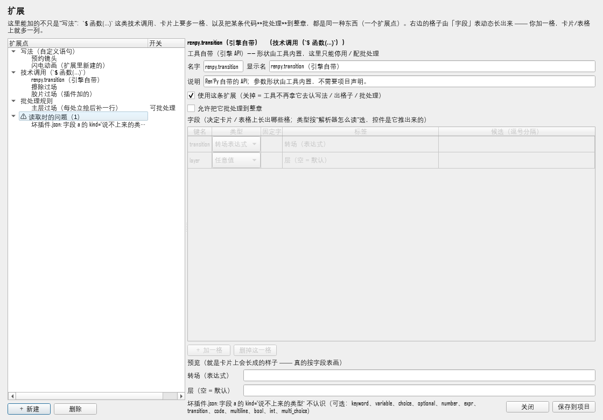
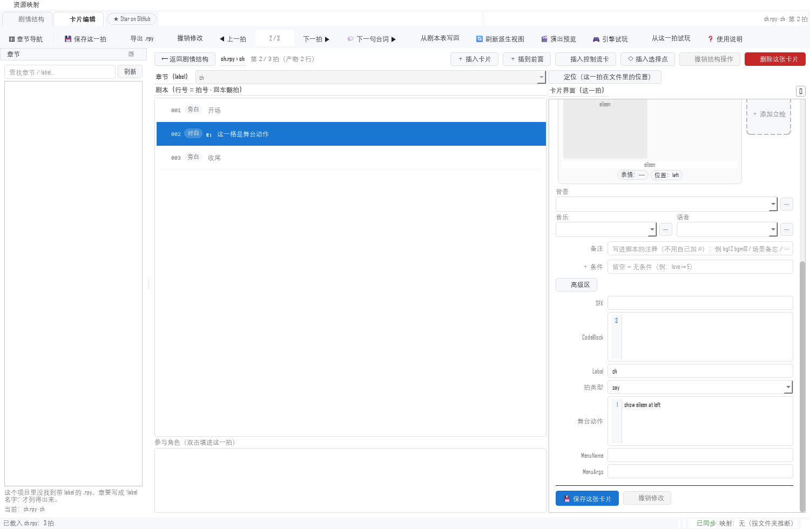
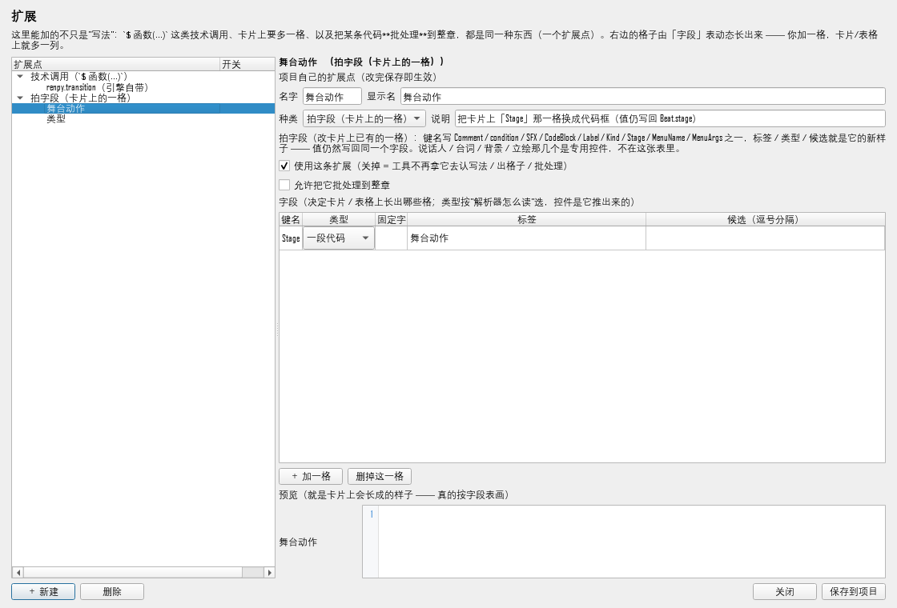
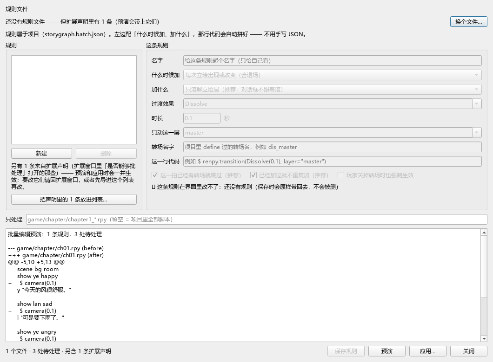
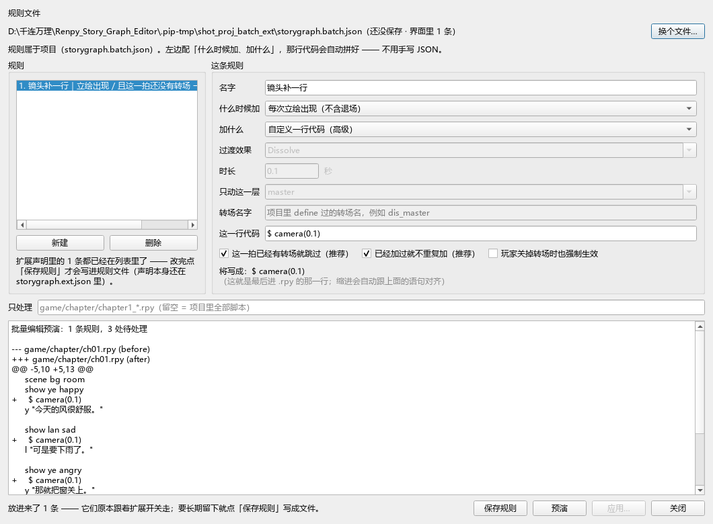
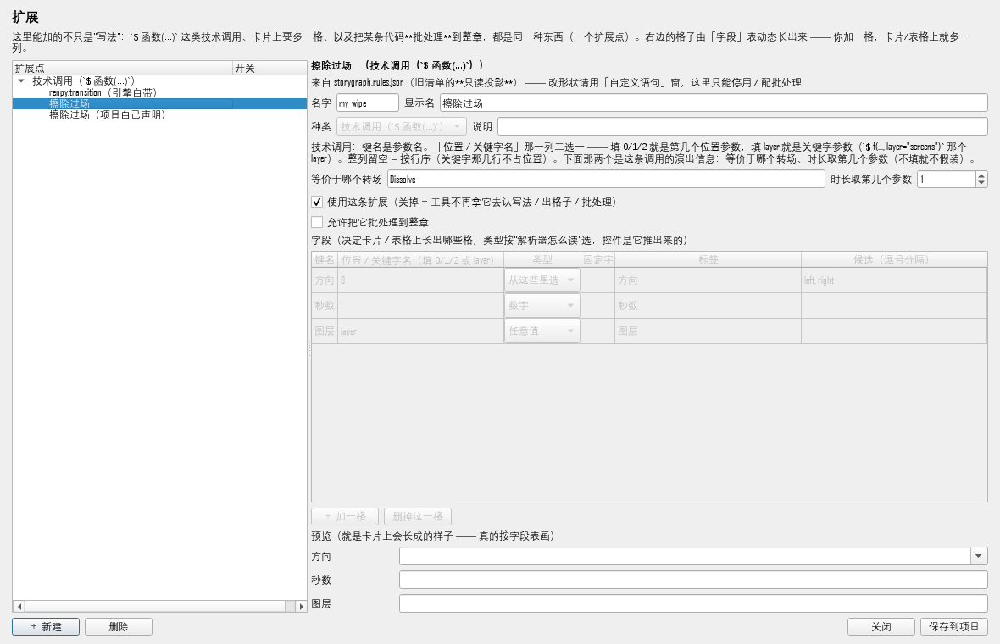
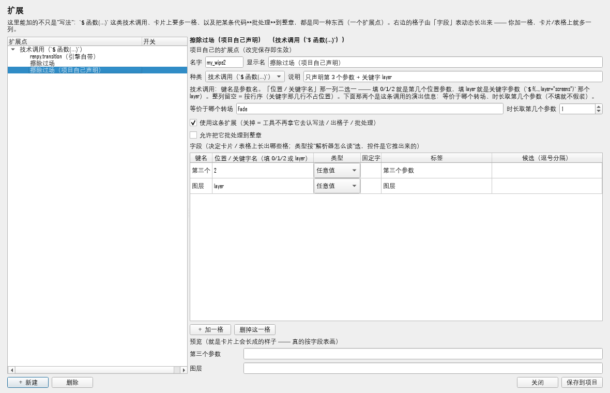

# 设计 + 落地：**扩展平台**（一个形状装下写法 / 调用 / 字段 / 批处理）

> 2026-11-07 · 本轮**已写代码**（不是纸面设计）。判据 `tests/test_ext_platform.py`（17 条全绿）。
> 触发：用户原话
>
> > "你现在根本没办法让我把 `$ renpy.transition(Dissolve(0.1), layer="master")`
> >  这条东西当作一个自定义写法输入进去，并自由让我决定它是否使用，是否能够批处理！
> >  你的工具 UI 根本就没有给我这个功能！而且**太散了**！
> >  我们首先要统一三套字段表，不能让它们互不相通，其次需要做一个动态的自定义界面！
> >  我们也要做支持插件这样的做法……必须要能够兼容一切自定义功能的改进……
> >  比如我想要在工具里加个新写法，加个批处理的功能一类的。"

## 一、先说一个事实核对

`$ renpy.transition(...)` 这一条**引擎侧是通的**：它有内置形状
（`story/spec_args.BUILTIN_CALL_SCHEMAS`），卡片上真会长出「转场（表达式）」
「层（空 = 默认）」两格（实测 `tools/_probe_call_card_shot.py`，
`values = {'renpy.transition·transition@0': 'Dissolve(0.1)', 'layer@kw': 'master'}`）。

**断的是另外三件**，也正是你点名的三件：

1. 你不能**自己**把一条 `$ 函数(...)` 声明成"我的写法"（旧的「技术调用」小窗要你背
   `转场@0; 层=layer` 这种语法，而且没有开关）；
2. 「是否使用」「是否能够批处理」**没有任何界面**——批处理至今只有 JSON；
3. 四种自定义是**四个入口、三套字段表**，互不相通。

## 二、一个形状：`ExtensionPoint`

`storygraph/ext/`（新包，纯 Python，**不 import Qt**）：

| 文件 | 干什么 |
|---|---|
| `ext/schema.py` | `ExtensionPoint` / `FieldSpec` / 校验（不认识的键**整条拒绝**） |
| `ext/registry.py` | 四个来源合成一份：内置 → `storygraph.ext.json` → 插件 → 旧 `rules.json`（只读投影） |
| `ext/plugins.py` | `<项目>/extensions/*.json|*.py` 发现与加载；坏插件不连坐 |

四种扩展点就是**同一个形状**，只是 `kind` 不同：

```json
{
  "id": "master-dissolve", "kind": "batch",
  "label": "主层过场（每处立绘后补一行）",
  "enabled": true,          // ← 是否使用
  "batchable": true,        // ← 是否能够批处理
  "fields": [ {"key": "时长", "label": "时长（秒）", "kind": "number"} ],
  "batch":  { "when": {"show": "sprite"},
              "insert": {"text": "$ renpy.transition(Dissolve(0.1), layer=\"master\")",
                         "placement": "after_last_show"} }
}
```

`kind` 只有四种（`statement` / `call` / `field` / `batch`）——**加第五种要先说清它
和这四种的关系**，这是刻意收窄的。

## 三、两个开关，而且**真的生效**

这是本轮最要紧的一条：开关不能只是 JSON 里写着 `enabled: false`。

`story/statement_registry.for_project` 现在会读 `storygraph.ext.json` 里被关掉的
扩展点，**从注册表里摘掉**：

```
关掉 mycue   → reg.match('mycue') is None   → 卡片不出格子、表格不出列
没关 my_wipe → reg.call_spec('my_wipe') 照旧
关掉 my_wipe → call_columns(reg, 'my_wipe') == []   → 那几格消失
```

判据：`test_disabling_a_point_really_hides_it_from_the_tool` /
`test_disabling_a_call_removes_its_columns`（**打到消费方**，不是断言 JSON）。

「是否能够批处理」走 `ExtensionRegistry.cue_rules()` → 直接产出
`app.batch_edit` 能吃的那份规则（`to_cue_rule`，形状校验仍归 `batch_edit`，
那一层是唯一真源）。关着 → 返回 `{}`，批处理不会偷偷跑。

## 四、"动态的自定义界面"

**三套字段表 → 一张映射表**：`ext/schema.py` 的 `FIELD_KINDS`
（`text / multiline / code / expr / number / int / bool / choice / multi_choice`），
落到 `ui_qt/dynamic_form.py` 的 `DynamicForm`（Unity 的 Property Drawer 的等价物）。

- 加一格 → 卡片 / 表格 / 预览同时多一格，**不用改界面代码**；
- 解析器的"格"（`pattern[].kind`：word/words/expr/transition/number/…）
  经 `field_of_slot()` **只在这一处**翻成控件类型；
- 必填没填、数字格写了非数字 → `DynamicForm.problems()` 当场报（界面自己的事，
  业务合法性仍归各自的层）。

## 五、插件

`<项目>/extensions/` 下丢文件就行：

```
extensions/项目擦除.json   →  {"extensions": [ {...} ]}
extensions/项目擦除.py     →  EXTENSIONS = [...]  或  def extensions(): return [...]
```

- 单个插件坏了 → 记进 `problems`，其它照常加载（判据 `test_a_broken_plugin_does_not_take_the_others_down`）；
- 插件加的扩展点同样受两个开关约束；
- `plugins.write_example()` 会写一份注释齐全的模板（界面上「新建」将来接它）。

## 六、界面

工具栏「🧩 自定义语句」右边多了一个 **「🛠 扩展」**（不替代前者：那个仍是"教一次"
最顺手的地方）。左树 = 全部扩展点（带来源：工具自带 / 旧清单 / 项目 / 插件），
右边 = 基本信息 + 两个开关 + **字段表** + 批处理 + 动态预览。




## 六点五、自适应：**"不管它是代码还是别的什么东西"**

用户 2026-11-07 追加的要求。落地成三条链路：

**① 声明词汇扩到 9 种**（`authoring/pattern.SLOT_KINDS`）
`keyword / variable / choice / optional` + `number / expr / transition /
code / multiline`。后五种**都是值格**（吃词方式与 `variable` 相同），
区别只在界面画什么控件。

⚠ 扩之前有一段静默误读：不认识的 kind 会被 `parse_pattern` **强制当成固定关键字**
——声明里写 `kind: "code"`，结果凭空多出一个叫 `code` 的固定词，那一格
**再也不出现**。这正是"写了但显示不出来"的一种成因。

**② 卡片按 kind 选控件**（`card_editor.SPEC_EDITOR_KIND`）
新增 `code` / `multiline` → 带行号栏的 `CodeEditor`。写回时**折成一行**
（它最终要折进语句头，多行参数会让语法坏掉 —— 与 `expr` 只给单行同一条理由）。
`_apply_spec_values` / `_get_value` 一并认了这个控件（它没有 `setText`）。

**③ 声明里没变成字段的部分也要看得见**
`别名 / 块体允许 / 渲染` 走 `docs` 拼在人话说明里（它们要改得回写
`rules.json` 才生效，做成可编辑格子会变成"改了没反应"）。



实测（`tools/_probe_code_field_card_shot.py`，临时项目）：

```
kinds  = [('mycue·文字@1','variable'), ('mycue·片段','code'), ('mycue·转场~with','')]
values = {'mycue·文字@1': '闪电', 'mycue·片段': 'Dissolve(0.1, 0.2)',
          'mycue·转场~with': 'Fade(0.2, 0, 0.2)'}
```

**已知边界（诚实写在这里）**：代码格里的值如果**不带引号又含空格**，
按空白切词的解析器会把它切成两个词（`Dissolve(0.1,` + `0.2)`）。
现在要么用引号包起来，要么把它声明成**子句**（`clauses` 的 `expr` 能吃到下一个
关键字为止）。"值格贪吃多词"是解析层的改动，下一轮单独做。

## 七、还没做（下一轮）
1. **卡片接入同一张字段表**（`card_editor` 的 7 个硬编码高级字段 + spec columns）
   —— 这是"统一三套字段表"的另一半，改的是 `card_editor` 而不是新包；
2. **批处理的预演按钮**（现在能配出规则，还没在界面上跑 `batch_edit.plan`）；
3. **回写 `rules.json`**：扩展点目前只写 `storygraph.ext.json`；旧清单仍是语句与
   批处理的运行时真源，两边要一次"同步"动作（避免两份真源长期漂移）；
4. 立绘子句（`behind/as/with/zorder`）的归宿（见 `设计_卡片检查器与自定义语句UI_2026-11-07.md`）。

## 八、判据

`tests/test_ext_platform.py`：

- 形状与校验（不认识的键整条拒绝、坏 kind 拒绝、slot→控件唯一映射）；
- 两个开关在**注册表消费方**真的生效；
- 旧清单投影只读、`ext.json` 覆盖旧清单、内置 `renpy.transition` 永远在；
- 插件 JSON / PY 都能装、坏插件不连坐；
- 落盘往返、坏 JSON 拒绝覆盖；
- 动态表单按字段表长、对话框四类齐全并能存出 `master-dissolve`。

全量（`python tools/fasttest/run.py`，2026-11-07 18:56 那轮）：
**9897 用例 / 9883 通过**，失败 10 条**全部**是既有问题（`SayTail` 列、
`card_rows.py` 重复定义、`docs/schema.json` 漂移、mapping 初稿、sync golden），
与本轮改动的文件（`ext/`、`dynamic_form`、`dialog_extensions`、工具栏一行、
`statement_registry` 的开关分支）没有交集。

⚠ 技术债棘轮（`tests/tech_debt_budget.py`）是**只许降**的：本轮为此把新代码里的
宽 `except` 全部收窄成元组、把 `_from_rules_manifest` 拆成两个小函数、
把 `ExtensionDialog.__init__` 拆成 `_build_*` 五段（原 162 行），
并顺手把 `dialog_calls` 里那处 `except …: pass` 与 `_from_cds` 的宽捕获收窄。
最终 long/complex/print/swallow/broad **一项没涨**。

## 九、第二轮：**探针抓到的三处断链**，以及"新建的写法真的生效"

> 2026-11-07 第二轮。判据 `tests/test_ext_runtime.py`（17 条）+ 原 `test_ext_platform.py`。
> 触发：上一轮交付时我自己写下的那句"下一件该做的事" —— 值格吞多词；
> 而真去验它时，先撞上的是三件更硬的事。

### 9.1 先验，不先修：`.pip-tmp/probe_ext_runtime.py`

上一轮的验收全部停在"界面/注册表"这一层：窗口能开、能存、开关能让注册表摘掉它。
**没有人验过"新建一条，工具会不会真的用"**。探针（临时项目，真跑）给出：

```
ext.json 里声明 mycue（字段 文字 / 片段 / with / 转场）
  → StatementRegistry.match('mycue') = None        ← ①
  → spec_columns(reg, 'mycue')       = []          ← ①
插件 extensions/闪电动画.json 里同一条
  → match('mycue')                   = None        ← ②
cue_rules() 产出 dict → plan_batch(...)
  → AttributeError: 'dict' object has no attribute 'when'   ← ③
```

也就是：**窗口回你"已保存"，解析器当没这回事；开关能开，引擎吃不下。**
（顺带还有一处：字段写 `kind: "keyword"` → 整条扩展点被丢掉，只留一句
`problems`，界面上看就是"我加的写法不见了"。）

### 9.2 断链① ②：`ext.bridge` —— 扩展点 → 运行时声明

新模块 `storygraph/ext/bridge.py`，纯函数：`ExtensionPoint` → `rules.json` 那套形状。

| 扩展点 | 变成 | 谁消费 |
|---|---|---|
| `kind: statement` | `{"name","pattern","label","docs"}` | `StatementRegistry`（`declared`） |
| `kind: call` | `{"head","columns"}` | 同上（`calls`） |
| `kind: batch` | `CueRule`（先过 `parse_rules`） | `app.batch_edit` |

`StatementRegistry.for_project` 里多了**第四个声明来源**，优先级落在列表顺序上：

```
扩展点（ext.json + extensions/ 插件） > rules.json > 宿主 CDS
```

同名时**以扩展点为准** —— "界面上改过的那份更新"，不是"改了没反应"。
来处也记得住：`RegisteredStatement.origin` 会是 `plugin:闪电动画.json` / `storygraph.ext.json`。

⚠ 这一条会**装载插件**（`.py` 要执行），所以只在 `for_project` 里调，而它按项目根
**缓存**；扩展窗口保存后会 `clear_cache()`（否则要重启工具才生效）。

### 9.2.1 但"能改"不等于"该改"：`override`（只带开关的记录）

接上这条线之后冒出一个**新的危险**，是这轮自己造的，得自己收：

旧清单那条投影是**有损**的 —— `name` 里的别名、`block`、`body.allows`、
`clauses`、`render` 都在 `pattern → 字段` 的转换里表达不出来。上一轮它无害
（改了不生效）；现在它生效了，于是"我在扩展窗口里点了停用"就会写出一份
**丢掉了别名和块体的新声明**，盖在真声明上。用户什么都没干，语义变了。

所以：工具自带的（`builtin`）与旧清单投影（`rules.json`）在窗口里**只能改两个开关**
（字段表置灰，说明里直接写"改形状请用「自定义语句」窗"），落盘时带
`override: true`、**不写 `fields`**；`ext.bridge` 见到它就不产出运行时声明 ——
形状仍归原处，开关记在这里。

装载顺序因此变成 **内置 → 旧清单投影 → ext.json → 插件**（旧清单在前，
`override` 记录才能**借用**投影的字段来显示：见 `registry._borrow_fields`）。

判据 `test_switching_a_legacy_statement_never_rewrites_its_declaration`：
停用 → 落盘只有 `{id, kind, enabled, override}`；重新启用后，别名 `cue`、
`block: yes`、`clauses`、两格 `pattern` **一个不少**。

### 9.3 断链③：批处理开关的产物，必须过引擎那道门

`app.batch_edit` 补两个口子：

- `parse_rules(raw_rules)` —— 一串原始 dict → `[CueRule]`（校验仍只有 `_parse_rule` 一份）；
- `rules_from_extensions(project_root)` —— 「开了批处理」的扩展点 → `([CueRule], problems)`。

扩展窗口的批处理区多了两个按钮：

- **「预演（不写盘）」** —— 按引擎口径跑 `plan_batch`，把 `format_plan` + `format_diff`
  摊在窗口里；
- **「写进 `storygraph.batch.json`」** —— 让这条规则真的进入批处理窗口
  （那个窗口只读这一份文件）。同 id **就地替换**（规则 id 必须唯一），
  现有文件读不出来时**拒绝写入**（不许半读半改，与 `load_rule_file` 同一条纪律）。

于是"开关 → 规则文件 → 批处理窗口 → 预演/写入剧本"是一条通的链：

```
开关打开 → 预演看到 1 处会写 → 写进 batch.json → 批处理窗口列出它 → apply 才动 .rpy
```


### 9.4 一套词：字段类型 **就是** 解析器的格类型

上一版有两套词：字段表说 `text / expr / code …`（控件名），声明说
`keyword / variable / choice …`（格类型）。`field_of_slot()` 在中间翻一次，
于是就出现了 9.1 末尾那种"翻不过去 → 整条丢掉"。

现在 `FieldSpec.kind` 是**语义类型**（`FIELD_KINDS` = `authoring.pattern.SLOT_KINDS`
＋ `bool / int / multi_choice` 三个只影响控件的细化），控件由 `widget` 推出来：

```
声明写什么  →  parser_kind（解析器怎么读）  →  widget（界面画什么）
```

`field_of_slot()` / `slot_of_field()` 互为逆运算，`multi / limit / group / choices /
required / literal` **往返不丢**（判据 `test_slot_and_field_round_trip_keep_every_detail`）。
旧文件里的 `kind: "text"` 仍然认（别名 → `variable`）；`word` / `words` 也一样，
其中 `words` 还额外意味着"这一格吃多词"。

界面上「类型」下拉从此是中文的九种（固定关键字 / 任意值 / 一段代码 / 转场表达式 …），
`with` 这种固定字在预览里是**灰字只读**（改它等于改语句名）。


### 9.5 值格吞多词：**这次是真的**

上一轮留的边界是"代码格里的值不带引号又含空格时，会被切成两个词"。修法不是加一条
特判，而是两件事：

1. **`multi` 默认打开**：`expr / transition / code / multiline` 四类格天生可能含空格
   （`Dissolve(0.1, 0.2)`），`slot_of_field()` 自动带 `multi`；
2. **代码格按"自由文本"计价**（`pattern_cost._tok_cost(..., free=True)`）：
   "不认识这个词"这一档从 2 降到 0 —— 否则"多焊一个词（2+2）"比"晾着（3）"贵，
   代价最小的解永远是**只吃一个词、剩下的晾着**。

⚠ 只降"不认识"这一档，**抢词仍然贵**（`COST_BORROW` 8）：
`dissolve… 泳装` 里 `泳装` 是别的格子的候选，代码格不许把它焊进去
（判据 `test_a_code_cell_does_not_steal_a_candidate_word`）。

实测（探针 + 判据都压着）：

```
mycue "闪电" "Dissolve(0.1, 0.2)" with Fade(0.2, 0, 0.2)   → exact=True
mycue  闪电  Dissolve(0.1, 0.2)  with Fade(0.2, 0, 0.2)    → exact=True
cells = {文字: 闪电, 片段: Dissolve(0.1, 0.2), 转场: Fade(0.2, 0, 0.2)}
```

### 9.6 端到端那一屏：只在 ext.json 里的写法，卡片上真出格子

`tools/_probe_ext_card_shot.py`（临时项目，**没有 rules.json**）：

```
kinds  = [('flash·文字@0','variable'), ('flash·片段','code'), ('flash·转场','transition')]
values = {'flash·文字@0': '闪电', 'flash·片段': 'Dissolve(0.1, 0.2)',
          'flash·转场': 'Fade(0.2, 0, 0.2)'}
```


### 9.7 读不进来的条目，现在**出现在树上**

以前只在状态栏一行小字。现在左树最后一个节点是「⚠ 读取时的问题（N）」，
展开就是每条的原因（哪个文件、哪个键、可选值是什么）。



### 9.8 仍然没做（下一轮）

1. **卡片的 7 个硬编码高级字段**接入同一张字段表（§七.1 剩下的那一半）：
   `ADVANCED_FIELDS` 是 `app.editor` 里的常量，改它要动卡片布局，不是在 ext 层能收的；
2. **批处理窗口里"导入扩展规则"**：现在扩展窗口能预演，`dialog_batch` 还只读
   `storygraph.batch.json`（两处规则来源还没在一个列表里）；
3. **回写 `rules.json`**：仍然"扩展点只写 ext.json"。好处是**只有一份运行时真源**
   （`ext.json` + `rules.json` 各管各的，同名以扩展点为准），代价是老的
   `rules.json` 用户在扩展窗口里改完会得到一条"覆盖项"而不是原地改。

### 9.9 判据与全量

`tests/test_ext_runtime.py`（20 条）＋ 原 `tests/test_ext_platform.py`（17 条），
外加 `test_package_layering` / `test_tech_debt_budget` / `test_complexity_budget`
三个棘轮（**一项没涨**）。

全量 `python tools/fasttest/run.py`（2026-11-07 19:29 那轮）：
**9923 用例 / 9909 通过**，9 失败 + 1 收集错误 —— 失败集合与上一轮**逐条相同**，
全部是本轮没碰过的地方（`SayTail` 列 ×2、`card_rows.py` 里同名函数、
`docs/schema.json` 漂移、资产 mapping 初稿、sync golden、`stage_thumb` 与
`ui_qt` 的 kind 推断各 1）。收集错误来自 `tests/test_card_rows.py` 的
**语法错**（`names:/n`）—— 那是**未跟踪文件**、并行工作者的在写稿子，我没动。

⚠ 本轮**没有提交**：工作树里有 ~196 项未提交改动（含别人的在写文件），
按"提交按文件分组、文档只追加"的规矩，留给收尾那一轮统一提交。

## 十、第三轮：**一份字段 schema 画两处界面**，以及 `field` 扩展点的消费方

第二轮把"一个字段是什么"收成了一套词（`FIELD_KINDS`），§9.8 里写着还剩一件：
"卡片的 7 个硬编码高级字段接入同一张字段表"。这一轮做完的就是它，外加一个
同类的断链。

### 10.1 先说症状：**两份"kind → 控件"互相打脸**

```
dynamic_form._make_editor      —— if 链，扩展窗口用
card_editor._spec_cell_editor  —— SPEC_EDITOR_KIND 字典 + if 链，卡片参数格用
```

同一份声明，`transition` 在卡片上是下拉、在扩展窗口里是输入框；`code` 在卡片上
带行号、在窗口里是纯多行。用户能看见的差别就是"定义出来的模块和卡片上那一格
长得不一样"，而它**不报错**。

现在只有一份：`ui_qt/field_widgets.make_editor`，控件由
`ext.schema.KIND_TO_WIDGET` 推出来（`SPEC_EDITOR_KIND` 已删）。读值/赋值同理
（`read_value` / `write_value`，按**控件类**分派，不按 kind 再判一遍）。

判据直接**比控件类**（`tests/test_ext_card_fields.py::test_the_two_screens_build_the_same_widget_class`），
这是这条链上唯一没法用"注释说是一致的"糊过去的地方。

### 10.2 `ext/card_fields.py`：卡片那几格的唯一一份声明

`Comment / condition / SFX / CodeBlock / Label / Kind / Stage / MenuName / MenuArgs`
的标签、类型、提示、灰字（新增 `FieldSpec.placeholder`）都在这张表里。
`card_editor._build_meta_area` 的 if/elif 全删了 —— 顺带删掉两个**死分支**
（`SayTail` 早搬去主区、`Notes` 早取消了，代码里还留着它们的构造）。

**专用控件的格不在表里**（说话人下拉 / 台词框 / 背景色块 / 立绘网格 / 台词转场）：
它们的"控件"是业务逻辑，一个 kind 描述不了。`BESPOKE_CARD_FIELDS` 把它们列出来，
覆盖它们会得到一句带原因的话，而不是悄悄没反应。

### 10.3 断链②：`kind: "field"` 以前**没有消费方**

和上一轮 `statement` 那个断链是同一类问题：窗口里建得出来、存得下、树上看得见，
卡片上什么都不会发生。

现在它的字段表就是"这一格的新样子"：

```json
{"id": "舞台动作", "kind": "field", "enabled": true,
 "fields": [{"key": "Stage", "label": "舞台动作", "kind": "code"}]}
```

打开项目 → `window_graph_page` 建卡片时把 schema 交过去 →
`BeatCardEditor.set_card_field_specs` 按新 schema **重建那几行**（旧值按名字搬过去）。
`Stage` 那一格变成代码框、标签变成「舞台动作」，**值仍然写回 `Beat.stage`**。



上面这张截图的项目里，`card_editor.py` 一行没改 —— 只有
`<项目>/storygraph.ext.json` 那份 JSON。同一屏里 `拍类型` 是下拉（候选来自声明）、
`舞台动作` 是代码框（带源文件真实行号）。

三条边界（写在 `ext/card_fields.py` 顶部，也在判据里）：

  · **只能改已有的格**：多一格意味着多一列要存、要导出、能撤销 —— 那是
    `story.beat_fields.COLUMN_SPECS`（改代码）的事，不是外观层能许的；
  · **专用控件不归字段表**（同上）；
  · **不许改成开关/多选**：卡片上的值都是字符串（要写回 `Beat`、要折进语句头），
    `Stage=True` 写不进脚本。写错 → `problems` → 控制台，卡片照旧画原来那格。

### 10.4 顺手补的：扩展窗口能选「种类」了

`_new_point` 从前写死 `kind='statement'`，于是**调用 / 拍字段 / 批处理在界面上
根本建不出来**（只能手改 JSON）—— 和"UI 根本没有给我这个功能"是同一句话。
现在右上有「种类」下拉，切到哪一类，字段表下面就换成那一类的"键名写什么"。



### 10.5 几条**旧判据**跟着改（并说明为什么）

  · `test_primary_fields_cover_the_daily_basics` 仍写着六个字段（不含 `SayTail`）——
    `SayTail` 2026-11-03 就搬去主区了（"with 是 say 的一部分"），判据没跟；
  · `test_advanced_is_collapsed_by_default` 断言高级区默认收起 —— 2026-11-07
    改成默认展开（Unity Foldout 口径）；
  · `test_the_kind_field_follows_the_speaker`（上一轮 known failure 里的
    "ui_qt 的 kind 推断"）根因也是默认展开：它靠 `_toggle_adv()` 把高级区**打开**，
    默认开着之后这一下反而关上了，于是 `Kind` 写了不落地（`FieldWriter` 按展开
    状态过滤）。改成"确认它开着"；
  · `test_the_advanced_toggle_is_short` 断言 tooltip 里有 `Notes` —— 那格早没了。
    现在断言的是"schema 里那几格的名字都在"，改字段表时它跟着走。

### 10.6 一套口径里**还没统一**的一处（记录在案）

`collect_fields()` 从 2026-11-07 起"收起高级区也照收"，但数据层
`FieldWriter._apply_advanced_fields` 仍按 `advanced_open` 过滤（"收起 ≠ 清空"，
有自己的判据 `test_advanced_fields_are_left_alone_when_collapsed`）。
实际影响很小（收起时人看不见、也编辑不到高级区），但**两层口径不一致**这件事
写进了 `collect_fields` 的注释 —— 别让下一轮的人以为已经统一了。

### 10.7 本轮自己踩的坑（判据当场抓到，都是真的）

  · **重建卡片行会抢焦点**：`set_card_field_specs` 一开始无条件重建，于是
    打开项目时（schema 根本没变）把高级区所有控件换了一遍 ——
    `test_page_switch_keeps_the_focus_inside_the_visible_page` 立刻红：
    `QApplication.focusWidget()` 变成了卡片里的某个 `QLineEdit`，不是控制台。
    修法不是改判据，而是**形状没变就一行都不动**（`ext.card_fields.signature`）
    —— 这同时修掉一个真问题：重建会把用户正在编辑的那一格换掉（光标 / 选区 /
    输入法全丢）；
  · **两处静态网各抓到一个手误**：`card_editor.py` 里多出一行
    `root.addWidget(self._adv_host)`（`test_no_undefined_names` 报
    "`root` 在本模块里不存在"），以及 `parse_field` 因为多了一句
    `x or ''` 让分支数 20 → 21、把技术债棘轮顶红（改成 `_text()` 之后降回 16）。

### 10.8 判据与全量

  · `tests/test_ext_card_fields.py`（**36 条**）：schema 不漂移、两处界面画出来
    的控件**同类**、`field` 扩展点（内存 / 真 ext.json / 插件来源）、关掉 / 写错
    名字 / 改成开关都要**说出来**、重建保值与"形状没变不重建"；
  · 原 `tests/test_ext_platform.py`（17）+ `tests/test_ext_runtime.py`（20）不变；
  · 三个棘轮：`test_package_layering` / `test_tech_debt_budget` /
    `test_complexity_budget` —— **一项没涨**（`complex_functions` 回到 195）。

全量 `python tools/fasttest/run.py`（2026-11-07 19:52 那轮）：
**9959 用例 / 9948 通过**，6 失败 + 1 收集错误，**本轮没有新增失败**，
且上一轮的失败**消失了 5 条**（`SayTail` 列、高级区默认收起、ui_qt 的 kind
推断、以及它们的连带断言）。剩下 6 条全是本轮没碰过的地方：

| 失败 | 是不是本轮引入 |
|---|---|
| `test_stage_thumb::test_it_sits_under_the_current_stage_heading` | 否（上一轮就在） |
| `test_no_duplicate_definitions`（`card_rows.py: compact_picker` 两次） | 否（并行工作者的在写文件） |
| `test_sync_pipeline_golden` | 否 |
| `test_asset_mapping` ×2（初稿布局） | 否 |
| `test_schema_single_source`（`docs/schema.json` 的「台词后缀」漂移） | 否 |
| `tests/test_card_rows.py` 收集错误（语法错 `names:/n`） | 否（未跟踪文件） |

⚠ 本轮**仍然没有提交**（工作树 ~200 项未提交改动里混着别人的在写文件）。

### 10.9 仍然没做（下一轮）

1. **批处理窗口里"导入扩展规则"**（§9.8 第 2 条，仍未做）；
2. **回写 `rules.json`**（§9.8 第 3 条，仍未做）；
3. **`placeholder` 还没串到语句参数格**：卡片参数格用的是按类型的默认灰字
   （`PARAM_PLACEHOLDER`）。要让"声明里写的提示"到参数格上，得让
   `slot_of_field` → `pattern` → `spec_columns` 这一段带上它 —— 那是解析器声明的
   形状，本轮不动；
4. **加新列**：`field` 扩展点只能改已有格（见 10.3 的第一条边界）。

## 十一、第三轮：**「是否能够批处理」那个开关，接进了真跑的那条路**

> 2026-11-07 第三轮。触发：上一轮 §10.9 第 1 条"批处理窗口里导入扩展规则"。
> 真去接的时候先撞上一个更硬的事实，和第一轮那三处断链是同一类。

### 11.1 先验：这个开关的产物，**没有一条真路在读**

```text
$ grep -rn "rules_from_extensions" storygraph/ tests/
storygraph\app\batch_edit.py:307:def rules_from_extensions(...)
tests\test_ext_runtime.py:305/318/327:  rules, problems = BE.rules_from_extensions(...)
```

生产代码里**零个调用方**。也就是说：

    扩展窗口里把「是否能够批处理」打开 → 界面「预演」能看到 diff（它直接问注册表）
      → 关掉窗口，去跑 `cli.py batch` 或开批处理窗口
      → 读的是 storygraph.batch.json / 界面上的规则 = **声明那条不在里面**

和 §9.3 那个"`cue_rules()` 产出 dict、`plan_batch` 要 CueRule"是同一条链上的
两个断口：先把类型接对（上一轮），这一轮才把**路**接上。

### 11.2 一条去重口径，只有一处：`merge_declared_rules`

规则有两个来源：文件/界面（能改、能审、能进版本库）与声明（"我开了一个开关"）。
同名时**留下文件那条** —— 否则"我明明改了文件怎么没生效"；但内容不同必须**说出来**
（那正是两份真源开始漂移的那一刻），且**不阻断**（把规则抄进文件之后整章跑不了，
比不报还糟）。内容一样就一个字都不说 —— 扩展窗口本来就有「写进 batch.json」，
写完之后两边都是同一份，再喊一遍就是噪音。

```python
merged, notes = merge_declared_rules(file_rules, declared)   # 纯函数
```

### 11.3 CLI：默认就带上；`--rule` 不带

`_cmd_batch` 以前要求**必须有** `storygraph.batch.json`。现在：

| 情形 | 行为 |
|---|---|
| 只有规则文件 | 和以前一样 |
| 只有声明（没有规则文件） | 能跑；`注：另有 1 条来自扩展声明（批处理开关；共 1 条规则）` |
| 两边都有 | 都跑；同 id 文件优先，写法不同打 `注：…写法不同…` |
| `--rule x.json` | **只**按这份来（写盘类操作不能因为项目里多了一个开关就多写几行） |
| 开关关着 + 没有规则文件 | 明确报"没有规则文件…也可以在扩展窗口里声明一条并打开「是否能够批处理」"，不静默跑个空的 |

一条声明坏了 → 进 `注：` 且其余照跑（坏插件不连坐的同一条纪律）。

### 11.4 批处理窗口：声明随计划跑 + 一键落成列表项

- `_rules_for_plan()` 末尾合并声明 → **预演/应用都带上**；
- 左栏多两行：`另有 N 条来自扩展声明…` 与「把声明里的 N 条放进列表…」；
- 放进来之后变成普通列表项（表单里能改，`save()` 能写成 `storygraph.batch.json`），
  提示随即改成"都已经在列表里了 —— 改完点「保存规则」才会写进规则文件"，
  按钮消失（别让人对着旧字再点一次）；
- 「换个文件…」= 显式指定 → 不并入声明，提示与「导入」按钮一并收起
  （与 `--rule` 同一条口径）；
- 只有声明时「预演」可点、「保存规则」灰着（保存写的是规则文件，没那么个东西）。



上面这一屏的实测输出（同一个计划，不是另算的）：

```text
规则文件存在？ False
声明条数 = 1 ｜按钮： 把声明里的 1 条放进列表… ｜预演可点： True
计划：文件 1 处 3 错误 []
状态栏： 1 个文件 · 3 处待处理 · 另含 1 条扩展声明
规则 id： ['镜头补一行']
```



### 11.5 顺手抓到的两个"能骗人"的小地方

  · **`CueRule.to_dict()` 带 `source`，而规则白名单里没有它**。`source` 是
    "从哪读进来的"（报错定位用），不是规则内容；把 `to_dict()` 直接存回规则文件
    会被**整份拒绝**。导入那一步先 `pop('source')`，并把这句写进注释；
  · **"规则文件"这三个字曾被显示成不存在的那份文件**：只有声明时，标签原样印
    `…\storygraph.batch.json`（文件根本没有），人会以为已经存过了；导入之后又印
    `（1 条）`（其实只在内存里）。现在分三种说法：`（还没保存 · 界面里 N 条）` /
    `（N 条）` / `还没有规则文件 —— 但扩展声明里有 N 条`。

### 11.6 判据

新 `tests/test_ext_batch_wiring.py`（**16 条**），钉的是"声明 → 真跑"这条路：

  · 引擎侧：合并（同 id 文件优先 / 写法不同要说 / 一模一样不说）；
  · CLI：只有声明能跑、开关关掉明确报错、`--rule` 不并入、两边都有一起跑、
    坏声明不连坐；
  · 插件：`extensions/*.json` 与 `.py` 各一条 → 直接进计划（核心一行没改）；
  · 窗口：只有声明能预演、导进列表且第二次不重复加、导完能存成规则文件、
    显式文件不并入、关掉开关时按钮全灭、坏声明在提示里说清而不弹异常。

原 `test_ext_platform.py`（17）/ `test_ext_runtime.py`（20）/
`test_ext_card_fields.py`（36）/ `test_batch_dialog*.py` / `test_batch_edit.py`
全部不变通过。

### 11.7 判据与全量

真机（不是判据里的夹具，是上面那个"只有声明"的项目）：

```text
$ python cli.py batch .pip-tmp/shot_proj_batch_ext --diff
注：另有 1 条来自扩展声明（批处理开关；共 1 条规则）
批量编辑预演：1 条规则，3 处待处理
  game/chapter/ch01.rpy: 3 处（+3 ~0 -0）
    L6 after  +     $ camera(0.1)
    ...
未写盘；加 --apply 才写。
```

全量 `python tools/fasttest/run.py`（2026-11-07 20:03 那轮）：

**9975 用例 / 9964 通过**，6 失败 + 1 收集错误 —— **和上一轮同一批**
（`stage_thumb`、`card_rows.py` 同名函数、`sync_pipeline_golden`、
`asset_mapping` ×2、`docs/schema.json` 的「台词后缀」漂移、未跟踪的
`tests/test_card_rows.py` 语法错），**本轮零新增失败**；用例数 +16 = 本轮新判据。

`FULL_RUN_R3: 9975 / 9964 passed / 6 failed + 1 collection error / 0 new`

三个棘轮（`test_package_layering` / `test_tech_debt_budget` /
`test_complexity_budget`）与 `test_no_undefined_names` **全绿**：新代码拆成
`_refresh_declared` / `_update_declared_ui` / `import_declared_rules` /
`merge_declared_rules` 几个小函数，没有一项涨到超预算（宽捕获一律不收）。

### 11.8 仍然没做（下一轮）

1. **`dialog_calls` 的参数列**仍是它自己的一行文字语法（`转场@0; 层=layer`）——
   同一个 `columns` 形状，扩展窗口用字段表表达、这里要人背语法；
2. **回写 `rules.json`**（§9.8 第 3 条，仍未做）；
3. **`placeholder` 还没串到语句参数格**（§10.9 第 3 条）；
4. **加新列**：`field` 扩展点只能改已有格（§10.3 第一条边界）。


## 十二、第四轮：**一条声明只有一个能改的地方**

> 2026-11-07 第四轮。触发：上一轮 §11.8 第 1 条"`dialog_calls` 的参数列仍是
> 它自己的一行文字语法"。真去改这一格的时候，先撞上一个更硬的事实 ——
> 和第一轮那三处断链是同一类。

### 12.1 先验：这扇窗保存时，写的是**读不到的那份文件**

探针 `.pip-tmp/probe_call_owner.py`（真装配，不是断言 JSON 形状）：

```text
① 打开时 (只有 ext.json): label='擦除过场' columns=[('方向','pos:0'),('秒数','pos:1')] origin=None
② 保存返回: ok=True path=storygraph.rules.json count=1
③ 保存后重新打开:        label='擦除过场' columns=[('方向','pos:0'),('秒数','pos:1')]   ← 改了没变
   rules.json 里现在写着：[{'head':'my_wipe','label':'我改的名字',…}]
④ 关掉扩展那条之后:       my_wipe = 认不出（注册表里没有）                            ← 手写那份也没了
```

`declare_calls` 返回 `ok: True`，界面照念"已保存 1 条技术调用"，而装配顺序是
「扩展 > rules.json」（`for_project` 里 `ext_calls` 盖掉同名条目）—— 写下去的那份
**永远读不到**；更糟的是把扩展那条关掉时，rules.json 里同名的那条会**跟着消失**
（`_ext_disabled` 按 head 摘掉）。

这不是"保存失败"，是"保存成功、没有任何效果"—— 比失败难发现得多。
第一轮那三处断链（窗口建得出、没有消费方）是同一类：**界面在替一条不生效的路回话**。

### 12.2 来处：调用声明也说得出自己住在哪

`_calls_from_manifest(raw, origin=…)`：每条调用带 `origin`
（`storygraph.rules.json` / `storygraph.ext.json` / `plugin:xxx.json`）。
`for_project` 给清单那条写**文件名**，`bridge` 给扩展那条写 `_origin_of(point)`。

顺手修掉一个"给机器看的字符串"：`bridge` 以前把项目自己的那几条写成
`origin='project'`（那是**装载分类**，不是文件），于是界面会说"来处：project"，
而分流那边也认不出它归扩展管。现在 `'project' → 'storygraph.ext.json'`，
插件照旧 `plugin:<文件名>`。清单写在 `game/` 下也照文件名认（`call_owner`）。

### 12.3 落点：`save_calls` —— 写进**生效的那个文件**，写不了就照实说

| `origin` | 归谁 | 保存时 |
|---|---|---|
| `storygraph.rules.json` / 没有 origin | `rules` | **写**（`declare_calls`，`replace` 语义不变） |
| `storygraph.ext.json` | `ext` | **不写**：写进去会被它盖住 → 返回 `blocked`，界面指路 |
| `plugin:xxx.json` | `plugin` | **不写**：插件文件是只读输入（可能还是别人的） |
| `builtin` | `builtin` | **不写**：形状是工具内置的 |

```python
res = SR.save_calls(root, calls)
# {'ok','path','count','written','deleted','blocked','reason'}
```

`replace` 语义保留 ⇒ "被扩展盖住的旧条目"**自动清掉**：它们不在可写集合里，
写盘时就不见了，并出现在 `deleted` 里。没有任何可写的、规则文件里也没有 calls 时
**不建空文件**（写盘也要有理由）。

### 12.4 参数那一格：从一行私有语法到一张小表

`storygraph/ui_qt/call_params.py`（新）：四列 = 参数名 / 显示名 / 位置（0、1、2…）/
关键字名。**位置与关键字二选一**，两个都填、位置不是数字、关键字名不合法、
两行抢同一个位置 —— 每一条都说清**第几行**，而且**留在窗口里**（关窗会让人以为存了）。
`SR.call_kw_ok()` 与清单读取共用 `_IDENT_RE` 这一条规则（界面说行、存进去没了，是最烦的一种）。

为什么不是"再写一行文本"：`转场@0` 把名字和位置压进一个字符串，写错时人分不清
错在哪；`层=layer` 又给 `=` 一个"这是关键字"的约定 —— 同一个符号学两次。
现在这两件事各占一列，`parse_columns_text` 退成**只用来生成摘要**。

### 12.5 归扩展 / 插件管的那几行：只读 + 指路


  · 新增「这条归谁」列（`规则文件` / `扩展` / `插件：xxx.json`）；
  · 归扩展 / 插件的那几行**格子设成只读**（让人改完才发现没生效是最坏的），
    tooltip 说清"形状住在别处"；
  · `edit_params` 对它们**不开编辑器**，当场指路；
  · 「这条在扩展窗口里改…」→ `ExtensionDialog(focus_id=…)` → `focus_on()` 落在
    **那一条**上（不是把人丢进四组树里自己找）；扩展窗口保存后 `changed=True`，
    调用窗口据此重新读一遍（不然显示的是旧形状）；
  · 选中一行就说清这一行能不能在这里改（省一次白改，也不让上一句提示挂在
    另一行上）。

### 12.6 同一条规则也管语句：`dialog_learn` 的守卫

同一个装配顺序对语句一样成立（`declared` 里 ext 盖 rules）。`_save_statement`
先看 `self._editing.origin`（`SR.statement_owner`，与 `call_owner` **同一份判据**）：

  · 归扩展 / 插件 / 内置 → **不写**、`_blocked_origin_note` 说清去哪改；
  · CDS（`ch01.rpy:12`）**仍然可教** —— 写进 rules.json 覆盖 CDS 本来就是
    "教工具认出脚本里已经注册的写法"。

这也把上一轮 §11.8 第 2 条"回写 `rules.json`"的**边界**定死了：回写只有在
"这条本来就归 rules.json"时才有意义；归扩展的那份回写进去，只多一个读不到的影子。
真正要"回写"的场景是"把扩展里配好的东西抄进 rules.json 当存档"—— 那是另一件事（§12.10）。

⚠ 写这句提示时踩了判据：字符串里带了 `**扩展优先**`，而
`test_no_markdown_markers_in_any_string_literal` 立刻红 —— **Qt 不渲染 Markdown**，
`**` 会原样显示。这是项目自己的网抓到的，不是人眼。

### 12.7 顺手修的一个"读错值"

`call_declarations` 以前用 `enumerate(字段)` 当下标：把关键字那行写在第一行，
第二个位置参数就被标成 `position: 1` → 工具去读 `args[1]`（第一个参数读不到、
第二个读错）。**不报错，只读错值**。现在位置只数位置参数
（`test_keyword_rows_do_not_shift_positions`）。

### 12.8 判据

新 `tests/test_call_save_routing.py`（**33 条**）：

  · 来处：扩展 / 清单 / `game/` 下的清单 / 插件各一条 + `call_owner` 的四个落点与兜底；
  · 落点：扩展那条保存被**挡住**且不建文件（**主判据**，对应 §12.1 的探针）、
    规则文件那条照旧能存、被盖住的旧条目**清掉**、插件那条也被挡、没有项目根时说清；
  · 参数表：`columns` ↔ 表格一一对应、新行拿下一个空位、五类坏行各说第几行、
    同一位置两行要拒、空表要拒、有错**不关窗**；
  · 窗口：两行的「归谁」、摘要只读、扩展行只读且 tooltip 说清、改参数后摘要与
    `built_calls` 一起变、点扩展行的「改参数」指路、一屏两行保存后**两边都说得清**、
    只有扩展行时一个字不写、「扩展窗口能停在指定那条」、「保存后 changed=True」；
  · 语句：`statement_owner` 把 CDS 当可写、扩展里那条**存不了**且不建文件、
    普通清单那条照旧能存。

原 `test_ext_platform.py`（17）/ `test_ext_runtime.py`（20）/
`test_ext_card_fields.py`（36）/ `test_ext_batch_wiring.py`（16）/
`test_autospec.py` / `test_spec_clauses.py` / `test_custom_statement_*.py`
全部不变通过。

### 12.9 判据与全量

全量 `python tools/fasttest/run.py`（2026-11-07 20:23 那轮）：

```text
FULL_RUN_R4: 10008 / 9997 passed / 6 failed + 1 collection error / 0 new
```

第一遍全量（20:20 那轮）抓到**两条真新增**，都不是偶发：

  · `test_no_markdown_markers_in_any_string_literal` —— 真的红（§12.6 末尾那句
    `**扩展优先**`），改掉字符串后通过；
  · `test_ui_cards::test_next_beat_touches_nothing_but_the_index` ——
    `worker 'gw10' crashed`，**单跑通过**：并行假失败，记在这里，别当回归。

修完重跑：用例数 **10008 = 上一轮 9975 + 33**（正是本轮新判据），剩下
6 失败 + 1 收集错误**全是既有的**：`stage_thumb`、`card_rows.py` 同名函数
（别人在写的文件）、`sync_pipeline_golden`、`asset_mapping` ×2、
`docs/schema.json` 的「台词后缀」漂移、未跟踪的 `tests/test_card_rows.py` 语法错。

四个静态闸门（`test_package_layering` / `test_tech_debt_budget` /
`test_complexity_budget` / `test_no_undefined_names`）全绿：`save_calls` 第一版
把 `complex_functions` 顶到 **196**（预算 195），拆出 `_split_call_owners` /
`_call_heads_in_manifest` 之后回到 **195**。

### 12.10 仍然没做（下一轮）

1. **扩展点还装不下一条调用的全部**：`effect` / `seconds_arg`，以及每格的**位置**
   （扩展里是"行的顺序"）。所以归扩展管的调用，那两格只能空着、位置也只能连着排。
   下一步给扩展点加调用元数据（`effect` / `seconds_arg` / 每格 `position`），
   那时 `dialog_calls` 对扩展那条才有可能**直接改**（无损往返），而不是只读 + 指路；
2. **`placeholder` 串到语句参数格**（§10.9 第 3 条，仍未做）；
3. **加新列**：`field` 扩展点只能改已有格（§10.3 第一条边界）；
4. **回写 `rules.json`**（§11.8 第 2 条）的**正当形态**：把扩展里配好的声明
   "抄一份存档进 rules.json"（这样删掉 ext.json 之后形状还在）。这件事要配
   "抄的时候说清哪些是抄的"，否则又是一份看不见的副本 —— 所以留给下一轮。

⚠ 本轮**仍然没有提交**（工作树里混着别人的在写文件，按 §AGENTS 的分组提交纪律，
等这一系列做完再按文件分组提交）。

## 十三、第五轮：最后一份字段表 —— 技术调用的 `columns`

> 2026-11-07 第五轮。触发：上一轮 §12.10 第 1 条"扩展点还装不下一条调用的全部"。
> 真去补的时候先跑探针 —— 探针抓到的东西比预想的多两条。

### 13.1 先验：四个探针输出

`.pip-tmp/probe_call_schema.py`（真装配 + 真 QDialog，不是断言 JSON 形状）。
项目里 `rules.json` 声明 `my_wipe`：`方向@0`（choice）、`秒数@1`（number）、
`图层=layer`（关键字），`effect: Dissolve`、`seconds_arg: 1`：

```text
① 投影字段: [('方向','variable'), ('秒数','variable'), ('图层','variable')]
   投影 position/kw: [('<没有这一位>', …), …]        ← 字段上根本没有这两格
   点上有 effect / seconds_arg 吗: (False, False)
   照这条复制成项目点 → columns: 方向@0, 秒数@1, 图层@2  ← 关键字变成第 3 个位置参数
② 字段表列: ['键名','类型','固定字','标签','候选（逗号分隔）']  ← 没有"位置"这一列
③ 新建的调用里写 {"key":"图层","kw":"layer"}:
   problems: ['字段里有不认识的键：kw'] → 这条还在吗: None  ← 整条扩展点消失
   只声明「秒数」→ 位置 0 → 读到 'left'（本该是 0.6）     ← 读错值，不报错
④ 舞台预览: transitions=[('declared-call','my_wipe2')] effects=[('unknown', 0.0)]
```

四句话，四件事：

1. **投影是有损的**：`kind` 一律 `variable`，`choices` / `position` / `kw`
   全丢，`effect` / `seconds_arg` 没地方放 —— 窗口里看到的形状不是真声明；
2. **字段表没有"位置"**：扩展窗口里新建的调用只能按行序，
   `layer=` 是唯一能表达关键字的私有记号；
3. **人按 `columns` 的词写会整条消失**：`kw` 不在字段词表里 → `ExtError`；
   而字号最小的那种错（"只声明第 2 个参数"）根本表达不出来，工具去读第 0 个；
4. **演出信息存不下**：扩展点里声明的转场没有时长，舞台预览标"认不出"。

### 13.2 `FieldSpec.position` / `FieldSpec.kw`：同一份 schema 的最后两位

```python
@dataclass
class FieldSpec:
    ...
    position: object = None   # 第几个位置参数（0 起）；None = 没指定
    kw: str = ''              # 关键字参数名；非空 = 不是位置参数
```

- `parse_field` 收这两位并**当场校验**：两个都填 / 负数 / 不是整数 /
  关键字名不合法 —— 每种都说清是哪个字段、错在哪；
- `to_dict` 只在真写了的时候落盘（`position is None` / `kw == ''` 不写），
  ext.json 不会平白多两个空位；
- `field_of_column()`（`columns[]` → 字段）与 `column_of_field()`（字段 →
  `columns[]`）**互逆**，判据拿六种列（位置 / 关键字 / 候选 / 必填 / 转场 /
  带标签）逐一往返；
- 老记号 `layer=` 仍然认（老文件一个字节不用改），但只在"去掉等号确实是
  合法参数名"时才翻 —— `图层=` 翻出来是非法的，会被 `_calls_from_manifest`
  整格丢掉，所以现在**按原名留成位置参数**，界面上看得见（§13.6 第 3 条）。

### 13.3 一处转换：`bridge` 只走 `column_of_field`

`call_declarations` 以前自己拼字典（`key.endswith('=')` 判关键字、`position`
自己数）。现在只有一句 `column_of_field(spec, position=位置计数器)`：

- 字段写了 `position` / `kw` → 按字段的；
- 都没写 → 按行序数**位置参数**（关键字行不占位置，上一轮 §12.7 那条修正保留）——
  老 `storygraph.ext.json` 的语义不变；
- 值的语义类型（`choice` / `number` / `transition` …）跟着列走，
  `choices` 也一起带（以前只带 `transition` 一种 `kind`、把 `choices` 丢了）。

内置形状（`renpy.transition`）与旧清单投影（`_call_point`）也改走同一个函数 ——
三条路一份映射，判据
`test_the_builtin_call_shape_knows_which_parameter_is_the_keyword`。

### 13.4 一条调用的演出信息也进 schema：`effect` / `seconds_arg`

`ExtensionPoint` 多了两位（只在 `kind == 'call'` 且非 `override` 时落盘）。
于是"在扩展窗口里新建一条转场调用"能说全三件事：

    参数形状（columns） + 等价于哪个转场（effect） + 时长取第几个参数（seconds_arg）

舞台预览由 `app.stage._declared_call_transitions` 按 `registry.calls` 演，
所以这两位一到，**扩展点里声明的调用就有了时长**：

```text
没写 effect 时:          effects = [('unknown', 0.0)]    ← 如实说"认不出"
写了 effect/seconds_arg: effects = [('dissolve', 0.6)]   ← 按声明的第 1 个参数取时长
```

### 13.5 窗口：第 2 列是「位置 / 关键字名」，多一行演出信息





- 字段表插了一列（`_FIELD_HEADERS` 从 5 列变 6 列，列号改成常量 ——
  第五轮插列时就是因为用数字下标才错的）：**数字 = 位置参数，名字 = 关键字**，
  两件事写在一个格子里，但**存下来是两位**（不是把 `转场@0` 又塞回一个字符串）；
- 这一列**只有技术调用能编辑**；写法的格子锁着（tooltip 说清为什么），
  已有的值原样留着（切种类再切回来不会丢）；
- 表头跟着种类换：调用是「位置 / 关键字名（填 0/1/2 或 layer）」，
  其余是「位置 / 关键字名（只有技术调用用）」；
- 种类是调用时多一行「等价于哪个转场」+「时长取第几个参数」（`QSpinBox`，
  「不按参数算」= -1）；换回别的种类时这两位清空（不留在文件里当噪音）；
- `_kind_note('call')` 重写：不再教 `layer=`，改说"那一列二选一，
  整列留空 = 按行序"。

调用窗口那边只改了提示与 tooltip：归扩展管的那行仍然**只读 + 指路**
（§12.5 的规矩不变），但指过去的地方现在**真的有位置和关键字可以改**。

### 13.6 顺手修的三处「不报错、只做错」

| # | 现象 | 根因 | 现在 |
|---|---|---|---|
| ① | 插件 / 手写 ext.json 漏写 `kind` → **整条扩展点消失** | `parse_field` 把空 kind 当"不认识" | 空 → `variable`（`FieldSpec` 的缺省本来就是它） |
| ② | 列里写 `required: true` 与不写完全一样 | `_calls_from_manifest` 不认这一位 | 只在真写了时带上（老文件不变） |
| ③ | `图层=`（中文键 + 老记号）被**静默丢掉** | 翻成 `kw='图层'` 后非法 → 整格跳过 | 按原名留成位置参数，看得见 |

三条都是同一类：**声明里写了，工具当没看见**。这类错最贵 —— 它不报错，只是
"我明明写对了，工具说认不出"。

### 13.7 判据

新 `tests/test_ext_call_schema.py`（**37 条**），每条都打到消费方：

- **一份 schema**：`position` / `kw` 存在且落盘；四类坏值各说清；`kind` 省略
  不再整条消失；`ES.kw_ok` 与 `SR.call_kw_ok` 同一份规则；六种列的
  `column ↔ field` 往返；老记号 `layer=` 仍认；中文 `图层=` 不丢；
  显式位置不依赖行序；没写位置时按行序（关键字不占位置）；
- **一处转换**：投影带全 `kind / choices / position / kw / required` 与
  `effect / seconds_arg`；照投影复制成项目点，columns 与原声明等价；
  内置 `renpy.transition` 的 `layer` 是关键字；
- **一处存储**：ext.json 的 `to_dict → parse_extension` 往返相等；
  `seconds_arg` 写错说清是哪条；`ExtensionRegistry.save` 之后重新装配仍是原形状；
  老 ext.json（`layer=`）装配出来仍是关键字；省略 `kind` 的声明能进注册表；
- **消费方**：位置 2 → 卡片读到第 3 个实参；关键字 → 读到 `layer=` 的值；
  同一格位置 0 → 1，读到的值从 `left` 变 `0.6`；扩展点写的
  `effect/seconds_arg` 进舞台预览（0.6）；没写 effect 时如实 0.0；
- **两扇窗**（主判据）：窗口里把位置格改成 `1` → 存盘 → 卡片读到 `0.6`；
  窗口里把位置格写成 `layer` → 存盘 → ext.json 有 `kw`、卡片读到
  `screens`；窗口里填效果 / 时长 → 存盘 → 预览 0.6；老文件存一次 →
  `kw` 出现、键名不动、装配意思不变；调用窗口那张小表产出的 `columns`
  与 `column_of_field` 一致（两扇窗同一份 schema）；写法的位置列锁着、
  演出信息那一行不显示。

### 13.8 全量

全量 `python tools/fasttest/run.py`（2026-11-07 20:36 那轮，**补开关之前**）：

```text
FULL_RUN_R5: 10045 / 10034 passed / 6 failed + 1 collection error / 0 new
```

（补完 §14 那个开关之后又跑了一轮，最终数字见 §14.4。）

用例数 = 上一轮 10008 + **37**（正是本轮判据）；失败的 7 条与上一轮**逐条相同**：
`stage_thumb`、`card_rows.py` 同名函数（别人在写的文件）、`sync_pipeline_golden`、
`asset_mapping` ×2、`docs/schema.json` 的「台词后缀」漂移、未跟踪的
`tests/test_card_rows.py` 语法错。

四个静态闸门（`test_package_layering` / `test_tech_debt_budget` /
`test_complexity_budget` / `test_no_undefined_names`）全绿；
`tools/audit_qt_signal_slots.py` 干净（没有"信号 bool 被当成参数"的接线）。

**变异验证**（判据真的能抓到改回去）：

| 改回哪里 | 红了几条 |
|---|---|
| `parse_field` 把空 `kind` 当"不认识"（第三轮的旧行为） | **22** |
| `bridge` 忽略字段自己的 `position` / `kw`（只按行序） | **10** |
| 窗口 `_table_fields` 不读「位置 / 关键字名」那一格 | **3** |

### 13.9 仍然没做

1. **`dialog_calls` 对扩展那条仍然只读**（§12.5 的规矩）。现在"指过去"那边
   真的能改位置 / 关键字了，但两扇窗**同时**编辑同一份 ext.json 这件事还没做
   （要做的话得先说清"哪个窗口说了算"）；
2. **`placeholder` 串到语句参数格**（§10.9 第 3 条）；
3. **加新列**：`field` 扩展点只能改已有格（§10.3 第一条边界）；
4. **回写 `rules.json`** 的正当形态（§11.8 第 2 条、§12.10 第 4 条）。

## 十四、第五轮补记：插件那条的「是否使用」也关不掉

> 2026-11-07 第五轮收尾。给"目标验收"写一个小探针时顺手跑到的 ——
> 不是本轮主题，但它是**要求 (3)「带启用开关」**的一部分，而且和第一轮那三处
> 断链同一类：**开关看着能关，关不掉**。

### 14.1 探针：三种来源，只有插件那条关不掉

`.pip-tmp/probe_plugin_switch.py`（把开关**真的**写进 `storygraph.ext.json`
当 `override` 记录，再重新装配）：

```text
① 插件声明的调用 + ext.json {"id":"my_wipe","enabled":false,"override":true}
   注册表里的调用 = ['my_wipe']                  ← 关不掉
   扩展点树上看得到吗 = [('my_wipe', True)]       ← 窗口里也显示"在用"
② rules.json 声明的那条：注册表里的调用 = []      ← 这条一直是对的
③ 项目自己 ext.json 声明的那条：[]               ← 这条也一直是对的
```

根因是**装载顺序**：`内置 → 旧清单 → ext.json → 插件`，插件在最后
`upsert(replace=True)`，把 ext.json 里那条"只带开关"的记录**整个换掉**。
于是"插件那条的『是否使用』"怎么写都没用；更糟的是窗口里对它**是开放编辑**的
（`_switch_only` 只认 `builtin` / `rules.json`），改完存进 ext.json 的字段
下一次装载会被插件**盖回去** —— 又是一次"保存成功、实际没变"。

### 14.2 修法：开关记录**留到插件之后再贴**

`ext/registry.py::_apply_switches(reg, records)`：ext.json 里
`override: true` 的那几条先记下来，**等插件装完**再贴回最终那条上，
只盖三样：

    enabled / batchable / batch        ← 开关
    形状（字段 / 标签 / 说明 / 种类）   ← 仍归插件

与 `_borrow_fields` 是同一条分工：**开关记在项目里，形状住在来源里**。

窗口那边把插件点归进"只能改开关"那一类（`ui_qt/dialog_extensions.py::_switch_only`）：

- 字段表、种类下拉**锁上**（形状是别人的）；
- 来源那一行说清「插件：xxx.json —— 形状归插件文件（别人的），这里只能停用 / 配批处理」；
- 保存只写 `override` 记录（`to_dict` 有闸门，**不抄形状**）；
- 「删除」按钮说清"删了它也会被装回来"，让人用开关 ——
  插件点删不掉这件事**当面说**，而不是点完发现它还在。

### 14.3 判据

新 `tests/test_ext_switch.py`（**11 条**）：

- 插件声明的**调用 / 写法**各一条：开关关掉 → 注册表里没有（探针 ① 的回归）；
  关掉再打开 → 回来；
- 开关只盖开关：插件的字段 / 标签 / `source` 原样留着（`enabled=False`）；
- 「是否能够批处理」也贴得上：插件点 + override 里 `batchable: true` →
  `cue_rules()` 有那条；不写 → 一条都没有；
- 窗口：插件点字段表 / 种类锁着、位置列不可编辑、来源说清是插件；
  勾掉「使用这条扩展」保存 → ext.json 里只有 `override` 记录（没有 `fields`），
  重新装配后注册表里没有了；
- 删除被挡：弹窗文字里有「插件」和「装回来」，文件不写、点还在；
- 老行为不退：`rules.json` 的投影仍借用字段来显示；项目自己的点仍能改形状。

### 14.4 全量

全量 `python tools/fasttest/run.py`（2026-11-07 20:43 与 20:45 两轮，数字一致）：

```text
FULL_RUN_R5b: 10056 / 10045 passed / 6 failed + 1 collection error / 0 new
```

用例数 = 补开关之前的 10045 + **11**（`tests/test_ext_switch.py`）；
两次全量的失败条目**逐条相同**（那 6 条 + 1 个收集错误都是既有的）。

四个静态闸门（`test_package_layering` / `test_tech_debt_budget` /
`test_complexity_budget` / `test_no_undefined_names`）全绿。

## 十五、第六轮：**存盘前先对表** —— 两扇窗改同一份 `ext.json`

> 2026-11-07 第六轮。§13.9 第 1 条留下的问题："两扇窗同时编辑同一份
> `ext.json` 这件事还没做（要做的话得先说清'哪个窗口说了算'）"。
> 这一轮先回答它：**按 id 说话** —— 你没碰的那几条归文件，你碰过的那几条
> 归你；同一条两边都碰过 = **停下来问**，不许默默盖。

### 15.1 先验：四个探针，四次都"保存成功、实际没变"

`.pip-tmp/probe_ext_conflict.py`（两份 `ExtensionRegistry` = 两扇窗，各自在
不同时刻读同一份文件，然后依次 `save`）：

```text
① 甲窗改 alpha 的名字，乙窗（更早打开的）改 beta 的开关
  A.save -> {'ok': True, 'count': 2}
  B.save -> {'ok': True, 'count': 2}
  实到：alpha.label = '甲'   beta.enabled = False
  → **丢了甲的改动**
② 甲窗新加 gamma → 存；乙窗跟着存一次
  乙又存了一次: [('alpha', '甲', True), ('beta', '乙', True)]   ← gamma 整条消失
③ 文件里有别人加的顶层键（手写注释 / 另一个工具写的）
  存完 顶层多出来的键: []                             ← 被悄悄删掉
④ 甲窗删掉 alpha → 存；乙窗只改 beta 的开关 → 存
  alpha 回来了吗： True                               ← 删掉的又回来了
```

四次都 `ok: True`、界面上什么也看不出来。根因一条：`save()` 是"拿我内存里
的整份稿子覆盖文件"，**从不看文件在这期间变没变**。

### 15.2 同一族的第三个：插件声明了同名那条，项目那份声明被删掉

`.pip-tmp/probe_ext_shadow.py`（项目 `ext.json` 声明 `my_wipe`，插件也声明
`my_wipe`）：

```text
① 窗口里看到的那一条：label='插件版擦除'  source='plugin:别人的插件.json'
   字段=['名字']
② 有没有一句"你的声明被盖住了"：problems = []          ← 一个字都没有
③ 什么都不改，直接存一次（比如顺手点了别的开关再存）
   save -> {'ok': True, 'count': 0}                    ← 整份文件被清空
   文件里现在是： []                                    ← 项目自己那条声明没了
```

第二个根因：`payload()` 只收 `source in ('project','plugin')` 的**活对象** ——
被插件盖住之后，文件里那条项目声明在内存里已经不是 `project` 了，于是下一次
保存**顺手把它删了**，还报"已保存 0 条"。

### 15.3 修法一：`save()` 从"整份覆盖"变成**三方合并**

`ext/registry.py::save`（合并逻辑拆成两个纯函数 `_merge_records` / `_compose`：
第一版整个写在 `save` 里 = 34 个分支，被 `test_tech_debt_budget` 当场点名）：

    base   = 我装载那一刻文件里的原话（`_baseline`，规范形）
    mine   = 我现在想写的（`records()`）
    theirs = **此刻**磁盘上的（`_read_ext_records`）

按 id 逐条判：

| 条件 | 取谁 | 含义 |
|---|---|---|
| `mine == theirs` | 一样 | 两边没分歧 |
| `mine == base` | **文件** | 我没动过 → 收进别人的改动（记进 `absorbed`） |
| `theirs == base` | 我的 | 别人没动 |
| 两边都变了 | **停下来** | `on_conflict='abort'`（默认）**一个字都不写**，把 id 列回去 |

`on_conflict` 只有三个值：`abort` / `mine` / `theirs`（别的值直接拒，不猜）。
返回里因此多了三样：

```python
{'ok','path','count','reason', 'conflict','conflicts','absorbed'}
```

`_base_for` 还分了一种情况：**手工搭出来的注册表**（`ExtensionRegistry(points=[...])`，
不知道文件里原来是什么）按"只对自己写的那几条有主张"处理 —— 文件里别人加的条目
照旧留着，同名的按我的来。这是它以前"整份写进去"的语义，只是不再顺手删掉自己
不知道的东西（`test_saving_from_the_registry_keeps_the_new_bits` 钉着）。

### 15.4 修法二：文件里别人的东西**原样还回去**

`_read_ext_records` 与装载用的 `_from_ext_manifest` 分工不同：那个是"读不懂就跳过
并出声"，这个是"文件里长什么样，就得能原样还回去"。

- 顶层**别人加的键**（`$comment` / `owner` / 另一个工具写的）只改
  `schema` / `extensions`，其余原样；
- **认得出的 id、读不懂的形状**（`kind: "nope"` 这种）原样写回，不替人删；
- **没有 id 的条目**按原顺序写回。

### 15.5 修法三：形状分来源，**开关跟着 id**

上一轮的分工是"开关记在项目里，形状住在来源里"，但 `_apply_switches` 只贴
`override` 记录。于是项目在**完整声明**里写 `enabled: false`，被插件盖住之后
就白写了。这一轮把口径改成**开关跟着 id 走**：

- `for_project`：`ext.json` 里**每一条**都在插件之后重贴一遍开关（不只是
  `override`），只盖 `enabled` / `batchable` / `batch`；
- `_record_of`：形状归别处（插件 / 内置 / 旧清单）时，写回去的是
  **"文件里那条 + 只换开关这三样"** —— 以前这里一个字都不写。

效果（探针 ④，修之后）：

```text
④ 在窗口里把被插件盖住的那条关掉（`_apply_to` 会置 override）再存
   文件里： my_wipe enabled = False  fields = ['方向','秒数']  override = None
   重装后： enabled = False   来源 = plugin:别人的插件.json
   → 形状还在、开关也记住了
```

同时 `_note_shadow` 让"两条声明撞了同一个 id"**出声**（进 `problems`，左树
⚠ 与状态栏都看得见），话也说清分工："**形状**以插件为准，项目那条**仍在文件
里**，开关仍按它算"。

### 15.6 窗口：存之前问，存之后**重读**


- `_save` 见到 `conflict` → `_ask_conflict`：弹窗列出**哪几条**被两边都改过，
  默认「否」= **这次不存**（文件保持原样）；「是」才用 `on_conflict='mine'` 重存。
  这里**刻意不先重读**：先 `_reread()` 会把"我的改动"换成文件版本，
  "以我的为准"就没有"我的"了。
- 存成功 → `_reread(keep)`：盘上重装 + 重建树 + 选中原来那条。合并可能把
  **别人加的**条目收进文件、也可能把**我删的**条目真删掉，内存和文件已经不是
  一回事；不重读，下一次保存就会拿更旧的内存去盖。
- 删除那条路同理：被冲突挡住时**不许装成功** —— 文件里那条还在，树上也得还在
  （`test_deleting_does_not_lie_when_a_conflict_blocks_it`）。

### 15.7 静态闸门抓到的一处：`checked` 被当成 `on_conflict`

`_save` 多了一个参数之后，`b_save.clicked.connect(self._save)` 会让 Qt 把
`checked=False` 当第一个实参喂进去 → 点"保存到项目"变成"on_conflict=False，
不认识，没存"。`tools/audit_qt_signal_slots.py` 当场抓到：

```text
storygraph\ui_qt\dialog_extensions.py:342  b_save.clicked → _save(on_conflict='abort')
```

改成 `lambda: self._save()`；`test_clicking_save_writes_the_file` 现在真的去
`button.click()` 一次再回读文件（这种"接线"问题只有真点一下才守得住）。

### 15.8 判据：`tests/test_ext_merge.py` **24 条**

按六组分：合并（4）/ 别人的东西（4）/ 冲突（5）/ 同名两条（4）/
程序化开关（2）/ 窗口（5）。全部打到**消费方**：文件内容、重新装配后的注册表、
窗口的树与状态栏、真按钮的点击。

**变异验证**（`.pip-tmp/mutation_r6.py`，每改回一处就复跑这一份判据）：

| 改回哪里 | 红了几条 |
|---|---|
| `save` 不问 `theirs`，直接写 `mine`（合并前） | **13** |
| `records()` 只收活的 `project` 点（合并前的 `payload`） | **17** |
| `_apply_switches` 只认 `override`（第五轮入口） | **1** |
| `_record_of` 对"形状归别处"什么都不写 | **2** |

### 15.9 全量

`python tools/fasttest/run.py`（2026-11-07 21:40，12 进程，2m18s）：

```text
FULL_RUN_R6: 10080 / 10069 passed / 6 failed + 1 collection error / 0 new
```

用例数 = 上一轮的 10056 + **24**（`tests/test_ext_merge.py`）。剩下的 6 条失败
+ 1 个收集错误与上一轮**逐条相同**，都是既有的、别人在写的东西
（`test_card_rows.py` 未跟踪文件语法错、`card_rows.py` 里 `compact_picker`
定义了两次、`stage_thumb`、`sync_pipeline_golden`、`asset_mapping` ×2、
`docs/schema.json` 漂移）。

这一轮里被静态闸门抓到的两处**是我自己引入的**，都已修：
`complex_functions 195 → 196`（`save` 34 分支）与
`b_save.clicked → _save(on_conflict='abort')`（§15.7）。

### 15.10 仍然没做

> **2026-11-07 第七轮已全部收口**（第 4 条拆两半：placeholder 做了，
> ield 加新列按 §16.6 的判断先不动）—— 详见下一节 §十六。


1. **把声明带走**（导出 / 导入一份可移植的扩展档案）—— 平台要能跨项目用，
   现在只能手工抄 `ext.json`；
2. **同一秒内两个进程同时写**：合并把窗口缩到"读→写"之间，但没有跨进程文件锁
   （`write_text_atomic` 只保证不写半截）。真要多人同时写，得先定一个锁协议；
3. **`rules.json` 那条写路还是"整份覆盖"**（`declare_statement` / `declare_calls` /
   `save_calls`）—— 同一个病、同一个药方，只是它不在这一轮的"扩展平台"范围内；
4. `placeholder` 串到语句参数格；`field` 扩展点加新列（§13.9 第 2、3 条）。

## 十六、第七轮：**把声明带走**、**跨进程锁**、**rules.json 也三方合并**

> 2026-11-07 第七轮。把 §15.10 四条"仍然没做"收口（第 4 条拆成两半，
> `field` 加新列那半按 §16.6 的判断先不动）。

### 16.1 先验：四条各验一次（`.pip-tmp/probe_r7_gaps.py`）

| # | 症状（真文件 / 真子进程） | 根因 |
|---|---|---|
| ① | `ExtensionRegistry` 上**没有任何**导出/导入入口；跨项目只能手工抄 `ext.json`，而且"同名覆盖还是追加"要人自己拿主意 | 平台没有"带走"这条腿 |
| ② | 两个进程同时 `save()`：顺序跑 A、B、C 三个改，最后文件里只剩**最后那个**改的那条（`A` 的标签被 `C` 覆盖），三次都 `ok: True` | 合并只挡"读得早"，挡不住"读得同时" |
| ③ | `declare_statement` / `declare_calls` 都是**裸 `Path.write_text`**（连原子写都不是）；`save_calls` 的 `replace=True` 语义是"这一份就是全部" → 界面存一次会把别人在另一个窗口加的调用**整条删掉** | 同一个病（整份覆盖），第六轮只治了 `ext.json` |
| ④ | `spec_columns` 里**没有** `placeholder`：声明里写的提示到不了卡片参数格，那格只有按类型的默认灰字 | 链路断在 `_column_entry` / `slot_of_field` |

### 16.2 ① 把声明带走：`storygraph/ext/archive.py`

档案是一份**独立文件**（建议后缀 `.sg-ext.json`），格式：

```json
{"schema": "storygraph.ext.archive/1", "name": "闪电动画包",
 "exported": "2026-11-07T23:10:00", "tool": "storygraph 1.0.0",
 "extensions": [ {"id": "my_wipe", "kind": "call", "fields": [...]} ]}
```

四条口径（都写进 `tests/test_ext_carry.py`）：

  · **只带形状真的住在文件里的**：`project` 与 `plugin:<文件>`。内置
    （`renpy.transition`）与旧清单投影的形状在别处；`override`（只带开关）
    带走是个空壳 —— 这两类**跳过并且说出来**（`describe_skipped()`，状态栏
    会写"3 条没带：形状在别处"），不静默少东西；
  · **不写绝对路径、不写项目名**：档案要能进 git、发给别人（判据里真的查
    了 `C:\` / `D:\` / 临时目录）；
  · **导入只有两方**（不是三方）：项目里没有 → 加；一模一样 → 什么都不做；
    同名不同形 → **冲突**，默认整份不导入（`replace` / `keep` 才动手）；
  · 档案坏一处（缺 id / 重复 id / kind 不认识 / 版本不认识）→ **整份拒绝**
    （"要么全对、要么完全不动"）。

窗口上就是两个按钮（`导出…` / `导入…`）。导入**只改内存**，落盘仍走
「保存到项目」那一步 —— 于是冲突照旧被 `_ask_conflict` 拦下，人可以
"先看冲突，再决定存不存"。

> 踩到的：`plugin:` 前缀。第一版写 `PORTABLE_SOURCES = ('project','plugin')`
> 判断用等号，插件那几条**被静默跳过**（判据 `test_plugin_declarations_are_portable`
> 当场红）—— 判据里那句注释就是为这个留的。

### 16.3 ② 跨进程锁：`storygraph/core/filelock.py`

协议（模块文档里有完整时序图）：

  · 锁文件放**用户缓存**（`…/StoryGraph/locks/<sha1(绝对路径)>.lock`），
    不写进用户项目（项目里多一个 `.lock` 会被当垃圾）；
  · 锁是**操作系统级**的（Windows `msvcrt.locking` / POSIX `flock`）：
    进程崩了、被 kill 了，锁由系统释放 —— 没有"僵尸锁"要人手动删；
  · 拿不到就等（默认 5 秒，20ms 一次），等不到抛 `LockTimeout`；调用方翻成
    人话（"另一个进程正在写，这次没有保存"），**不静默放行**；
  · 粒度是**一个文件**：`ext.json` 与 `rules.json` 的写者不互相排队；
  · **放锁 = 关句柄**（两平台都是），所以没有 `except` + 静默吞那一笔。

`ExtensionRegistry.save()` 的"读 theirs → 合并 → 写盘"整段进了锁：

```
进程甲 ──锁──[读 theirs → 合并 → 写]──放
进程乙 ──────────等────────────锁──[读 theirs（已经看到甲的）→ …]──放
```

判据 `tests/test_file_lock.py`（5 条，全部真子进程）：

  · 锁文件在缓存里、同一路径（含大小写/斜杠变体）映射同一把锁；
  · 子进程持锁 1.2s → 父进程等 0.2s 抛 `LockTimeout`（带上被锁的那个路径）；
  · 子进程结束后**立刻**能拿到（锁由系统释放，不靠"删锁文件"）；
  · **六个进程同时存 `ext.json`**：六条标签一条不丢（这条是这一轮的
    "前后对比"判据，见 §16.7 的变异表）。

### 16.4 ③ `rules.json` 也三方合并：`_edit_manifest`

四条写路（`declare_statement` / `declare_calls` / `save_calls` 用到的那两条、
以及 `attr_groups`）原本各写各的 `path.write_text(json.dumps(...))`。现在：

  · **一个入口** `_edit_manifest(project_root, edit)`：在锁里读 → `edit(path, data)`
    → `write_text_atomic` → 清装配缓存；
  · `edit` 可以抛 `_ManifestRefused`（坏 JSON / 这条本来就不在）或
    `_ManifestConflict`（两边都改过）—— 两种都**不写盘**，把原因/冲突 id 带回去；
  · `declare_calls(replace=True, base=None)`：`base` 给的是"我打开窗口那一刻
    文件里的 calls"。按 head 走 `core.threeway.merge_by_key`（**与 `ext.json`
    同一张决策表，只有一份实现**）：
    * 我没动 → 收别人的；别人没动 → 用我的；都在改 → 冲突；
    * **别人在我打开之后新加的**（不在 base、不在 mine）→ **留着**；
    * `base=None` → `base := theirs`，退化成本轮之前"这一份就是全部"的语义
      —— 老调用方（CLI 逐个装包）一个字不用改；
  · `save_calls(..., base=…)`：界面把**打开时读到的整份 calls** 传进来；
    冲突时窗口问「以界面为准覆盖 / 这词不存」（`_ask_call_conflict`，默认不存）。

判据 `tests/test_manifest_merge.py`（9 条）里有两条是真子进程同时教两条语句。

### 16.5 ④a `placeholder` 串到语句参数格

链路（每一步都有判据，`tests/test_param_placeholder.py` 9 条）：

```
FieldSpec.placeholder
  → slot_of_field / column_of_field（声明）
  → pattern[] / calls[].columns[]（落盘）
  → parse_pattern / _calls_from_manifest（读回来）
  → spec_columns / call_columns → _column_entry（列描述）
  → card_editor._spec_cell_editor(placeholder=…)（建控件）
  → QLineEdit.placeholderText()（人眼前）
```

老声明没有 `placeholder` → 一个字不多写，卡片照旧用 `PARAM_PLACEHOLDER`
按类型的默认灰字（判据钉着"没写提示时默认值仍然生效"）。

### 16.6 ④b `field` 扩展点加新列：为什么这一轮**不做**

§10.3 那条边界不是洁癖，是**导出**这一关过不去：

  · 卡片上多一格 = Excel 多一列（`story.beat_fields.COLUMN_SPECS`）、
    撤销快照多一项、Excel 导出门禁多一条；这些是**代码**里的一张固定表；
  · 更要紧的是：**这一列导出成什么**？本工具的产物是 `.rpy` —— 一列
    "自定义数据"没有对应的语句，导出时只能**静默丢掉**（违反铁律 7）；
    写进注释 / 写进「代码」列都是**替用户编语义**（违反铁律 9）。

所以现在能给的替代路是现成的那条：**声明一条自定义语句**（或一个技术调用），
它的参数格会自动出现在卡片上，并且**真的会导出**（`mycue 强度=7`），
Excel 里还会按章摊成动态列（`spec_fields`）。`field` 扩展点的职责仍然只是
"这一格长什么样"（标签/类型/提示），这也正是 §10.3 三条边界的原意。

真要加**基础列**（比如"情绪强度"这种不属于任何语句的策划字段），需要先定
一句口径：**它导出成什么**。三种可选，代价差很远：

| 口径 | 导出成什么 | 代价 |
|---|---|---|
| 不进 `.rpy`，只存 Excel | 无 | 违反"能带走"，导出必须**当场报出来**（不允许静默） |
| 折进「代码」列 | 一行 `$ 变量 = 值` 或注释 | 要定变量命名与作用域，还得防重复 |
| 绑定一条自定义语句 | `mycue 强度=7` | 其实等价于"声明一条语句"，不需要新机制 |

第三条就是现在的能力；前两条要用户点头才做（哪一个都不是"顺手加一列"）。

### 16.7 判据与变异验证

新增四个判据文件：

| 文件 | 条数 | 钉住什么 |
|---|---|---|
| `tests/test_ext_carry.py` | 17 | 档案格式 / 只带可带的 / 无绝对路径 / 冲突三种处理 / 坏档案整份拒绝 / 窗口两个按钮真落文件 |
| `tests/test_file_lock.py` | 5 | 锁文件位置 / 超时 / 释放 / **六进程同时存不丢改动** |
| `tests/test_manifest_merge.py` | 9 | 两进程同时教两条 / base 语义（保留别人新加的、删自己的）/ 冲突不写 / `mine` 覆盖 / 坏 JSON 拒绝 |
| `tests/test_param_placeholder.py` | 9 | 声明 → 落盘 → 读回 → 列描述 → 控件 五段都在 |

**变异验证**（`.pip-tmp/mutation_r7.py`，每改回一处就复跑对应判据）：

| 改回哪里 | 红了几条 |
|---|---|
| `ext.save()` 去掉跨进程锁（只剩三方合并） | **1**（六进程那条：标签丢了） |
| `declare_calls` 忽略 `base`（退回"整份覆盖"） | **2**（别人新加的被删 / 我的删除被挡） |
| `_edit_manifest` 不拿锁（读→写之间敞着） | **1**（六进程同时教六条，只落了部分） |
| `_column_entry` 不传 `placeholder` | **2**（列描述 + 卡片那一格） |
| `archive` 只认 `project`（插件声明静默跳过） | **1**（插件导出那条） |

五处全被抓住 —— 这一轮的判据不是"跑绿了"，是"改回去会红"。

### 16.8 仍然没做（留给下一轮）

1. **`declare_attr_groups` / `remove_statement` 的"读"还没进锁**：这两条是
   "先读、再（在锁里）写"，单条操作窗口只有毫秒级；`declare_statement` /
   `declare_calls` / `save_calls` 已经是"锁里读→改→写"。收进 `_edit_manifest`
   要处理"删整个文件"和"先备份"两条支路，第八轮做。
2. **`field` 扩展点加新列**：见 §16.6 —— 不是"再加一个字段"，而是
   "这一列导出成什么"，需要先定口径。
3. **档案里带插件的 `.py`**：现在只带走 `ext.json` 形状的声明（项目声明 +
   JSON 插件）。`.py` 插件是**代码**，带走它等于分发可执行文件 —— 不做。
4. **导入的撤销**：导入 + 保存之后没有 `undo`（要退就靠 `save()` 的 `.bak`）。
   要不要进 `undo` 栈等"导入"真的被用起来再说。

### 16.9 全量

`python tools/fasttest/run.py`（2026-11-07 22:56，8 进程，2m17s）：

```text
FULL_RUN_R7: 10130 / 10125 passed / 0 failed / 2 skipped / 2 xfailed
```

用例数 = 上一轮的 10089 + **40**（`test_ext_carry` 17 / `test_file_lock` 5 /
`test_manifest_merge` 9 / `test_param_placeholder` 9）。

第一遍有一条 `test_graph_canvas::TestEdges::test_right_click_on_an_edge_emits_the_edge_menu`
**worker crash**（`gw2` 挂了，不是断言失败）；单跑通过 —— 与 2026-11-07 第四轮
那条 `test_ui_cards` 同一个现象，**并行假失败**，不当回归。

提交：`6743980`（锁 + 三方合并）/ `3da2ef9`（档案）/ `05e1ccc`（placeholder）/
`d4ae4fc`（文档与记忆）。

## 十七、第八轮：清单的**删**与**备份**也进锁

> 2026-11-07 第八轮。收 §16.8 第 1 条：`remove_statement` / `declare_attr_groups`
> / `clear_attr_groups` / `reset_declarations` 的"读"还在锁外。

### 17.1 先验：这条洞是真的（`.pip-tmp/probe_r8_gaps.py`）

做法：把 HEAD 里的旧模块**原样**拷成 `storygraph/story/_old_registry_probe.py`，
同一份探针分别跑旧模块与新模块 —— 差别只有那个 import。

| 场景（真子进程） | 旧模块 | 新模块 |
|---|---|---|
| A 六条路同时各加一组词组 → 最后剩几组（该 6） | **1** | 6 |
| B 甲删掉"最后一条"（顺带删文件），乙同刻在加一条 → 六次里乙那条还在几次 | 6（没撞上） | 6 |

A 是**看到的**症状：六个人同时存，最后只剩最后一个 —— 和第五轮 `ext.json`
那次一模一样，只是发生在 `attr_groups` 上。

B 是**推出来的**窗口，不是这回撞上的：旧路先读、再备份（一次文件 I/O）、
再 `unlink`。乙只要在"读"与 `unlink` 之间写进来，那份文件就被甲删掉 ——
窗口只有备份那 1ms，六次没撞上不等于不存在。锁给的是**保证**，不是运气：
现在"读→判断→备份→删/写"是一段。

### 17.2 `_edit_manifest` 多了两个出口

原来它只会"原子写"，删与备份在四条路的函数体里各写一遍。现在：

```python
result, changed, delete = edit(path, data)   # 2 元组也行（delete=False）
```

  · `delete=True` = **这次的结果是把文件删掉**（`statements` 空且没有别的段
    时才这样）—— 判据也跟着走"删完文件不存在了"这条路；
  · `backup=True` = **真的改了才备份**，而且备份的是**锁里读到的那份文本**
    （`_backup_manifest(text=…)`）。从前是"读完文件再读一遍去备份"：两次读
    之间别人写进来的东西会出现在备份里，却不在被删掉的那份里 —— 那就不叫
    "改之前"；
  · 备份失败 = `_ManifestRefused`，**一个字节都不写**（没有备份就不许删）；
    写失败时把备份路径带进原因里（"备份在 …"），与从前一样能找回；
  · `refuse_word` 只改"坏清单"那句人话的动词：新增/覆盖说 `拒绝覆盖`，
    删除/清空说 `拒绝改动`（对用户来说那确实是两件事）。

`_write_manifest_after_removal`（"剩空段就删文件"那个小函数）删掉了：
判断挪进 `edit`，删文件由 `delete` 出口做 —— 一件小事只有一处实现。

### 17.3 四条路收进来

| 函数 | 从前 | 现在 |
|---|---|---|
| `remove_statement` | 锁外读 → 锁外备份（再读一遍） → 写/删 | 锁里读 → 备份那份文本 → 写/删 |
| `declare_attr_groups(replace=True)` | 锁外读 → 再读一遍备份 → 整段替换 | 同上；`replace=False` 的 merge 不备份（行为不变） |
| `clear_attr_groups` | 同上 | 同上 |
| `reset_declarations` | 同上 | 同上 |

对外返回的键**一个没少**（`ok/path/removed/deleted_file/backup/count/reason`），
只多了一处：备份路径现在来自锁里的那一份，所以"备份 == 被改之前"是**成立**
而不是"大概成立"。界面没改一行（`dialog_learn` 那四处早已在显示 reason/backup）。

### 17.4 判据与变异

`tests/test_manifest_locking.py`（7 条）：

  · 六进程同时加六组词组 → 六组都在；
  · 六进程同时各删一条语句 → 六条全没；
  · 删"最后一条"（连文件一起删）与"同刻加一条"并发 → 六轮里新加的那条**每轮都在**；
  · 有别的配置时只清那一条、文件保留；没改动 → **不产生备份**；
  · 备份目录写不了 → 四条删/清/重置**全部拒绝**且文件一字不动；
  · 没有清单时 `clear_attr_groups` 如实说"没有"。

**变异验证 4/4 抓住**（`.pip-tmp/mutation_r8.py`）：

| 改回哪里 | 红了几条 |
|---|---|
| `_edit_manifest` 不拿锁（`with` 换成 `if True`） | 2（六组只剩 1 组 / 六条里还剩 5 条） |
| 备份失败不再拒写（`saved = ''`） | 1（"备份失败要拦住"那条） |
| "删掉整个文件"改回"写回空清单" | 2 |
| 没改动也备份 | 1 |

（条数是不带 `-x` 复跑的：`-x` 会停在第一条，只能证明"抓得住"，说不出"抓住几条"。）

### 17.5 全量

`python tools/fasttest/run.py`（2026-11-07 23:26，12 进程，2m14s）：

```text
FULL_RUN_R8: 10136 / 10132 passed / 0 failed / 2 skipped / 2 xfailed
```

用例数 = 上一轮 10129（不含那条并行假失败的 worker crash）+ **7**
（`test_manifest_locking`）。

### 17.6 仍然没做

1. **`field` 扩展点加新列**：仍卡在"这一列导出成什么"（§16.6 三种口径），
   要用户点头；
2. **导入的撤销**：导入 + 保存之后没有 undo（退路是 `save()` 的 `.bak`）；
3. **档案里带插件的 `.py`**：那是分发可执行文件，不做；
4. **`save_calls` 开头那次 `_call_heads_in_manifest` 读**：只用于"什么都没写
   就不建空文件"的短路，读旧了也只会**少写**（不会覆盖别人的），留作已知；
5. 拍级三路合并 / G1 行为级契约进 CI / G2 引擎版本适配层（老账，另开）。

### 17.7 顺带核掉一条老账：`resolve_layers` **不需要**"组里第一个"兜底

记忆里记着"`resolve_layers` 只认显式 `default`、无'组里第一个'兜底（未修）"。
这轮对着引擎源码核了一遍（`D:\千连万理\storygraph_fork_sdk\renpy\common\00layeredimage_ren.py`）：

  · `Attribute.default` 的文档原话：*"If True, and no other attribute for the
    group is selected, this attribute is."*；
  · `Attribute.get_displayable()` 只回答"这个属性在不在当前属性集合里"——
    没有"取组里第一个"的分支；
  · 组条件（`if_all` / `if_any` / `if_not` / `when`）不成立 → 整组不叠。

所以工具现在的行为（没命中、没 `default` → 跳过该组）**与引擎一致**，
缺的不是兜底。真要给它加"组里第一个"，预览会画出一层引擎不会画的东西 ——
那才是 bug。记忆里那句已改成"这是引擎语义，别加兜底"。

## 十八、第九轮：两个**死按钮**，与导入的退路

> 2026-11-07 第九轮。先说一件不好听的：上一轮（§16.7）表格里写着
> "窗口两个按钮真落文件" —— **那句话是错的**。修它，再把 §16.8 第 4 条
> （导入没有 undo）补上。

### 18.1 先验：按钮点下去什么都没发生

`.pip-tmp/probe_r9_dead_slots.py`（AST 扫 `connect(lambda ...: self._x())`）
一跑就出来两条：

```text
[死槽] dialog_extensions.py:348 -> self._export_archive
[死槽] dialog_extensions.py:351 -> self._import_archive
```

类里定义的是 `export_archive()` / `import_archive()`（**没有下划线**）。
第二个探针 `.pip-tmp/probe_r9_slot_exception.py` 问的是"这会不会把进程炸掉"：

```text
PySide6 6.11.1 Qt 6.11.1
AttributeError: 'PySide6.QtWidgets.QPushButton' object has no attribute …
点完之后进程还活着 —— 只打了 stderr，界面表现为"没反应"
```

**为什么上一轮的判据没抓到**：那一节测的是"方法干了什么"
（`dlg.export_archive()`），**没有一条真的去点按钮**。第二跳
（按钮 → 槽 → 方法）从来没被走过。判据全绿，功能全死。

### 18.2 修：连对名字，lambda 仍然得留

```python
b_export.clicked.connect(lambda: self.export_archive())
b_import.clicked.connect(lambda: self.import_archive())
```

包一层 lambda 不是多余：直接 `connect(self.export_archive)` 会把 Qt 的
`checked=False` 当第一个实参喂进 `path`（`path='False'`，写出一个叫 False 的文件）
—— 同一个坑上一轮在 `_save(on_conflict=...)` 那里踩过一次。

### 18.3 判据：点一下，加一条源码守卫

  · `tests/test_ext_carry.py` 多了**两条真点击**（`btn.click()`）：
    导出真的落文件、导入真的进项目 —— 这才是"按钮能用"；
  · `tests/test_dead_slots.py`（2 条）：把 `storygraph/ui_qt/*.py` 里所有
    `connect(lambda ...: self.<名字>(...))` 的名字收集起来，必须在包里声明过。
    ⚠ 它挡的是"名字**整个不存在**"这一类；同名 `def` 写在别的类里也会通过
    （跨模块 mixin 就长这样，如 `GraphPageMixin.insert_card` 住在
    `window_card.py`），所以它**不能替代**"点一下真生效"那种判据。

### 18.4 撤销：为什么是"整份恢复"，不是"再存一遍旧内容"

最省事的写法是"把旧内容塞回注册表再 `save()`" —— **不行**：`save()` 是三方
合并，它按 id 判"谁改过"，撤销就会变成"部分撤销 + 一堆冲突提示"，那是**又一次
编辑**，不是撤销。所以另开一条路：

```python
res = reg.save(root)              # res['undo'] = {'path','before','after'}
ER.restore_manifest(res['undo'])  # 锁里比对，然后整份放回去
```

三条底线，每条都有判据：

  ① **逐字节**：`before` 是用 `newline=''` 读出来的**原话**（`_read_text_exact`），
     写回去也走 `write_text_atomic`（同样 `newline=''`）。CRLF 的文件恢复回去
     还是 CRLF —— 用 `read_text()` 读会悄悄换成 LF，用户 `git diff` 一眼就看见
     满屏改动，那不叫"恢复原样"；
  ② **不覆盖别人**：磁盘上那份必须还是 `after`（**我写下去的那份**）才动手。
     别人在这之后改过 / 删了 → **一个字都不写**，如实说"没有撤销"
     （旧版本仍在同目录 `.bak` 里）。比对与写在**同一把锁**里；
  ③ **也拿锁**：撤销是写，和"别人的保存"排队。拿不到 → `locked: True`，
     说"稍后再试"（与 `save()` 同一套说法）。

`before is None`（保存前本来没有这份文件）→ 撤销 = **把它删掉**，与第八轮
"清单空了就删文件"同一条口径：不留一份空清单当遗迹。

两处实现上值得记的：

  · `_read_ext_records(path)` → `_parse_ext_records(text, name)`：`save()` 现在
    **在锁里只读一次**，同一份字符串既用来对表、又原样存成撤销材料。
    读两次的话，"对表用的那份"和"撤销回到的那份"可能不是同一份；
  · **快照放在窗口里，不放注册表**：`_reread()` 每次保存后都会换一个新的
    注册表对象（它要丢掉旧内存、按磁盘重装），挂在注册表上的材料会被自己
    弄丢。窗口的 `self._undo` 活得比它久；
  · **没改字节的保存不给材料**（连点两次保存 → `undo is None`）。给了材料会
    让人以为退得回去，其实前后一样；那一份**保留上一次的**（文件没变，
    上一份照样成立）。

### 18.5 判据与变异

新增/新增条数：`tests/test_ext_undo.py`（14 条）、`tests/test_dead_slots.py`
（2 条）、`tests/test_ext_carry.py` 17 → 19（+2 真点击）。

| 大类 | 钉住什么 |
|---|---|
| 撤销材料 | `before` 就是保存前那几个字节；文件原本不存在 → `None`；没改字节 → 无材料；第二次保存的材料指向第一次 |
| 恢复 | **CRLF 逐字节**；保存前没有文件 → 删掉；别人改过 → 拒绝且一字不动；被删掉 → 不许变回来 |
| 真并发 | 别人持锁 → 等不到就**拒绝**（不是硬写）；两个进程同刻撤销同一份 → **恰好一个成功**，另一个看到"文件已不是我写的那样" |
| 窗口 | 没存过盘时按钮是灰的；导入后按钮亮、`status` 明说能退；**点按钮**退回原样（树/内存也回去）；别人改过后点它 → 拒绝且按钮灰掉 |

**变异验证 5/5 抓住**（`.pip-tmp/mutation_r9.py`）：

| 改回哪里 | 红了几条 |
|---|---|
| 导出按钮改回 `self._export_archive()` | 2（死槽守卫 + 真点击） |
| 导入按钮改回 `self._import_archive()` | 2 |
| 撤销时不比对"磁盘上还是不是我写的那份" | 2（被别人改过 / 被别人删掉） |
| 撤销不拿锁（读→比→写 敞着） | 2（等锁那条 + 双进程恰好一个成功） |
| "保存前没有文件"改回"写一份空清单" | 1 |

⚠ 这一轮的改法还被**三处仓库级守卫**当场逮住（都不是功能错，是账）：

  · `test_code_health`：不许 `except ...: pass`。第一版在"文件已经不在"那里写了
    `except FileNotFoundError: pass`，红；改成 `swallow(...)` 之后
    `test_tech_debt_budget` 又红（`swallow_calls` 1293 是**棘轮**，只许降）——
    最后用 `path.unlink(missing_ok=True)`：既没有静默吞，也不多一个计数；
  · `test_tech_debt_budget` 的 `complex_functions`（195）也是棘轮：把"要不要说
    能退回"那句塞进 `import_archive` 多两个分支，正好越过"单函数 >20 分支"
    那条线（196）→ 抽成 `_undo_hint()` 一句小函数，回到 195；
  · 两条合起来的教训：本仓库的"不许涨"是真数出来的 —— 多一条 `swallow`、
    一个函数多两个分支都算**一次有意的决定**，不是格式问题。

### 18.6 全量

`python tools/fasttest/run.py`（2026-11-07 23:48，12 进程，2m19s）：

```text
FULL_RUN_R9: 10154 / 10150 passed / 0 failed / 2 skipped / 2 xfailed
```

用例数 = 上一轮 10136 + **18**（`test_ext_undo` 14 / `test_dead_slots` 2 /
`test_ext_carry` 的 +2）。

### 18.7 仍然没做

1. **`field` 扩展点加新列**：仍卡在"这一列导出成什么"（§16.6 三种口径），
   要用户点头；
2. **撤销只有"一次"、且只在窗口活着的时候**：关掉扩展窗口就没了（退路仍是
   `.bak`）。要活得更久就得在用户缓存里记一份"上次写了什么" —— 那是另一个
   决定（记多久、几个项目、算不算隐私），没做；
3. **撤销不做重做**：退回去之后想再导一次，就再导一次（导入是幂等的）；
4. **档案里带插件的 `.py`**：那是分发可执行文件，不做；
5. **`save_calls` 开头那次 `_call_heads_in_manifest` 读**：只用于"什么都没写
   就不建空文件"的短路，读旧了也只会**少写**（不会覆盖别人的），留作已知；
6. 拍级三路合并 / G1 行为级契约进 CI / G2 引擎版本适配层（老账，另开）。


