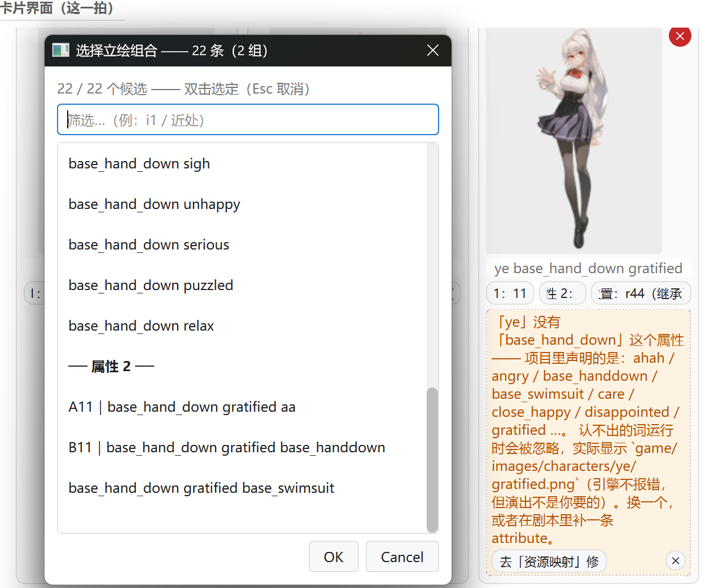
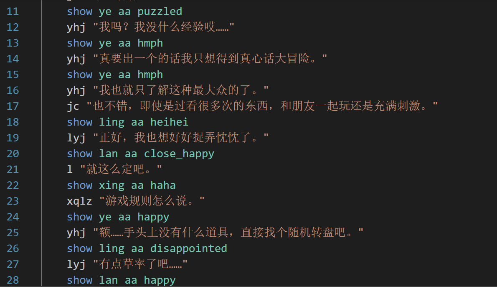
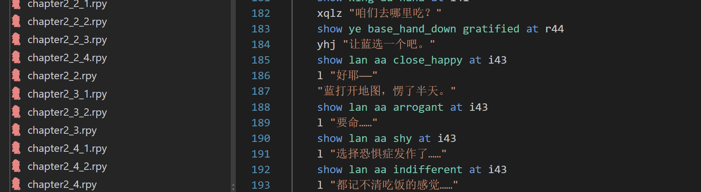

# 诊断报告：`ye base_hand_down` —— 能跑、却报“没有这个属性”，候选还修不好

> 2026-11-05 · 真机 `D:\千连万理\sr_general` 只读诊断（**没有改你的 `.rpy` 一个字节**）
>
> 一句话结论：**不是工具读错了你的代码，也不是引擎少声明了什么。**
> 是 `chapter2_5.rpy` 里两行手写拼写错误（`base_hand_down`，比正确写法多了一个下划线），
> 再叠加“跨章继承 + 候选把不认识的词原样保留 + 体检 W111 对 layeredimage 全线误报”三层放大，
> 才变成你看到的“明明有、却检测不到 / 属性 2 明显错 / 只有部分修好”。

---

## 0. 先回答你问的五个问题

| # | 你的疑问 | 结论 | 证据在哪 |
|---|---|---|---|
| 1 | chapter3_1_1 的代码明明是 `show ye aa puzzled`，卡上却是 `base_hand_down gratified`，是不是它识别错了？ | **没有读错本章。** 这张卡是**跨章继承**的“沿用”卡：chapter3_1_1 开头 6 拍还没写 `show ye`，台上站着的是上一章 chapter2_5 最后一条 `show ye base_hand_down gratified at r44`。本章第 11 行才第一次 `show ye aa puzzled`。 | §3 的 `entry.state.actors` 与 `inherited=True` 真机输出 |
| 2 | 为什么“明明是有的”却报没有？ | 项目里**有**的是 `base_handdown`（ye）和 `base_hands_down`（xing）；`base_hand_down` 是把两者混写的**第三种**写法，`layeredimage ye` 里没有它。Ren'Py 的 image name 区分大小写、也区分下划线。 | §2 的命名表 + `declared_attrs_of('ye')` 输出 |
| 3 | 游戏能跑，怎么会报？ | **能跑正是它危险的地方**：`layeredimage` 对不认识的属性**静默忽略、照常渲染**，不抛异常。实际只画了 `gratified.png`，少了 `base_handdown.png` 这一层——立绘的“手放下”姿势没了，但游戏不报错。 | §5 的 `resolved_paths_of` 对比 |
| 4 | 属性 2 为什么全是 `base_hand_down …`？为什么选不出正确组合？ | 候选是**从当前这张图**（错的那张）出发逐维替换的。`base_hand_down` 不属于任何一个维度，被当成“不认识的额外词”原样保留；**22 条候选每一条都带着它**，正确的 `ye base_handdown gratified` 永远拼不出来。 | §4 的 22/23 条候选逐条输出 |
| 5 | 为什么体检没抓住？为什么只有部分修好？ | 体检的 W111 **对每个 layeredimage 组合都报**（这一章 36 条问题里 27 条是 W111，连 `lan aa shy` 这种完全合法的行也报），真正的错词被淹没。卡片黄条能抓到，但它的按钮指向“资源映射”，修不了拼写；候选又只能追加、不能去掉坏词——所以点一下只是“看起来好了”，黄条还在。 | §6 的 W111 清单 + §7 的 23 张卡统计 |

---

## 1. 三张截图其实是同一件事

### 1.1 你给的截图



- 卡片：`ye base_hand_down gratified`，位置 `r44（继承）`，黄条说“没有 `base_hand_down` 这个属性”。
- 弹窗：`22 条（2 组）`；属性 1 是表情，属性 2 是服装；属性 2 的三条候选都带着 `base_hand_down`。



- 本章第 11 行才是 `show ye aa puzzled`；第 13/15 行 `aa hmph`；第 24 行 `aa happy`。
- 这一章**没有任何** `base_hand_down`。



- 第 183 行：`show ye base_hand_down gratified at r44`。
- 第 144 行（同一场景前面）反而是正确的：`show ye base_handdown gratified at i44`。

### 1.2 时间线：错词是怎么进项目的

`git blame` / `git log -S` 的结果：

```text
96e19100 2026-11-04 21:56:46 +0800  Sorano
    show ye base_handdown gratified at i44      ← 第 144 行，正确
    show ye base_hand_down hi                   ← 第 152 行，错
    show ye base_hand_down gratified at r44     ← 第 183 行，错
```

- 两行错词是**同一次提交**里进来的（`96e1910`，2026-11-04 21:56）。
- 同一次提交里第 144 行写对了，说明不是“整个项目都这么写”，而是**手写/粘贴时混了两种命名**。
- 编辑器没有“把 `base_handdown` 拆成 `base_hand_down`”的代码路径：`cards_to_show` / `_replace_attr_word` 都是**原样拼接或原位替换**，不会在两个词之间插下划线。所以这更像人手写时把 ye 的 `base_handdown` 和 xing 的 `base_hands_down` 记混了，而不是工具生成。

### 1.3 为什么这个名字特别容易写错

`game/charactercenter/charactercenter.rpy:6-11` 的项目自己的服装表：

```python
CC_OUTFIT_CYCLE = {
    "ling": ["aa", "base_swimsuit", "base_arms_akimbo"],
    "lan":  ["aa", "base_hand_up", "clothes2"],
    "ye":   ["aa", "base_handdown", "base_swimsuit"],
    "xing": ["aa", "base_hands_down", "hanfu_base"],
}
```

`layeredimage` 里声明的 attribute：

| 角色 | 服装/姿势的合法写法 | 下划线数 | 备注 |
|---|---|---|---|
| lan | `base_hand_up` | 2 | `base_hand` + `up` 分开 |
| ling | `base_arms_akimbo` / `base_swimsuit` | 2 / 1 | |
| ye | **`base_handdown`** | **1** | 只有 `base_` 后面那一个；**`hand` 和 `down` 之间没有下划线**（本次出事的角色） |
| xing | **`base_hands_down`** | 2 | 注意是 **hands**（复数），`hands` 和 `down` 之间有一个下划线 |

`base_hand_down` 有 **2** 个下划线：`base_hand` + `down`，也就是在 ye 的 `base_handdown` 的 `hand` / `down` 之间多插了一个。它既不是 ye 的 `base_handdown`，也不是 xing 的 `base_hands_down`——它是第三种写法。引擎不会报错，只会忽略它。

---

## 2. “明明是有的”——有，但不是这个名字

真机 `Symbols` 的输出（`tools/_probe_ye_slots.py`）：

```text
declared_attrs_of('ye') =
  ['ahah', 'angry', 'base_handdown', 'base_swimsuit', 'care',
   'close_happy', 'disappointed', 'gratified', 'happy', 'hi', 'hmph',
   'lose', 'moved', 'puzzled', 'relax', 'scared', 'serious', 'sideeye',
   'sigh', 'unhappy']

defined_words() 里带 hand 的 =
  ['base_hand_up', 'base_handdown', 'base_hands_down']
  # 没有 base_hand_down

model.poses['ye'] =
  ['aa', 'base_handdown', 'base_swimsuit']
```

所以黄条那句话是准确的：

> 「ye」没有「base_hand_down」这个属性 —— 项目里声明的是：ahah / angry / base_handdown / base_swimsuit / care / …。

注意：它**没有**说 `base_handdown` 不存在——它列出的正是 `base_handdown`。它否认的是 `base_hand_down`；两者只差 `hand` 和 `down` 之间那一个下划线。

**项目里有的是 `base_handdown`。** 你看到“base_hand”开头就以为它一定在，但 Ren'Py 的 image name 是**逐字符**比较的；下划线多一个就是另一个名字。

---

## 3. 为什么 chapter3_1_1 开头会显示它——跨章继承

### 3.1 这不是本章的 `show`，是上一章的收尾

`session.cards(idx)` 除了返回这一拍自己写的 `show`，还会把**舞台上还站着、但这一拍没写**的角色补成“沿用卡”（`inherited=True`）。跨章时，这个“台上”由 `continuity` 整本分析算出来。

真机输出（`tools/_probe_ch3_cards.py`，带 `stage_entry.analyze`）：

```text
entry: ChapterEntry(label='chapter3_1_1', why='接上一章 chapter2_5 的收尾')
entry.state.actors:
  [('lan aa close_happy', 'i43'),
   ('xing aa haha',     'l41'),
   ('ye base_hand_down gratified', 'r44'),   ← 就是它
   ('ling aa shy',      'i42')]

beat 0（第 4-5 行，还没有 show ye）:
  ye card: image='ye base_hand_down gratified', inherited=True,
           position='', inherited_at='r44'

beat 5（第 10 行，仍然没有 show ye）:
  ye card: 同上

beat 6（第 11-12 行，show ye aa puzzled）:
  ye card: image='ye aa puzzled', inherited=None
```

- chapter3_1_1 的**前 6 拍**（第 4-10 行）都没有 `show ye`；
- 台上站着的是 chapter2_5 第 183 行留下的 `ye base_hand_down gratified`，位置也是那一行留下的 `r44`；
- 第 11 行 `show ye aa puzzled` 一出现，卡片立刻变成本章的 `ye aa puzzled`。

### 3.2 为什么你会觉得“显示的和源代码不一致”

你看的是第 11 行以后（`aa puzzled` / `aa happy`），而卡片对应的是**第 11 行之前**的“开场白”拍。那几拍在 chapter3_1_1 里确实没有 `show ye`——所以源代码里当然找不到 `base_hand_down`；它在**上一章**第 183 行。

按当前源码，这种卡片的标题应该带「（沿用）」（`sprite_grid.py:684`），位置 chip 带「（继承）」（`sprite_grid.py:753-759`）。你的截图里位置 chip 有「（继承）」，标题的「（沿用）」没看到——可能是卡片宽度把后半截截掉了，可能是运行的是旧构建，也可能是你点过这张卡（`inherited` 已被清掉，它现在算这一拍自己的，但位置仍从 r44 继承）。无论标记显示与否，数据层 `inherited=True` 是确定的（上面的真机输出）。

### 3.3 一个需要警惕的副作用

“沿用卡”只要点一下 chip，`inherited` 就会被清掉（`sprite_grid.py:916/956/994`），从此它**算这一拍自己写的**。如果点的操作没有去掉 `base_hand_down`（候选根本去不掉，见下一节），保存时就会在**当前章**新写一条：

```renpy
show ye base_hand_down gratified ...
```

也就是说：**你想修一张继承卡，反而可能把错词复制进本章。** 这能解释为什么你感觉“不止一个图片出现、只有部分得到修复”——每点一次，可能多一条副本，而原来的第 183 行还在。

> 当前 `git status` 里 chapter 目录没有未提交改动，说明这些副本还没有落盘；但代码路径是通的。

---

## 4. 为什么候选是 22 条、而且没有一条是对的

### 4.1 候选是怎么拼出来的

相关代码只有三处：

| 位置 | 作用 |
|---|---|
| `storygraph/app/beats.py::attr_slot_rows`（2375-2477） | 把 spec 拆成“一维一格”：`expressions` 一格、`outfit` 一格；不认识的词放进 `extras` |
| `storygraph/ui_qt/sprite_codes_view.py::slot_choices`（59-96） | 对每一格的每个候选调用 `apply(group, value)`，拼出完整 spec，再挂美术代号 |
| `storygraph/app/beats.py::apply_attr_slot`（2592-2626） | 只替换**这一维认识的那个词**；其余词（包括不认识的）原样保留 |

`base_hand_down` 的处境：

- 它不在 `expressions` 的 18 个候选里；
- 也不在 `outfit` 的 3 个候选（`aa` / `base_handdown` / `base_swimsuit`）里；
- 所以 `_attr_slot_cells` 把它放进 **`extras`**，`apply_attr_slot` 每次重拼都把它带上。

真机 `attr_slot_rows('ye base_hand_down gratified')`：

```text
row group='expressions' label='属性 1'
    value='gratified'
    options=[ahah, angry, care, close_happy, disappointed, gratified,
             happy, hi, hmph, lose, moved, scared, sideeye, sigh,
             unhappy, serious, puzzled, relax]
    extras=['base_hand_down']

row group='outfit' label='属性 2'
    value=''                       ← 它没认出 base_hand_down 是服装
    options=['aa', 'base_handdown', 'base_swimsuit']
    extras=['base_hand_down']
```

### 4.2 这些路径都去不掉它

| 操作 | 结果 | 坏词还在？ |
|---|---|---|
| 属性 1 换成 `sigh` | `ye base_hand_down sigh` | ✅ 还在 |
| 属性 1 点「✕ 不写这一维」 | `ye base_hand_down` | ✅ 还在 |
| 属性 2 选 `aa` | `ye base_hand_down gratified aa` | ✅ 还在 |
| 属性 2 选 `base_handdown` | `ye base_hand_down gratified base_handdown` | ✅ 还在（还多了一个服装词） |
| 属性 2 点「✕ 不写这一维」 | **这一条根本不出现**：`outfit` 当前值为空，清空后 spec 没变，`slot_choices` 直接跳过 | — |

所以 22 条候选，**没有一条能产生 `ye base_handdown gratified`**。

### 4.3 22 与 23：数字本身就是指纹

用**正确**的 spec 跑同一个函数（`tools/_probe_ye_slots.py`）：

```text
=== ye base_handdown gratified ===
  -> 23 candidates / 2 groups
     [属性 2]
       'ye gratified'                    ← 不写服装
       'ye aa gratified'                 ← 普通
       'ye base_handdown gratified'      ← 正确的这一条！
       'ye base_swimsuit gratified'
```

对比：

```text
错的 spec：22 条 —— 属性 1 的 19 条 + 属性 2 的 3 条（没有“清空服装”那一条）
对的 spec：23 条 —— 属性 1 的 19 条 + 属性 2 的 4 条（多出“不写服装”）
```

你在截图里看到 `22 条（2 组）`，不是巧合，正是“服装那一维被错词占住、清空选项消失”的结果。

### 4.4 `aa` 为什么会在属性 2 里？

`aa` 是项目自己的**服装代号**（“普通”），不是 `layeredimage` 的 attribute：

```python
# charactercenter.rpy
CC_OUTFIT_CYCLE["ye"] = ["aa", "base_handdown", "base_swimsuit"]
CC_OUTFIT_LABEL = {"aa": "普通", "base_handdown": "手放下", "base_swimsuit": "泳装"}
```

`beats.py::_merge_pose_words`（2152-2189）会把项目服装表里、引擎没声明的词补进服装那一格，所以 `aa` 出现在属性 2 的候选里。它本身不是本次报错的原因；引擎对 `aa` 也是忽略的，项目里大量 `show … aa …` 是正常写法（`立绘提示检测器_2026-11-04.md` 记录过 `show lan aa …` 有 922 处）。**真正的坏词是它旁边那个 `base_hand_down`。**

`A11` / `B11` 是 `storygraph.mapping.json` 里的代号：

```text
A = aa（普通），B = base_handdown，11 = gratified（欣慰）
```

`base_swimsuit` 没有代号（mapping 里 `code` 是空串），所以第三条没有前缀——这不是候选拼错，是映射本来就没给它编号。

---

## 5. 为什么“能跑”：引擎的静默忽略

Ren'Py 的 `LayeredImage._duplicate` 对未知 attribute 的行为（工具在 `sprite_hints.py:186-198` 引过引擎源码 `renpy/common/00layeredimage_ren.py:734-740`）：

```python
if unknown and args.lint:
    args.args = tuple(unknown)
if unknown and config.developer:
    message = [..., "unknown attributes:", ...]
return rv          # ← 照常渲染，不抛
```

真机 `resolved_paths_of`（`tools/_probe_ye_layers.py`）：

| spec | 实际叠的层 | 说明 |
|---|---|---|
| `ye base_hand_down gratified` | `['gratified.png']` | 错词被忽略，只剩表情层 |
| `ye base_handdown gratified` | `['gratified.png', 'base_handdown.png']` | 表情层 + 手放下的身体/服装层 |
| `ye base_hand_down hi` | `['hi.png']` | 同上，少一层 |
| `ye base_handdown hi` | `['hi.png', 'base_handdown.png']` | 正确 |

所以：

- **游戏能跑**：引擎不报错，画面也有人；
- **演出不对**：少了 `base_handdown.png` 这一层，角色是“普通站姿”，不是“手放下”；
- **lint 也不一定帮你**：对 layeredimage 的属性组合，`is not an image` 是静态局限（工具的 `sprite_hints.py:19-23` 专门写了这条教训），不能拿它当“这个属性合法”的证据。

一句话：**“能跑”不等于“写对了”；这张卡报的不是崩溃，是“你的画面和你想的不一样”。**

---

## 6. 为什么体检没抓住：W111 对 layeredimage 全线误报

### 6.1 代码病灶

`storygraph/pipeline/validate.py::_image_ref_issue`（197-219）：

```python
tag_id = resolve_references(parts[0], registry, index)
row = (registry.images or {}).get(tag_id[0]) or {}     # ← 只拿第一条
declared = set(row.get('_attrs') or [])                # ← 只拿这一条的属性
unknown = [p for p in parts[1:] if p not in declared]
return 'attrs' if unknown else None
```

问题是：资源表里 **一个 tag 有很多行**，每行只登记一个属性：

```text
ye 有 28 行：
  characters__hd_cut   _attrs=['_hd_cut']     ← tag_id[0]，被选中
  ye_ahah              _attrs=['ahah']
  ye_base_handdown     _attrs=['base_handdown']
  ...
lan 有 32 行：
  afraid.png           _attrs=['afraid']      ← tag_id[0]
  ...
```

于是：

- `ye` 的“声明属性”被当成 `{'_hd_cut'}` → 任何 `show ye ...` 都 W111；
- `lan` 的“声明属性”被当成 `{'afraid'}` → 任何 `show lan ...` 都 W111。

### 6.2 真机结果：27 条 W111，其中 25 条是误报

`tools/_probe_validate_w111.py` 对 chapter2_5 跑 `validate_all`：

```text
total=36 W111=27
  chapter2_5.0024: 图片 'lan aa shy' 的属性组合未在资源表声明
  chapter2_5.0025: 图片 'lan aa indifferent' 的属性组合未在资源表声明
  chapter2_5.0121: 图片 'ye base_handdown gratified' 的属性组合未在资源表声明   ← 合法的也报
  chapter2_5.0125: 图片 'ye base_hand_down hi' 的属性组合未在资源表声明        ← 真正错的
  chapter2_5.0147: 图片 'ye base_hand_down gratified' 的属性组合未在资源表声明  ← 真正错的
  ...
```

- 合法的 `lan aa shy`、`ye base_handdown gratified` 和错误的 `ye base_hand_down …` 得到**一模一样**的 W111；
- 27 条里只有 2 条是真错，其余 25 条是误报；
- 用户（和程序）没有理由在这 27 条里 special-case 那 2 条——这就是“检测不到”的真正含义：**不是没报，是报了也等于没报。**

### 6.3 项目级 `engine_unknown` 也没帮上忙

`app/beats.py::unknown_attrs_by_tag` 走的是**引擎事实**（`engine_facts`），没有事实就返回 `{}`：

```text
s.engine_facts() → dict, len=0
sr_general 没有 storygraph.engine_facts.json
```

于是“项目级未声明属性”这条报告是空的。**唯一准确的判据**是卡片黄条用的 `declared_attrs_of`（`dsl.py:891-905`，读 `layeredimage` / `image` 声明），但它没有接进体检，也没有接进导入/导出。

### 6.4 全项目同类问题扫描

用卡片黄条同一条判据扫全部 `show` 行（`tools/_probe_unknown_attrs.py`）：

| 文件:行 | 写法 | 未声明的词 | 应该是 | 说明 |
|---|---|---|---|---|
| `chapter2_5.rpy:152` | `show ye base_hand_down hi` | `base_hand_down` | `base_handdown` | 本次截图相关 |
| `chapter2_5.rpy:183` | `show ye base_hand_down gratified at r44` | `base_hand_down` | `base_handdown` | 本次截图相关 |
| `chapter3_2_3.rpy:87` | `show lan indifferernt at i11` | `indifferernt` | `indifferent` | `er` / `re` 换位 |
| `chapter1_2.rpy:417` | `show lan p happy` | `p` | ？ | `p` 不是 transform、不是 position、也不是声明过的属性；要么删掉，要么本来想写 `at p`（先定义 p） |

这 4 行就是“不止一个图片出现此情况”的全部源行。它们都只在卡片黄条上可见，体检里全是 W111 噪音。

---

## 7. 为什么“只有部分得到修复”

把第 183 行的影响面算一遍（`tools/_probe_ch25_spread.py` + `_probe_ch3_cards.py`）：

```text
chapter2_5:
  自己写的 ye 卡（第 183 行）      1 张
  后面继承它的 ye 卡              15 张（第 185–205 行）
chapter3_1_1:
  开头继承它的 ye 卡              6 张（第 4–10 行）

合计：22 张卡显示同一串 'ye base_hand_down gratified'
```

再加上第 152 行自己的 1 张卡，一共 **23 张卡**被这 **2 行**源文件影响。

这解释了两件事：

1. **“不止一个图片”**：不是 23 张图都写错了，是 2 行错词被继承成了 23 张卡；改 2 行就能全好。
2. **“只有部分得到修复”**：如果你在卡片上点候选，`apply_attr_slot` 只会：
   - 换掉它认识的那一维（表情或服装）；
   - 把不认识的 `base_hand_down` 原样保留。
   
   于是画面可能变了（比如追加了 `base_handdown`，身体层出来了），但黄条还在——**看起来修好了，其实坏词还在**。如果点的是继承卡，还可能把这条坏 spec 复制进当前章的新 `show`，越修越多。

> 结论：**不要在卡片候选里修这个错。** 正确入口是源文件的这两行（或给候选加一个“去掉不认识的词”的明确选项）。

---

## 8. 修复建议

### P0：先修源文件（需要你点头，我不擅自写你的 `.rpy`）

`D:\千连万理\sr_general\game\chapter\chapter2_5.rpy`：

```diff
@@ line 152
-    show ye base_hand_down hi
+    show ye base_handdown hi

@@ line 183
-    show ye base_hand_down gratified at r44
+    show ye base_handdown gratified at r44
```

另外两处同类问题（建议一起清，不属于本次截图，但同一条判据）：

```diff
# chapter3_2_3.rpy:87
-    show lan indifferernt at i11
+    show lan indifferent at i11

# chapter1_2.rpy:417
-    show lan p happy
+    show lan happy            # 如果 p 是误敲的
# 或者：先定义 transform p，再写 show lan happy at p
```

改完前两行，由 chapter2_5 那两行继承/自有的 **23 张 ye 卡**会全部恢复；后两行是另外的同类问题（`lan indifferernt` / `lan p`），各自只影响自己那一拍。**不要**再去点那 23 张卡的候选——候选去不掉坏词，点过的继承卡还可能把错词复制进本章。

### P0：候选必须能“去掉不认识的词”，但不能静默丢

现状的正确底线是“不认识的词一个字节都不许丢”（`_attr_slot_cells` 的 `extras` 就是为 `_hd_cut` / `_mask` 这类内部件设计的）。所以不能简单地把 `extras` 从候选里删掉——那会误删合法内部件。

建议二选一：

1. **显式“不认识的词”一格**：当 `known_tag_warning(spec)` 非空时，在候选弹窗最上面加一条：
   ```
   ⚠ 这张图有 1 个未声明的词：base_hand_down
      [✕ 去掉它]   [保留它，先不改]
   ```
   只有用户点“去掉”才删；默认保留，符合“不静默改”的铁律。
2. **确定性拼写建议**：对 `base_hand_down` 这种“去掉一个下划线就能命中已声明属性”的情况，给一条：
   ```
   项目里是 base_handdown（少一个下划线）
   [改成 base_handdown]
   ```
   这是**字面规则**（逐个下划线试删），不是模糊匹配；`indifferernt` 这种换位错拼不要自动猜，只列声明。

两条都要记住：**绝不自动写**，只在用户点击后改。

### P0：黄条的按钮指错了地方

现在黄条写“去「资源映射」修”（`sprite_grid.py:444`）。但资源映射是“图 → 角色/类别”的登记，**不能把一个不存在的 attribute 变出来**。这个错词的修法只有两种：

- 改 `show` 行里的拼写；
- 或者在 `layeredimage ye` 里补一条 `attribute base_hand_down`（如果你真的想叫这个名字）。

建议把按钮改成两个明确入口：

```
[改这一行]   [在声明里补 attribute]
```

并在文案里直接说“项目里是 `base_handdown`（少一个下划线）”。

### P1：体检的 layeredimage 属性判据要修

`_image_ref_issue` 不能只拿 `tag_id[0]` 的 `_attrs`。最小修法：

```python
rows = [cand for cand in (registry.images or {}).values()
        if str(cand.get('Tag') or '') == tag]
declared = set()
for cand in rows:
    declared.update(cand.get('_attrs') or ())
```

更好的修法：直接复用 `Symbols.declared_attrs_of(tag)`（它读的是 `layeredimage` / `image` 声明，是真正的“项目声明”），再并上 `defined_words()`（`aa` 这类项目变量代号）。这样：

- `lan aa shy` 不再 W111；
- `ye base_handdown gratified` 不再 W111；
- `ye base_hand_down gratified` 仍然报，但可以升级成一条**专门的**警告，例如：
  ```
  W116 属性 'base_hand_down' 没有在 layeredimage ye 里声明；
       最接近的已声明写法是 'base_handdown'（少一个下划线）
  ```

不要把 W111 直接改成 ERROR：项目里合法的 layeredimage 组合很多，误报会变成阻断。先把它变成“准确、可解释”的警告。

### P1：把“沿用”卡的出处写出来

现在只写「（沿用）」，不写“从哪来”。建议标题或 tooltip 加：

```
ye base_hand_down gratified（沿用自 chapter2_5:183）
```

这样用户一眼就知道“不是本章读错了”，也知道该去改哪一行。`ChapterEntry` 已经带 `label` / `file`，`cards()` 补卡时可以带 `origin_label` / `origin_line`（`stage_snapshot` 里有 `source` 信息可用）。

### P2：属性 1 / 属性 2 的顺序与命名

这张卡上「属性 1」是表情、「属性 2」是服装，而项目自己的写法是 **人物 → 服装 → 表情**。原因是：

- `_attr_slot_label` 在没有项目改名时用「属性 N」；
- `_declared_column_order` 只读 `storygraph.rules.json` 的 `show.pattern`；
- `sr_general` **没有** `storygraph.rules.json`，所以 `_reorder_by_declared` 直接返回原顺序（引擎组顺序：expressions 在前、outfit 在后）。

这不是数据错，是“没有声明顺序可用”。两条路：

1. 给项目补一个 `storygraph.rules.json`（或在映射编辑器里声明 `show` 的列顺序）；
2. 工具在缺 `rules.json` 时，退而从 `storygraph.mapping.json` 的 `outfit_codes` / `expression_codes` 段推断顺序（服装在前、表情在后），或从项目里 `show` 行的主导顺序推断。

在没做之前，至少把标题写成「表情」「服装」而不是「属性 1」「属性 2」——`_merge_pose_words` 已经知道哪一格是 outfit，`slot_kind` 也能认；只是标签层没用上。

---

## 9. 建议新增的判据（测试）

| 测试 | 钉什么 |
|---|---|
| `test_slot_choices_can_drop_unknown_extra` | spec 里有一个不属于任何组的坏词时，候选弹窗必须提供“去掉它”的显式入口；正确的完整组合可达 |
| `test_apply_attr_slot_keeps_unknown_extras` | 默认仍然保留 `_hd_cut` 这类合法 extras（不能为了修 bug 把“不丢数据”弄坏） |
| `test_validate_layeredimage_attrs_union` | 一个 tag 多行资源时，合法组合不再 W111；拼错词给专门的 W116 |
| `test_inherited_card_origin` | 跨章沿用卡带 `origin`；点候选前不写回，点了也只写用户真正改的那一维 |
| `test_hint_suggests_underscore_variant` | `base_hand_down` → 只提示 `base_handdown`；不自动改、不猜 `indifferernt` |

改完跑全量：`python tools/fasttest/run.py`（不要裸 `pytest`，见 `AGENTS.md`）。

---

## 10. 附录：复现命令（全部只读）

这些探针在 `tools/` 下，都不写 `sr_general`：

```powershell
python tools\_probe_ye_slots.py        # 22 条候选 / 23 条正确候选
python tools\_probe_ye_layers.py       # 错词 vs 正词，实际叠哪几层
python tools\_probe_ch3_cards.py       # chapter3_1_1 入口继承 + 前 6 拍
python tools\_probe_ch25_beat.py       # chapter2_5 第 152 / 183 行的卡片字段
python tools\_probe_ch25_spread.py     # 1 张 own + 15 张继承
python tools\_probe_validate_w111.py   # 27 条 W111（含合法行）
python tools\_probe_unknown_attrs.py   # 全项目 4 行未声明属性
```

关键真机输出已在上文各节引用；原始日志在 `.pip-tmp/probe_*.log`。

---

## 11. 一句话总结

你没有看错代码，工具也没有读错文件。**错的是 chapter2_5 里两行手写的 `base_hand_down`**；跨章继承把它带进了 chapter3_1_1 的开场卡；候选把不认识的词原样保留，所以怎么点都修不掉；体检的 W111 又把所有 layeredimage 组合一起报，真正的错词被 25 条误报淹没。**改 2 行源文件，23 张卡一起好；不要在候选里修。**
