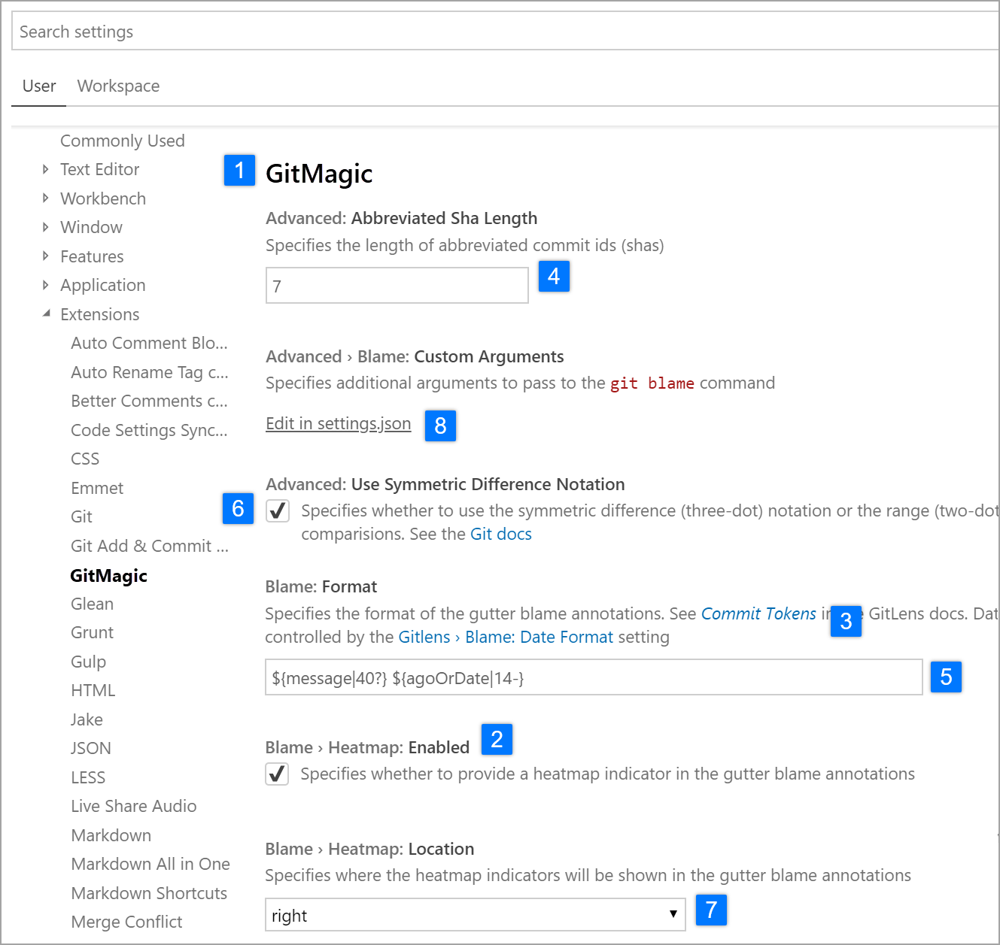
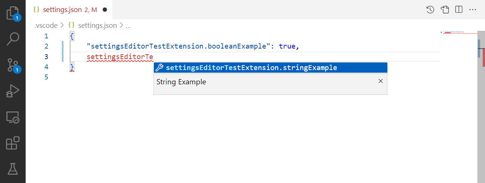

# 调研：自定义模块的 UI，以及它怎么和编辑器联动

> 用户 2026-11-07：
>
> > 你先搜索一下市面上的自定义模块的 UI 究竟是怎么做的吧……别乱动！最好有图就截图！
> > 然后，再搜索一下自定义模块如何与编辑器界面联动的……还是先搜索，别乱搞
>
> **本轮没有改任何产品代码。** 下面全是"别人怎么做" + "我们差在哪" + "建议怎么做"，
> 落地前先由你拍板。

---

## 0. 一句话结论

市面上的成熟工具**没有一个是"手写每个字段的界面"**的。它们都做同一件事：

> **让用户/程序员写一份「声明」（注解、属性、JSON Schema），
> 编辑器按「声明里的类型」机械地生成控件。**

联动也是同一份声明驱动的两个消费者：**一份给 UI 生成，一份给校验/补全/写回**。
我们项目已经有这份声明（`storygraph.rules.json` 的 `statements` / `calls`），
**缺的是"类型 → 控件"那张映射表**，以及声明里的分组信息没往 UI 上传。

---

## 1. 我查了什么（四类范式 + 两张实拍图）

| 来源 | 它是什么 | 关键机制 |
|---|---|---|
| **Godot 4** `@export` 注解族 | 游戏引擎的属性面板 | 注解的**后缀**决定控件（`_range` → 滑块、`_enum` → 下拉…） |
| **Unity** `PropertyDrawer` + `PropertyAttribute` | 引擎 Inspector | 特性类 → 绘制器类，`[Range]` 就是内置的一条 |
| **VS Code** `contributes.configuration` | 编辑器扩展 | **JSON Schema 超集** → 设置页 + JSON 补全（两个消费者） |
| **JSON Schema Form**（RJSF / JSON Forms） | Web 表单生成库 | `schema`（数据）+ `uiSchema`（表现）**两层分家** |

### 图 1：VS Code 的设置页 = 声明生成出来的



一眼能看到的四件事（图里 1–8 是官方标注）：

| 编号 | 是什么 | 来自哪条声明 |
|---|---|---|
| 4 | 数字输入框 | `"type": "number"` |
| 5 | 文本框 | `"type": "string"` |
| 6 | **复选框**（说明文字当它的 label） | `"type": "boolean"` + `description` |
| 7 | **下拉** | `"enum": ["left", "right"]` |
| 8 | **「Edit in settings.json」** | `"type": "object" / "array"` —— **表达不了就不硬塞** |
| 3 | 设置之间的交叉链接 | `markdownDescription` 里的引用 |

分组也是自动的：键名 `gitMagic.blame.heatMap.enabled` → 显示成
**「Blame › Heatmap: Enabled」**（`›` 就是层级）。

### 图 2：同一份声明的第二个消费者 —— JSON 补全



写 `settings.json` 时，键名、类型说明、默认值都是**同一份声明**给的。
这就是"联动"最省的形态：**没有第二套真源**。

> 两张图来自 VS Code 官方文档 <https://code.visualstudio.com/api/references/contribution-points>
> （截图仅作内部调研参考，不进发布包）。

---

## 2. 四类范式的机制细节

### 2.1 Godot：注解的**后缀**就是"选哪个控件"

```gdscript
@export var speed := 200.0                          # 数字框
@export_range(0, 100, 5) var volume := 80           # 滑块（步长 5）
@export_enum("Warrior", "Mage", "Rogue") var job    # 下拉
@export_multiline var description := ""             # 大文本框
@export_file("*.json") var level_file := ""         # 文件选择器
@export_dir var save_folder := ""                   # 目录选择器
@export_color_no_alpha var tint := Color.WHITE      # 取色器
@export_flags("Fire", "Ice") var resist := 0        # 多选勾选（位标记）
@export var spawn_points: Array[Vector2] = []       # 可增删/排序的列表
@export_category("Enemy")  @export_group("Movement") @export_subgroup("Name")
```

三条可以直接借的：

1. **`type` 不够就加 `hint`**：`int` 是数字框，`int + range` 是滑块 ——
   **同一个类型，多一条提示就换一种控件**；
2. **分组是声明的一部分**（`category/group/subgroup`），不是界面里写死的；
3. ⚠ **"Default Value Trap"**：一旦在 Inspector 改过值，场景就存住你的值；
   之后改脚本默认值**不影响**那个节点。这是"两处真源"的经典坑，
   它靠"值旁边显示一个 revert 箭头"来提示。

### 2.2 Unity：特性 → 绘制器，可以整类型接管

```csharp
[Range(0f, 10f)] float myFloat;                       // 滑块（内置特性）
[CustomPropertyDrawer(typeof(Ingredient))]            // 整个类型换一套布局
class IngredientDrawer : PropertyDrawer { ... }
```

`PropertyDrawer` 有两个用途：**给一个类型换布局**、**给一个特性换控件**。
关键是它有**兜底**：没有 drawder 就走默认绘制 —— 跟"没有声明就原样保留"同一思路。

### 2.3 VS Code：JSON Schema 超集，且**承认自己表达不了**

`contributes.configuration` 就是一份 JSON Schema，外加几个扩展字段：
`markdownDescription`（富文本说明）、`enumDescriptions`（下拉底部说明）、
`deprecationMessage`（弃用警告）。

最值得学的是它对 `object` / `array` 的处理：**不生成控件，给一个
「Edit in settings.json」链接**。理由写得很直白 —— 复杂结构用表单表达，
要么做不全、要么做出一堆没人用的输入框。

### 2.4 RJSF / JSON Forms：`schema` 与 `uiSchema` 分家

```js
schema   = { role: { type: "string", enum: ["admin","editor"] } }  // 数据契约
uiSchema = { role: { "ui:widget": "radio" } }                       // 只是表现
```

- `type: string` → 文本框；`format: email` → 邮箱框；`enum` → 下拉；
  `boolean` → 复选框；`array` → 可增删字段组；`object` → fieldset；
- `if/then/else` 让"条件字段"也是**声明里的事**，不是组件里写 show/hide；
- `ui:widget` 专门用来覆盖某一条的表现 —— **数据契约不动**。

---

## 3. 三条共同规律（这才是"联动"的本质）

1. **一份声明，多个消费者。**
   VS Code 同一份 schema → 设置页 UI + JSON 补全 + 运行时校验；
   Godot 同一份 `@export` → Inspector + 序列化 + 网络同步。
   **任何"界面里再写一遍字段清单"的做法，最后都会和声明对不上。**
2. **类型 → 控件是机械映射（表驱动），不是 if-else。**
   四家都有那张表；加一种类型 = 加一行表，不是加一个分支。
3. **表达不了的必须给逃生口，并且明说。**
   VS Code 的「Edit in settings.json」、Unity 的默认绘制器、
   Godot 的 `_get_property_list()` 动态属性。**不硬塞进表单**。

---

## 4. 我们现在的坐标（逐条对照）

### 4.1 已经有的（这部分不比别人差）

| 我们的东西 | 对应市面上的什么 |
|---|---|
| `storygraph.rules.json` 的 `statements`（`columns` / `pattern` / `clauses`） | Godot 的 `@export` / VS Code 的 `configuration` |
| `calls`（技术调用的参数列） | 同上（针对 `$ f(...)`） |
| `dynamic_spec_columns()` → **Excel 动态列 + 卡片 `_spec_host`** | "一份声明两个消费者" ✅ 已成立 |
| `choices` / `choices_from: transform` → 可编辑下拉 | VS Code 的 `enum` |
| `attr_groups`（候选分栏） | Godot 的 `@export_group` / VS Code 的层级键 |
| 高级区「代码」格（原样保真） | **就是逃生口**（但界面上没说清） |

### 4.2 缺口：**`kind` 根本没参与"选什么控件"**

这是用户说"UI 和自定义模块一定要对应"却对不上的**具体原因**。
我核对了实现（`card_editor._spec_cell_editor`，只有两个分支）：

```python
if opts:      w = QComboBox()   # 有候选 → 可编辑下拉
else:         w = QLineEdit()   # 其它一律普通输入框
```

**`kind` 一次都没被读。** 于是声明里已经写清楚的事实，到卡片上全变成了输入框：

| 声明里的事实 | 卡片上现在 | 应该 |
|---|---|---|
| `choices` 非空 | 可编辑下拉（**已对**） | 保持，并按 `group` 分栏 |
| `kind=variable` + `multi`（可多值） | 输入框 + 一个"可写多个"的提示 | **chip，一格一维**（立绘已经这么做了） |
| `kind=keyword`（剧本必须原样出现的固定字） | **可编辑的输入框**（改了会写坏脚本） | **只读 chip / 灰字** |
| `kind=transition` 且 `choices_from=transform` | 下拉（**碰巧对**） | 保持 |
| `kind=transition` 但没给 `choices_from` | 普通输入框 | 下拉（候选 = 项目 transform） |
| `kind=number` | 普通输入框 | 数字框（带上下限更好） |
| `kind=expr`（一段表达式） | 单行输入框 | **可拉伸的多行** |
| 声明表达不了的东西 | 高级区「代码」 | 保持，但要在界面上写明"这是逃生口" |

### 4.3 缺口：分组信息没往 UI 上传

`attr_groups`（声明里的"词组"）现在只用在**候选下拉的分栏**上，
没有变成卡片上的**分组标题**。

而且就算声明里带了 `group`（`FieldCard` 是有这一项的），
`_add_spec_cell` 也只读 `label` / `param` / `positional` / `multi` —— **`group` 被忽略**。

VS Code 的 `Blame › Heatmap: Enabled` 就是"层级 → 视觉分组"；
我们这边数据已经有了（而且是人写的中文，比键名更直接），只是没画出来。

### 4.4 缺口：Godot 那个"Default Value Trap"我们也有，但没说

在 Inspector 改过的值会盖住脚本默认值 —— 我们这边等价的是：
**表/卡片里已经写下的值，不会因为你在自定义模块里改了候选而变**（这是对的，
不该变），但人看到"这一格的值不在候选里"会以为是 bug。
现在靠 `W114` / 校验在报告里提，**卡片上没提**。

---

## 5. 建议（三步，先不动代码）

**第 1 步：加一张"类型 → 控件"表（唯一真源）**

```python
# 形态：kind → 构建函数的名字（不写 if-else）
SPEC_WIDGETS = {
    'choice':    'combo',      # 有候选 → 可编辑下拉
    'keyword':   'fixed',      # 固定字 → 只读 chip
    'variable':  'text',
    'multi':     'chips',      # 多值 → 一格一维
    'expr':      'multiline',
    'number':    'number',
    'transition':'combo',      # 候选来自项目 transform（已有 choices_from）
}
```

判据：**声明里的每一种 kind 都有对应控件**；表里没有的 kind → 落回 `text`
并在报告里点名（不静默）。

**第 2 步：把 `group` 变成分组标题**

`columns[].group` 有值 → 卡片上画一条分组标题（`服装 › 款式`），
没有 → 平铺（现状）。与 VS Code 的层级键一个效果，但我们的分组是人写的中文，
比键名更直接。

**第 3 步：把"逃生口"明说**

「代码」格标题改成「代码（工具不认识的写法原样保留）」，并在自定义模块里
声明不了的时候**给一个链接**跳过去 —— 就是 VS Code 那个 Edit in settings.json。

### 我**不建议**做的

| 不做 | 为什么 |
|---|---|
| 给每种语句写一个专属卡片 | Unity 那种 `[CustomPropertyDrawer]` 是"给一个类型换整套布局"，我们已经有 25 种语句，写 25 个布局维护不动；声明驱动的表能覆盖 90% |
| 让声明里能写"控件类型"（`widget: "slider"`） | 用户是编剧，不该学控件名。`kind` 已经够（choice/keyword/variable/multi/expr/number/transition） |
| 把 `pattern` 的全部复杂度搬到界面上 | VS Code 对 `object/array` 的做法就是"不在表单里做"。我们的 `pattern` 已经是"高级"了，别往主界面搬 |

---

## 6. 参考

| 内容 | 链接 |
|---|---|
| Godot `@export` 与 hint 全表 | <https://docs.godotengine.org/zh_CN/stable/tutorials/scripting/gdscript/gdscript_exports.html> |
| Godot Inspector 插件（`EditorInspectorPlugin` / `EditorProperty`） | <https://docs.godotengine.org/en/4.7/tutorials/plugins/editor/inspector_plugins.html> |
| Unity PropertyDrawer | <https://docs.unity3d.com/6000.3/Documentation/Manual/editor-PropertyDrawers.html> |
| VS Code `contributes.configuration` | <https://code.visualstudio.com/api/references/contribution-points> |
| react-jsonschema-form（schema/uiSchema 分家） | <https://rjsf-team.github.io/react-jsonschema-form/docs/> |

截图：`docs/refs/vscode_settings_ui.png`、`docs/refs/vscode_configuration.png`
（VS Code 官方文档配图，**仅内部调研参考，别打进发布包**）。
Godot / Unity 两个文档页的图是 JS 渲染的，抓不到原图，所以只引文字。
